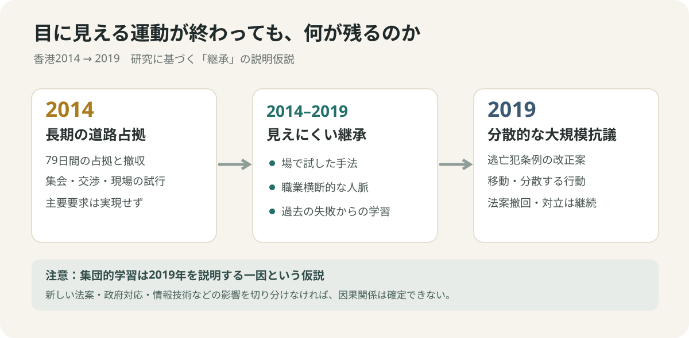

# 街を占拠した79日間は、どこに保存されたのか

*How movements remember: Hong Kong in 2014 and 2019*

**Where does a protest go after it ends?** デモが解散しても、参加者の経験まで消えるとは限らない。In December 2014, Hong Kong's Umbrella Movement ended after a 79-day occupation. Its central demand had not been achieved. Yet in 2019, another wave of protests emerged, using a noticeably different style of mobilization. 2014年を「2019年の予行演習だった」と決めつけるのは後知恵だ。それでも両者の間に、見えにくい継承（continuity）があったのかを調べる価値はある。

## 守｜2014年の争点は、投票する権利だけではなかった

Hong Kong returned from British to Chinese sovereignty in 1997 under the principle of 「一国二制度」(one country, two systems). 香港基本法45条は行政長官の普通選挙を最終目標とする一方、候補者の指名委員会を定めている。[香港基本法](https://www.basiclaw.gov.hk/en/basiclaw/chapter4.html/1000)。In August 2014, Beijing's decision allowed two or three candidates, each requiring majority support from the nominating committee. 中国側は普通選挙へ向かう制度と説明し、民主派は候補者の事前審査が実質的な選択を狭めると反発した。[2014年の制度説明](https://www.cmab.gov.hk/en/press/press_3481.htm)。

The protesters occupied major roads for 79 days, from September 28 to December 15. 警察の催涙ガスや唐辛子成分の噴霧剤に対して使われた傘が、運動の象徴になった。[Journal of Democracy](https://www.journalofdemocracy.org/articles/hong-kongs-umbrella-movement-the-protests-and-beyond/) 。A practical tool became a political symbol, but the larger question is what happened to the skills learned in the occupied streets.

*2014年11月14日、金鐘の占拠現場。撮影：あばさー。パブリックドメイン。[写真と利用条件](https://commons.wikimedia.org/wiki/File:Umbrella_Movement_at_Admiralty_on_14_November_2014_04.JPG)。*

Look closely: tents, notices, and a temporary way of living together. これは単なる「人が集まった写真」ではない。Occupying a road for weeks requires coordination. ただし、この写真だけで2019年への継承を証明することはできない。

## 守｜2019年には、別の法律から同じ社会の不信が噴き出した

The 2019 protests began with an extradition bill, not an election rule. 台湾の殺人事件を受け、香港政府は犯罪人引き渡し制度の抜け穴を解消しようとした。しかし、改正案により中国本土への引き渡しも可能になり得るため、反対派は司法の独立を危惧した。[香港保安局の当時の説明](https://www.sb.gov.hk/eng/articles/articles_2019_02_28.html)。

Mass rallies followed in June 2019, alongside confrontations and, in some incidents, destructive acts. 政府は6月15日に審議を停止し、9月4日に撤回を表明、10月23日に正式撤回した。[香港政府発表](https://www.info.gov.hk/gia/general/201909/04/P2019090400704.htm)／[10月の政府声明](https://www.info.gov.hk/gia/general/201910/31/P2019103100909.htm)。But the movement had already expanded beyond one bill, with demands concerning police accountability and political reform.

*2019年6月16日。撮影：ボイス・オブ・アメリカ（Voice of America）。米国でパブリックドメイン。[写真と利用条件](https://commons.wikimedia.org/wiki/File:Voa_hong_kong_protest_16june2019.jpg)。*

The contrast matters. In 2014, fixed sites and prolonged occupation were central. In 2019, mobile actions and decentralized decision-making became more visible. ただし、どちらの運動も多様な意見と戦術を含み、全員が一つの方針に従ったわけではない。[何明修の比較研究](https://www.harvard-yenching.org/research/how-protesters-evolve-hong-kongs-anti-extradition-movement-learned-the-lesson-of-the-umbrella-movement/)。

## 破｜本部が消えたあとも、運動の手順は残り得る

How can a movement survive without a visible headquarters? ここで社会学の概念である集団的学習（collective learning）が役立つ。Research by Ho Ming-sho identifies three channels: the 2014 occupation sites as spaces for experimentation, organizations and professional networks formed afterward, and lessons about decentralized decision-making. [ハーバード燕京研究所・研究紹介](https://www.harvard-yenching.org/research/how-protesters-evolve-hong-kongs-anti-extradition-movement-learned-the-lesson-of-the-umbrella-movement/)。

Another study, published in 2022, discusses latent civil-society networks that became active again in 2019. 「潜在するつながり」（latent networks）とは、表立った活動が少ない時期にも人々の関係が完全には消えていない状態を指す。[香港浸会大学・研究概要](https://scholars.hkbu.edu.hk/en/publications/total-mobilization-from-below-hong-kongs-freedom-summer/)。

*独自作図。This is an explanatory hypothesis, not proof of a single causal chain.*

Three possible forms of memory emerge: **place, relationships, and judgment**. 場で学んだ行動、人との信頼、何を避けるかという判断。An organizational chart can disappear while practical knowledge remains. ただし、それを2019年の唯一の原因とすることはできない。

## 破｜もっともらしい説明に、わざと別の説明をぶつける

**Collective learning is not the same as causal proof.** 2019年には新しい法案、衝突の拡大、技術環境の変化があった。An alternative explanation might emphasize the new political threat rather than experience gained in 2014. Another might focus on digital communication. 研究上も、2019年の戦術の進化とその限界が検討されている。[ケンブリッジ大学出版局・抗議戦術研究](https://www.cambridge.org/core/journals/china-quarterly/article/evolution-of-protest-repertoires-in-hong-kong-violent-tactics-in-the-antiextradition-bill-protests-in-2019/E59AC952FD5D818DB65F8043D4824A5F)。

空・雨・傘で点検しよう。**空（observation）**：2014年の長期占拠、2019年の異なる動員、二つの運動のつながりを示す研究がある。**雨（inference）**：2014年の経験が2019年の動員を支えた可能性がある。**傘（next test）**：活動の時系列、公開されている団体記録、匿名化された調査を突き合わせ、別の説明と比較する。We have not conducted interviews or tracked individual participants. 政治的リスクがある状況で、本人の安全に関わる個人追跡を軽々しく求めるべきではない。

The distinction is easy to miss: official records can identify when a bill was withdrawn, but they cannot, by themselves, measure how people learned. 制度の変化と経験の継承は、異なるデータで確かめる必要がある。

## 離｜会議が解散したあと、組織は何を覚えているか

Now shift to a completely different scene: a failed project meeting. 新規事業の提案が却下され、議事録には「見送り」と残る。But participants may leave knowing whom to ask, which assumption was weak, or which experiment could change the decision next time. これは香港の出来事から直接導かれる実証的結論ではなく、組織学習を考えるための思考実験だ。

A closed project is not always a project that taught nothing. ただし記憶には負の面もある。People may cling to the wrong lesson or avoid a viable option because of a previous conflict. 2019年の分散的な戦術にも、柔軟性だけでなく、意思決定や過激化を制御しにくい問題があった。[関連研究](https://www.cambridge.org/core/journals/china-quarterly/article/evolution-of-protest-repertoires-in-hong-kong-violent-tactics-in-the-antiextradition-bill-protests-in-2019/E59AC952FD5D818DB65F8043D4824A5F)。

The useful question is not merely, "Did the project survive?" It is, "What knowledge survived, and how did it affect the next choice?" 組織の存続と知識の存続は、別々に測るべきなのだ。

## 離｜その記憶を「勝利」と呼ばないために

We must not turn political loss into an uplifting success story. 2014年の主要要求は実現せず、2019年も法案撤回以外の多くの要求は満たされなかった。There were arrests, injuries, deep disagreements, and different experiences among Hong Kong residents. 誰かの経験を一つの「香港人の気持ち」にまとめることもできない。

The political environment also changed afterward. 2020年に香港国家安全維持法、2024年3月に香港国家安全条例が施行された。香港政府は国家安全と社会の安定のために必要と説明している。[香港保安局の説明](https://www.sb.gov.hk/eng/bl23/faq.html)。To acknowledge organizational learning is not to declare either movement a victory.

## 解散した街を、もう一度見る

So where does a protest go after it ends? 道路は元の用途に戻る。But experience may remain in people's habits, relationships, and judgments, even when no banner is visible. その経験が次に何を変えたかは、調査なしに決められない。それでも、何も起きていない交差点を見て「何も残っていない」と断定することは、以前より難しくなる。

**A city may remember through the choices its people can make next.** 記念碑や記録館だけでなく、次の行動の選択肢にも記憶は宿り得る。これが2014年と2019年を続けて調べたあとに残った、控えめで、しかし少ししつこい疑問である。

## 調査と出典｜確認できたこと、まだ言えないこと

**Facts**：基本法45条、2014年の指名制度、79日間の運動、2019年の法案撤回日、2024年の法施行。**Research-based interpretation**：2014年の場・人脈・経験が2019年の動員の一部を支えた可能性。**Our extension**：「場・関係・判断」の整理と会議への類推。**Not tested**：個人追跡、当事者への独自取材、因果効果の数量的推定。This essay separates evidence from explanation and does not assume one uniform political view among Hong Kong residents.

Sources: [香港基本法](https://www.basiclaw.gov.hk/en/basiclaw/chapter4.html/1000)／[2014年制度決定](https://www.cmab.gov.hk/en/press/press_3481.htm)／[2019年法案の提案理由](https://www.sb.gov.hk/eng/articles/articles_2019_02_28.html)／[2019年撤回](https://www.info.gov.hk/gia/general/201910/31/P2019103100909.htm)／[Ho Ming-sho, 2020](https://www.harvard-yenching.org/research/how-protesters-evolve-hong-kongs-anti-extradition-movement-learned-the-lesson-of-the-umbrella-movement/)／[Cheng and colleagues, 2022](https://scholars.hkbu.edu.hk/en/publications/total-mobilization-from-below-hong-kongs-freedom-summer/)。
