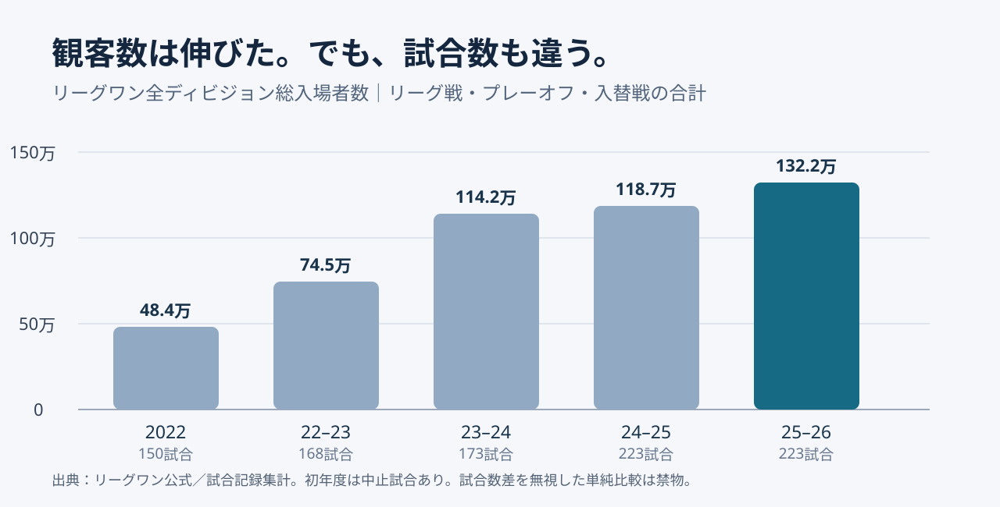
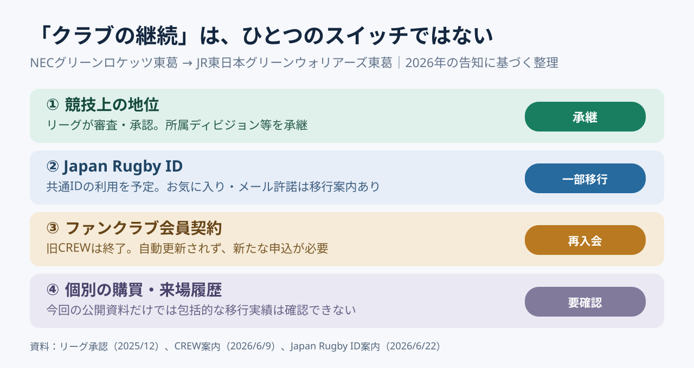

# When a league leader changes, what happens to a fan's login?｜リーグワンの経営構造

*As of November 3, 2026｜守破離 research. Reported news, formal decisions, interpretation, forecasts, and proposals are kept distinct.*

## Why a chairman story leads to fan memberships｜理事長人事とファンクラブ

A leadership story usually starts with people: 東海林一氏、玉塚元一氏、清宮克幸氏。Who wants reform, and who favors continuity? しかし調査を進めると、別の問いに行き着いた。**When the owner of a club changes, what happens to a fan's account?** 経営の問題が、ログイン画面という極めて日常的な場所に現れる。

On October 30, 2026, 共同通信 reported that 専務理事の東海林氏 was likely to become chairman. The league immediately clarified: **no formal decision has been made**. 12月の社員総会と理事会が必要になる。We should not turn a reported likelihood into a confirmed appointment, nor invent the committee's reasoning. 人事予想よりも、**the structural problems that survive a change of leadership**を探したい。[共同通信を掲載した神戸新聞](https://www.kobe-np.co.jp/news/zenkoku/compact/202610/0020984529.shtml)／[リーグ公式発表](https://league-one.jp/news/6233)

This photograph shows the March 22, 2025 match between 東芝ブレイブルーパス東京 and 埼玉パナソニックワイルドナイツ, not the personnel announcement. Photo: Bowwow, [Wikimedia Commons](https://commons.wikimedia.org/wiki/File:%E7%A7%A9%E7%88%B6%E5%AE%AE%E3%83%A9%E3%82%B0%E3%83%93%E3%83%BC%E5%A0%B420250322.jpg), [CC0 1.0](https://creativecommons.org/publicdomain/zero/1.0/).

## 守①｜League One is not simply a fully professional league

League One began play in 2022 as Japan's leading men's **rugby union（15人制）** competition, replacing the Top League launched in 2003. In 2026-27, 27 clubs are divided into D1: 12、D2: 8、D3: 7。開幕予定は12月12日。名前はLeague Oneだが、13人制のrugby leagueとは別競技。Yes, the naming itself needs a small glossary.[公式大会編成](https://league-one.jp/news/6041)

The old system was built on corporate sports. 母体企業は雇用・施設・運営資金を提供できるが、会社の事業方針とチームの成長は常に一致しない。League One shifted more responsibility for **home-match operations and commercial income** to clubs. 重要なのはpro vs. amateurという二択より、**who invests, who sells, and who carries the risk**である。

Reducing corporate support is not automatically progress. 日本ラグビーは会社の雇用、施設、育成投資に支えられてきた。The challenge is to preserve these assets while building **independent revenue and local relationships**.

## 守②｜1.32 million fans do not prove every club is viable

The 2025-26 season attracted **1,322,343 spectators across 223 matches**, a league record. 2022年の484,047人から大きく伸びたが、試合数も異なり初年度にはコロナ禍による中止試合があった。A growth multiple without its denominator is not a complete analysis. 「約2.7倍！」という数字だけでは、比較条件が置き去りになる。[リーグ公式](https://league-one.jp/news/6008)／[試合記録集計](https://rugby-zukan.com/leagueone/)

The chart compares total attendance by season. 2025-26のD1レギュラーシーズン平均は8,900人。ただし2023-24は8,929人だった。D2は約2,992人、D3は約1,103人。So a record league-wide total is not the same as steadily rising attendance for every division. **League growth and club-level viability require different indicators.** [試合記録集計](https://rugby-zukan.com/articles/leagueone-attendance/)

## 守③｜A chairman operates within collective governance

League One is run by a **general incorporated association（一般社団法人）**. ここでいう「社員」は従業員ではなく法人の構成員。The members' assembly selects directors; the board selects the chairman, according to the published rules. **Changing the person at the top does not automatically change decision rights.** [組織概要](https://league-one.jp/content/organization/)／[公開規程](https://league-one.jp/content/regulation/)

Suppose the chairman demands the same stadium standards from every club immediately. 各クラブには資金、会場の所有関係、地域事情の違いがある。Even a very determined leader cannot create an empty stadium booking slot by sheer enthusiasm. What matters is a practical mix of **consensus, decision rights, execution responsibility, and exception handling**.

## 守④｜The ¥55 billion ambition is also a dependency test

In 2024, the league announced a target of **¥55 billion in combined league-and-club business scale by 2027-28**. It also aims to bring the average parent-company sponsorship share in D1 to **60% or less**. 前者は事業の大きさ、後者は依存度の指標。¥55 billion is a target, not an achieved figure or revenue of the central league office alone.[リーグ公式](https://league-one.jp/news/3590)

Together, the two targets mean more than “earn more money.” 企業協賛への依存を下げつつ、チケット、外部スポンサー、その他の事業を育てる意図が見える。ただしa lower ratio can result from a larger denominator. 本当に確認したいのは**absolute independent revenue, operating results, and recurring cash flows**である。

## Cross-check ①｜A club's sporting status can survive an ownership transfer

To bring the argument down to earth, consider NEC Green Rockets Tokatsu. NEC said in August 2025 that continuing to develop the team sustainably would be difficult. The league approved transferring membership status to JR East in December 2025. From July 2026, the club moved to its new owner and became **JR EAST GREEN WARRIORS TOKATSU** for 2026-27.[NEC](https://jpn.nec.com/press/202508/20250820_02.html)／[リーグ承認](https://league-one.jp/news/4970)／[新名称](https://league-one.jp/news/6012)

The league reviewed the new owner's suitability, business continuity and financial condition. It allowed the team's **division status** to continue. チームの歴史を制度として引き継ぐルートはあった。ただしsporting continuity is not identical to the automatic transfer of every customer contract or database.[公式発表](https://league-one.jp/news/4970)

## Cross-check ②｜Membership ended, but favorite-team data moved

What happened to fans? The club announced that the old **CREW membership portal would close on June 30, 2026**, and membership would not renew automatically under JR East. ファンは新クラブの会員制度へ改めて申し込む必要があった。This does not mean supporters were expelled: **the old contract ended and a new one was required**.[旧クラブ案内](https://green.necrockets.net/news/20260610/)

But a second notice changes the picture. **Favorite-team settings and email permissions in Japan Rugby ID were scheduled to transfer** based on the July 1 status. 有料会員契約は自動で移らないのに、共通ID上の一部設定は移る。So we must separate **login identity, fan interest, consent, and paid membership contracts**. That distinction is the real finding, not a story about every fan connection being lost.[公式移行案内](https://green.necrockets.net/news/20260623/)

This is an explanatory diagram based on public notices, not an audit of individual customer records. **The continuity of a club and continuity of the fan's service are separate questions.**

## Cross-check ③｜Sporting policy can conflict with player rights

Another governance test involved player categories A-1 and A-2 for 2026-27. 一部の選手が制度の差し止めを東京地裁に求めた。The league later modified part of the requirements and announced a settlement on August 27, 2026. 国内育成機会、国際的な競争力、既存選手の扱いが交差した制度だった。[経緯](https://league-one.jp/news/6084)／[和解と変更](https://league-one.jp/news/6124)

This does not prove that the policy's aim was wrong. 逆にgood intentions do not cancel the need for due process. **A sound objective and a fair transition process must be evaluated separately.** 改革を発表する能力だけでなく、異議を受けて制度を修正する能力も経営の一部である。

## 破①｜The selection may have prioritized execution over slogans

**Interpretation, not a confirmed selection reason:** We cannot say that the choice of 東海林氏 proves that 清宮氏's reform agenda was rejected. 候補者の公約や評価基準は未確認。東海林氏はリーグ創設期から実務に携わった。A plausible hypothesis is that the league now needs **implementation across many member clubs**, not just ambitious proposals. 選考の争点は人柄でなく、経営ステージにあった可能性がある。

But continuity has a downside: **path dependence（経路依存性）**. 人は自ら関与した制度を見直しにくいことがある。So continuity is only an asset when governance can distinguish **what to preserve from what to revise**.

## 破②｜The difficult choice is what to build together

**A future policy question:** How should broadcasting, league sponsorship, and digital businesses create value? More performance-based distribution can reward success but widen gaps; equal distribution can protect the floor but reduce incentives. それだけでなく、clubs could jointly invest in CRM, sales tools, video production and staff training. Whether those services pay off requires evidence, not enthusiasm.

There is also **Japan Rugby Marketing (JRM)**, founded by JRFU, League One and Sony in 2022, with NTT DOCOMO joining as an investor in 2023. 代表戦、リーグ、クラブの顧客接点と事業権利をどう分けるか。The market is not run by one actor; **coordination across organizations** matters.[JRM会社概要](https://japan-rugby-mktg.com/company.html)

## 離①｜Ownership can move faster than a fan's memory

Consider **mobile number portability**: customers can change carriers while keeping a number. Could club transitions aim for similar continuity? ただし、これは同意なしに顧客情報や契約を移してよいという意味ではない。Club name, division status, login ID, email consent, paid membership, and attendance history are separate objects. **Each needs its own transfer rule, explanation, and consent process.**

It is tempting to ask, “Who owns the fans?” But fans are not property. 企業が管理するのは契約、データ、権利、サービスであって、愛着そのものではない。A person's long-term affection for a club is not an asset that can simply be transferred between balance sheets. **Separate what can be administered from what must be earned.**

## 離②｜A practical transfer checklist has four distinct workstreams

**Proposal, not a claim about the clubs' internal operations:** Split any transfer into four workstreams. ①Sporting status and player contracts. ②Commercial rights, sponsors and venues. ③Fan services, benefits and membership renewal. ④IDs, permissions and customer records. 一つの「引継ぎ」にまとめると、誰が何を承認したか分からなくなる。

**Suggested KPIs:** completed status transfers, sponsor renewal rate, communication reach and new membership conversion, valid consent coverage, and data-related complaints. 会場・日程の確定時期も別に追う。These measures avoid two simplistic stories: “the team survived, so everything worked” and “re-registration was required, so the whole transition failed.”

## Prompt｜Turn leadership news into a test of business structure

**Reusable prompt:** “Analyze a leadership change as organizational design, not personality. Check ①decision rights and governing bodies, ②revenue and dependency, ③contract changes for fans, staff and partners, ④recent performance metrics, ⑤conflicts and policy revisions through primary sources. Separate reported news, formal decisions, interpretation and scenarios. Test each scenario with falsifying indicators. Zoom into one ordinary customer experience, then explain the rights, data and operations behind it. Disclose sources, uncertainties and practical proposals.”

## Back to the news｜Judge leadership by what survives the handover

We still have to wait for the December formal process before calling any chairman appointment final. しかし、この調査で分かったことはある。A club can keep its division status while fans must renew their memberships, even as some common-ID settings move. **Continuity is not one switch; it consists of several separate systems.**

A better test of leadership may be an unremarkable moment: the fan logs in, recognizes the club, and understands the next step. 単なるUXの話に見えて、背後には規約、契約、データ管理、事業収益の配分がある。**A mature sports league is visible not only in its grand vision, but in how carefully it manages the seams.**

## Sources and research note｜Evidence and open questions

**Primary-source checks:** [league statement](https://league-one.jp/news/6233), [2026-27 structure](https://league-one.jp/news/6041), [attendance](https://league-one.jp/news/6008), [strategy](https://league-one.jp/news/3590), [NEC statement](https://jpn.nec.com/press/202508/20250820_02.html), [transfer approval](https://league-one.jp/news/4970), [membership notice](https://green.necrockets.net/news/20260610/), [Japan Rugby ID notice](https://green.necrockets.net/news/20260623/), [player-rule revision](https://league-one.jp/news/6124), [JRM](https://japan-rugby-mktg.com/company.html).

**Next research:** Compare candidates' published proposals and selection criteria; obtain club-level independent revenue and operating results; inspect revenue-sharing contracts; and measure actual fan re-enrollment after the transfer. 再調査で“all connections were broken”という初期仮説を訂正した。Official notices describe rules and intended transitions, **not evidence that every user's migration succeeded**. Our diagrams and forecasts are interpretations, not primary facts.
