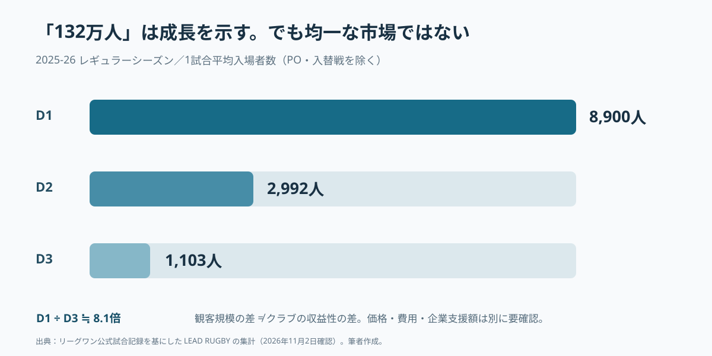
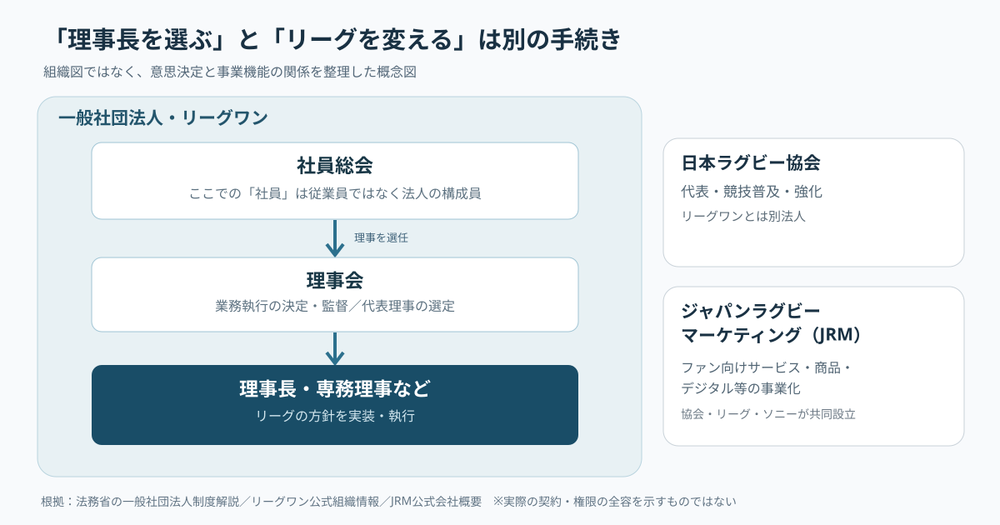
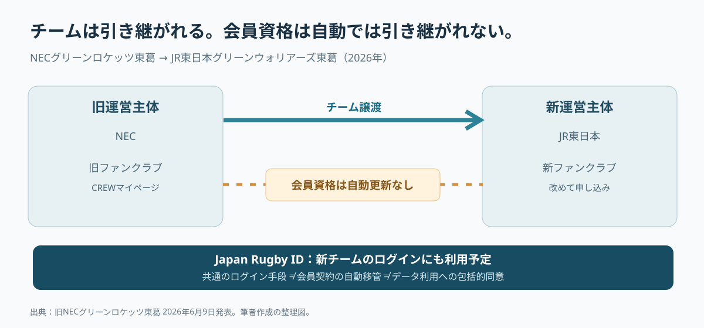

# 理事長を決める「社員」は、会社員ではない――リーグワンの改革を誰が動かすのか

*English Mix｜2026年11月3日時点。日本語を理解の軸に、英語を考える道具として混ぜる。Figures are facts; scenarios are not.*

## 「社員総会」で理事長が決まる。その「社員」は誰なのか

A new chairman will be chosen through a *shain-sokai* and a board meeting. 「社員総会」と聞いた瞬間、従業員が大勢集まって役員を選ぶ風景を想像してしまう。Sounds like a very serious staff meeting. しかし法制度上の「社員」は employee ではなく、一般社団法人を構成する **member** を意味する。全然違う会議だった。

This tiny word changes the whole story. 一般社団法人では社員総会が理事を選任し、理事会が業務執行を決め、代表理事を選定・監督する。リーグワンも一般社団法人である。The real question is not simply *Who will lead?* It is **who gives a leader authority, and who can hold that leader accountable?** [法務省](https://www.moj.go.jp/MINJI/minji153.html)／[リーグワン組織概要](https://league-one.jp/content/organization/)


*2026年6月7日の決勝写真。Photo: Bowwow／[Wikimedia Commons](https://commons.wikimedia.org/wiki/File:20260607jrlo.png)／[CC0 1.0](https://creativecommons.org/publicdomain/zero/1.0/)。This image shows the event, not proof of management success.*

## 報道で有力とされた東海林氏は、まだ正式に選ばれていない

The timeline matters. 2026年10月30日、共同通信は、2021年から専務理事を務めてきた東海林一氏が次期理事長に就く方向で調整されていると報じた。現理事長の玉塚元一氏と、日本ラグビー協会副会長の清宮克幸氏も候補者として挙げられた。However, on the same day, League One stated that the appointment had **not yet been formally decided**. 所定の手続きは12月予定とされる。[共同通信配信・神戸新聞](https://www.kobe-np.co.jp/news/zenkoku/compact/202610/0020984529.shtml)／[リーグ公式](https://league-one.jp/news/6233)

つまり、the reported front-runner is not yet the appointed chairman. ここで就任を既成事実として書くと、読者はその後の制度変更まで本人の方針だと思い込むおそれがある。原文には候補者4人が演説したとの記述もあるが、今回照合した記事と公式説明では、4人全員の氏名・演説全文・選考基準までは確認できなかった。**Selection process is not the same as formal appointment.** 報道の推測と法人の議決は区別したい。

## 守｜リーグワンは「会社のチームが試合をする大会」から変わろうとしている

Japan's top-level men's 15-a-side rugby competition changed in 2022. 2003年に始まったトップリーグを引き継ぐ形で、2022年1月にリーグワンが開幕した。2019年の日本開催ワールドカップで集まった関心を国内の定期的な観戦へどうつなげるか。それも背景にあった。しかし、the new league was not an overnight switch to fully professional, independent clubs. 企業がチームを保有・支援する形は残った。[J SPORTS・リーグワンの説明](https://www.jsports.co.jp/rugby/league-one/about/)

What changed was the incentive structure. 東海林氏は2023年のインタビューで、ホストゲームの主管権や収入の仕組みが変わり、チームがより主体的に興行を担うようになったと説明している。Ticket revenue, local sponsorship and merchandise revenue from normal home games go to the host team; league-wide broadcasting revenue is managed centrally and partly redistributed. つまり「一枚売れば、チームに経済的な意味がある」という結びつきが強くなった。[東海林氏インタビュー](https://net.keizaikai.co.jp/archives/2444)

Economists call this **incentive design**. 行動した主体が成果を受け取りやすい仕組みを作ることだ。ただし designing incentives is not the same as guaranteeing equal success. 都市の人口、会場、経営人材、企業支援など、チームごとのスタート地点は違う。制度を変えた結果は、一つの平均値では捉えられない。

## 守｜27チームが参加する一方、観客市場は一つではない

The 2026-27 season is scheduled to open on 12 December 2026. 参加は27チームで、D1が12、D2が8、D3が7。前シーズンの総入場者数は223試合、1,322,343人と過去最多だった。That's a meaningful achievement. しかし、total attendance includes regular-season games, playoffs and promotion/relegation matches. 比較するときには必ず分母を確認しなければならない。[公式・2026-27編成](https://league-one.jp/news/6041)／[公式・2025-26総入場者](https://league-one.jp/news/6008)



*Regular-season attendance per game: D1 8,900; D2 2,992; D3 1,103. プレーオフ・入替戦は除く。Source: [LEAD RUGBY](https://leadrugby.com/leagueone/attendance), based on official match records.*

D1 attracts about 8.1 times as many spectators per game as D3. しかし attendance is not profit. チケット単価、招待客、運営費、企業からの支援を確認しない限り、収益性の差は分からない。The league can grow while individual clubs face different financial realities. **Growth of the total is not proof of sustainability for every member.**

In November 2024, League One announced a target: a combined business scale of 55 billion yen for the league and its teams by 2027-28, with parent-company sponsorship accounting for no more than 60% on average in D1. さらにサラリーキャップやスタジアム固定化も目標に掲げた。ただし550億円は target, not current revenue or profit. 何を測る数字かを間違えると、成功の判定そのものを間違える。[中期方針](https://league-one.jp/news/3590)

## 守｜「社員総会」がある以上、改革は個人の決意だけでは進まない

League One is not a standard company with a single owner. 一般社団法人の社員総会、理事会、執行部にはそれぞれ役割がある。Board oversight matters because the people who make decisions also need to be monitored. チームを保有する組織の経営目的も一致しない。Some focus on corporate value and employee development; others want stronger local commercial operations. 共通制度は、利害が交差する場所に置かれる。[法務省](https://www.moj.go.jp/MINJI/minji153.html)



*Conceptual diagram created for this article. 正式な法的権限や契約の全容を表す図ではない。*

And there is more than one rugby organization. 日本ラグビー協会は代表と競技の普及・強化、リーグワンは大会運営、ジャパンラグビーマーケティング（JRM）はファン向けサービスやコンテンツの事業化などを担う。JRM was established in 2022 by the association, League One and Sony; NTT Docomo joined as an investor in 2023. JRMの会社概要には東海林氏が代表取締役の一人として載っている。[JRM会社概要](https://japan-rugby-mktg.com/company.html)

This structure can support coordination. 一方で、権利・収入・顧客情報の扱いについて、役割を明確にする必要がある。That does not prove any conflict of interest has occurred. 重要なのは、役職の数ではなく、decision rights and accountability が追跡できるかだ。専任理事長なら何でも早く決まる、という話ではない。

## リサーチ｜成長の裏で生まれた、三つの実務上の摩擦

**First, ownership is not the same as club continuity.** NECグリーンロケッツ東葛は2025年12月にJR東日本への正会員地位譲渡が承認され、2026-27から新しいチーム名で参加する。League One examined eligibility, business continuity and financial soundness before approval. チームの競技上の地位は引き継がれた。Yet a club's future can still depend on a parent company's strategy.[リーグ公式・譲渡決定](https://league-one.jp/news/4970)

**Second, the stadium calendar shapes the business calendar.** 2026-27の日程は9月以降も追加決定・変更が続き、11月2日にも更新された。If the venue or kickoff time is uncertain, ticket campaigns, sponsor activations and travel plans may become harder to arrange. これは合理的な経営仮説だが、失われた売上額を検証したものではない。9月時点の未定数をそのまま11月現在の未定数として扱わない。[9月の日程発表](https://league-one.jp/news/6140)／[11月2日更新](https://league-one.jp/news/6226)

**Third, player development rules affect real people's careers.** 2026-27からの選手登録区分A-1／A-2をめぐり、一部選手は施行差し止めを求めた。The league revised part of the eligibility rules and announced a settlement in August 2026. また事前の説明やコミュニケーションが十分でなかったことも認めた。Supporting homegrown talent and treating current players fairly are both valid concerns. 目的の正しさだけで、移行手続きの正しさは保証されない。[リーグ公式・8月28日](https://league-one.jp/news/6124)

Different cases, same underlying pattern: **the rule-maker and the person who must live with the rule are not always the same**. ルールの実施は、契約、売上、選手のキャリア、ファンの日常のなかで初めて試される。

## 次の調査計画｜ニュースの裏側を、誰の負担かで分解する

The next research questions are concrete. ①候補者の公約と選考基準、②クラブ別の自主財源と母体企業支援、③会場・開始時刻の公表日と変更履歴、④選手とファンが制度変更に意見を出せる経路。These questions help identify **who decides, who pays, who benefits, and who bears the risk**. 人物の印象を議論するより、改革案の負担の行き先を追うほうが精度は高い。

そのために official rules, match records, club announcements and fan notices を照合した。重要なのは implementation speed だけではない。制度変更を受け取る人が、事前に知り、準備し、異議を伝える時間も必要になる。

## 再リサーチ｜リーグは拡大を急ぐだけではない

An unexpected official announcement appeared one day before the chairman report. 2026年10月29日、リーグワンは2027-28シーズンの新規参入受け入れ・申請受付を実施しないと発表した。新規参入する2026-27のチームの競技・事業・運営面を見て、その先を検討するという。This is a pause, not a declared end to expansion. 拡大を一時止めた理由まで、勝手に「失敗」と名付けることはできない。[公式発表](https://league-one.jp/news/6227)

Another detail is more surprising because it affects a very ordinary fan action. 2026年のNECからJR東日本への移管にあたり、旧ファンクラブのマイページは6月末に終了し、会員資格も翌シーズンへ自動更新されないと案内された。しかし新チームでもJapan Rugby IDを使ったログインが予定されていた。The team continued; the membership contract did not automatically continue. ログインできることと、契約が引き継がれることは別だ。[旧クラブの案内](https://green.necrockets.net/news/20260610/)



*Officially announced transition, visualized as a concept. 共通IDはデータ移管への包括同意を意味しない。*

This shifts the question from ownership to continuity. 誰が法人を保有するか、どのカテゴリーで試合をするか、ファンがどんな体験を引き継げるか。この三つは独立した論点だ。A successful transfer of a club does not automatically mean a frictionless transfer of fan relationships.

## 破｜次の理事長に必要なのは、改革案より実装能力かもしれない

Here comes the hypothesis—not a reported selection criterion. 東海林氏が有力とされる背景には、新しい構想の提示より、リーグがすでに掲げた改革の実装力を重視する考えがあるのかもしれない。But continuity also has a cost: people may be less willing to question systems they helped create. どちらも人物評として断定する材料はなく、制度の評価に使う視点である。

Take revenue sharing. 均等配分なら小規模チームの経営安定に寄与しうる。Performance-based distribution may reward growth but also widen gaps. 共通のCRMや営業、映像基盤への共同投資なら、各チームの将来の稼ぐ力を補える可能性もある。These are options for analysis, not claims that the current formula is unfair. 大事なのは配り方そのものではなく、what behavior the rules encourage over time だ。

The first months of a new chairman's term are a poor test of personal impact. 2026-27の開幕予定日は2026年12月12日で、役員改選と近接しているからだ。観客数は何カ月も前からの営業や競技運営の成果も含む。A better scorecard looks at implementation over time.

| Question | Possible KPI（提案） | What it cannot tell alone |
| --- | --- | --- |
| Are clubs becoming self-sustaining? | 自主財源比率・母体企業依存度 | 収益の継続性 |
| Does governance work? | 決定から施行までの期間・事前説明率 | 誰が負担したか |
| Can clubs plan their events? | 会場確定時期・変更件数 | 会場固有の制約 |
| Do fan relationships continue? | 継続・再登録・再来場率 | 同意とデータ利用権限 |
| Does growth reach all levels? | 部門別事業収益・運営継続状況 | 市場条件の差 |

*These are proposed measures, not the league's official assessment criteria.*

## 離｜携帯電話の番号は持ち運べるのに、応援の履歴はどうなるのか

Number portability in mobile phones offers a useful comparison. 通信会社を変えても、電話番号を保持できる制度がある。もちろん fan memberships and phone numbers are legally different. それでも「サービスの運営主体が変わっても、利用者の日常をどう連続させるか」という問いは共通する。

Imagine a parent and child who watched their first rugby game together. チームの名前や所有者が変わったとき、その来場体験、会員継続年数、購入記録をどう扱うのか。Keeping data is not automatically permitted. 個人情報の利用目的、同意、アクセス権限、安全管理の確認が必要になる。**Data portability and permission to transfer data are not the same thing.**

A shared login may become valuable infrastructure for continuity, but we have not verified the precise data-sharing rights or migration capabilities of Japan Rugby ID. ここから考えられるビジネスの仮説は、移管時の会員再登録支援、クラブをまたぐ同意管理、小規模クラブ向けCRM支援などだ。Not proven market demand, not confirmed legal compliance—ideas to investigate.

Return to the strange word *shain*. 社員総会における「社員」と、毎週試合へ通うファンは違う。Members hold formal voting rights. Fans carry the lived consequences of many decisions. **The people with the right to decide are not always the people who live with the outcome.** そのずれをどう扱うかが、スポーツリーグのガバナンスの難しさなのである。

## 実務への落とし込み｜理事長人事を組織診断へ変える

A practical interview should start with five questions. ① Who approves a reform? ② Who pays for it? ③ Who receives the benefit? ④ When do players and fans hear about it? ⑤ What evidence would lead to an adjustment or reversal? 調査目的はリーダーの性格を評価することではなく、decision rights, costs and results を一つの構造で把握することだ。

提案として、各施策を **Input / Process / Outcome** で整理する。Inputは資金・権利、Processは決定・合意・説明、Outcomeはファン行動・クラブ収益・制度の実施結果。This makes a leadership story testable. よいスピーチと実装力を同一視せず、何がいつ変わったかを検証できるようにする。

## 本稿の限界｜まだ分かっていないこと

The selection committee's scoring, all four candidates' names and speeches, voting details, club-level financial breakdowns, fan-data transfer agreements and the effect of the appointment on JRM are not verified here. それらを既知の事実として補完しない。Total attendance and regular-season divisional averages have different scopes. Likewise, the 55-billion-yen ambition is a future target, not a reported result. 予測と事実を混ぜないことも、この調査の一部である。

## 再利用できる調査プロンプト｜別のスポーツリーグでも使う

```text
スポーツリーグのトップ人事報道を起点に、経営・統治の構造を検証する。
First verify: 公表日、報道内容、公式見解、正式決定の有無。
Map the system: 運営法人、社員総会・理事会、権利、収益、関係会社。
Check the business: 観客数の分母、財務の単位、会場条件、親会社支援。
Find the friction: 選手・スポンサー・ファンが制度変更で何を失い何を得るか。
Research again: 新資料で初期仮説を修正。未確認の論点は留保。
Use Shuhari: 守は背景、破は条件付きシナリオ、離は異分野の新しい問い。
Write with Uneven U: concrete evidence → analysis → a better question.
Deliver: 日本語正本、自然なEnglish Mix、図表、写真の利用条件、一次資料リンク。
```

## 主な資料と確認日

- [共同通信配信・神戸新聞（2026年10月30日）](https://www.kobe-np.co.jp/news/zenkoku/compact/202610/0020984529.shtml)／[リーグワン公式コメント](https://league-one.jp/news/6233)
- [法務省・一般社団法人制度](https://www.moj.go.jp/MINJI/minji153.html)／[リーグワン組織概要](https://league-one.jp/content/organization/)
- [リーグワン・中期方針](https://league-one.jp/news/3590)／[東海林氏インタビュー](https://net.keizaikai.co.jp/archives/2444)
- [2026-27編成](https://league-one.jp/news/6041)／[2025-26入場者](https://league-one.jp/news/6008)／[LEAD RUGBY](https://leadrugby.com/leagueone/attendance)
- [新規参入方針](https://league-one.jp/news/6227)／[選手登録の見直し](https://league-one.jp/news/6124)
- [クラブ譲渡](https://league-one.jp/news/4970)／[会員移行案内](https://green.necrockets.net/news/20260610/)／[JRM会社概要](https://japan-rugby-mktg.com/company.html)

*Research date: 3 November 2026. The English Mix preserves the Japanese article's claims and section flow. 段落は具体と抽象の間を動くUneven Uの考え方を参考に構成した。*
