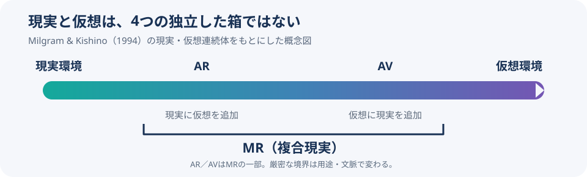
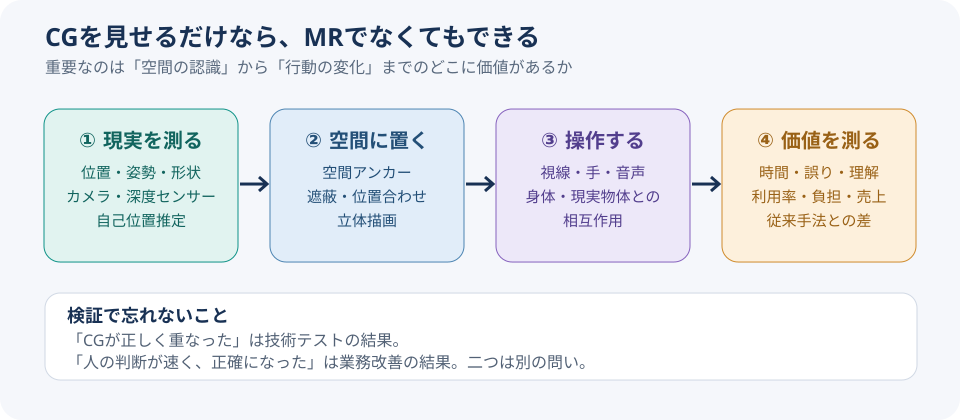

# CGの犬がソファの後ろに隠れた――Mixed Realityは何を「知っている」のか

*English Mix / 2026-11-06。日本語版と同じ根拠・事実を使用。A mixed reading mode, not a full English translation.*

A virtual dog appears in your living room. それ自体は驚かない。ゲーム画面には昔からCGの動物がいる。But then it walks behind your real sofa and disappears. 犬が家具の位置を守った。なぜ？

That small moment is the strange heart of **mixed reality（MR／複合現実）**. It is not only about placing graphics on a picture. The system uses the physical environment to decide where digital objects belong and how they should behave. ただし、すべてのMR機器が必ず家具を正確に認識できるわけではない。Capabilities vary by device and implementation.

## 要旨｜MR is not simply “AR, but better”

混同しやすい言葉をまずほどく。In the original academic framework, augmented reality (AR) belongs within a broader mixed-reality spectrum. 現在の製品説明では、空間理解や相互作用をMRの特徴として強調する場合もある。この二つの用法を混ぜると、MRをARの「上位版」と誤解しやすい。[Milgram & Kishino, 1994](https://globals.ieice.org/en_transactions/information/10.1587/e77-d_12_1321/_p) / [Microsoft's definition](https://learn.microsoft.com/en-us/windows/mixed-reality/discover/mixed-reality)

Our working hypothesis is this: **MR creates value when information needs a place in the real world.** とはいえ、場所が必要でない情報まで立体化する理由にはならない。That distinction becomes crucial when we evaluate a business, not just a demo.

## 守①｜The 1994 paper placed AR inside mixed reality

VR（Virtual Reality／仮想現実）は、主として作られた環境への没入。AR（Augmented Reality／拡張現実）は現実へデジタル情報を足す。MR（Mixed Reality／複合現実）は現実と仮想が混ざる広い領域を表す。

In December 1994, Paul Milgram and Fumio Kishino described a **Reality–Virtuality Continuum（現実・仮想連続体）**. It extends from a real environment to a virtual one. AR adds virtual elements to reality, while augmented virtuality (AV) brings real-world content into a virtual environment. Both fall within MR. 研究者たちは世界の認識、表示の再現性、現実感なども分類軸として検討した。[Original paper](https://globals.ieice.org/en_transactions/information/10.1587/e77-d_12_1321/_p)

*Figure 1. 筆者作成。A simplified reading of the 1994 framework, not a ranking of device quality.*

Marketing language has shifted since then. Microsoft includes environmental understanding, hand and eye tracking, spatial sound, and 3D collaboration in its account of MR. そのため、製品を比べるときは「ARなのかMRなのか」という名前より、**What does the system know about the environment?** と尋ねる方が有用だ。[Microsoft Learn](https://learn.microsoft.com/en-us/windows/mixed-reality/discover/mixed-reality)

## 守②｜A virtual dog needs a map before it can hide

Imagine the dog moving behind your sofa. Four technical layers make such an effect possible.

**SLAM（Simultaneous Localization and Mapping／自己位置推定と環境地図作成）** estimates where the device is while building a model of its surroundings. **Spatial Mapping（空間マッピング）** captures relevant surfaces and geometry. **Spatial Anchors（空間アンカー）** attach a digital object to a stable position. **Occlusion（遮蔽処理）** lets a physical object visually block a virtual one.

Meta separates passthrough, scene understanding, spatial anchors and depth-based occlusion into distinct capabilities. Microsoft likewise explains how spatial mapping makes virtual objects appear attached to real surfaces. It's not a single magic switch. **The system must measure, align, render and continuously update.** [Meta developer overview](https://developers.meta.com/vr/discover/mixed-reality-intro/) / [Microsoft spatial mapping](https://learn.microsoft.com/en-us/windows/mixed-reality/design/spatial-mapping)

*Figure 2. 筆者作成。The final outcomes box is an evaluation layer, not a mandatory hardware feature.*

ここで「現実」の役割が変わる。Your sofa is no longer just visual background. It becomes geometry that software uses to decide what to draw. もちろん照明、動く家具、センサー誤差などにより失敗は起きる。A sofa-aware dog is impressive precisely because maintaining a reliable spatial model is hard.

## 守③｜Seeing reality through glass is different from seeing it through cameras

Two display approaches are easy to confuse. HoloLens 2 uses **optical see-through**: digital light overlays a directly visible environment. Apple Vision Pro and Meta Quest mixed-reality experiences rely heavily on **passthrough**, showing camera-captured surroundings on screens within the headset. [Microsoft rendering guide](https://learn.microsoft.com/en-us/windows/mixed-reality/develop/advanced-concepts/rendering-overview) / [Apple visionOS guidance](https://developer.apple.com/design/human-interface-guidelines/immersive-experiences/)

*Image: Microsoft official announcement (2019). [Original source](https://blogs.microsoft.com/blog/2019/02/24/microsoft-at-mwc-barcelona-introducing-microsoft-hololens-2/). This promotional illustration does not prove productivity gains.*

Optical see-through preserves a direct view of the surroundings but brings limitations in representing dark or opaque virtual objects. Passthrough allows rich compositing, but users depend on the cameras, processing, and displays for their view. だから機器選定の問いは「どちらが未来的か」ではない。**What must the user continue to see, even when the system fails?**

## 破①｜The NBA is making a game into a spatial object

From a virtual dog to a real basketball game. Apple described an NBA app for Vision Pro that can show multiple broadcasts, live stats, and—during selected games—player movement reconstructed on a miniature 3D court. A May 2026 developer interview discusses 3D recreations alongside immersive video and multiview. [Apple Japan announcement](https://www.apple.com/jp/newsroom/2025/10/spectrum-brings-nba-games-in-apple-immersive-to-apple-vision-pro/) / [Apple Developer interview](https://developer.apple.com/news/?id=butwix3f)

*Image: Apple Developer, NBA app. [Source article](https://developer.apple.com/news/?id=butwix3f). The feature is not guaranteed for every game.*

Don't confuse **immersive 180-degree video** with **data-driven 3D reconstruction**. 前者はカメラが捉えた映像を包み込むように見せる。後者は選手の動きをデータから立体表現に変える。The user experience may feel related, but the production chain is not identical.

A business plan must decide which product it is selling. Video requires cameras, editing, transmission, and media rights. A 3D representation depends heavily on tracking quality, synchronization, rendering, and data permissions. 「臨場感を高める」だけでは、発注先すら決められない。

## 破②｜Research shows training benefits, not universal ROI

A 2025 systematic review and meta-analysis examined **53 studies** in vocational education and training. Compared with controls, the paper reported statistically significant positive effects on behavioral, cognitive and affective outcomes: standardized effects of **d = 0.40, 0.84 and 0.65**. But its definition of MR includes VR and AR. [Bödding et al., 2025](https://link.springer.com/article/10.1007/s10055-025-01118-z)

Important: d = 0.40 does **not** mean 40% faster work. これは標準化した群間差を表す統計指標で、売上増加率でも時間短縮率でもない。The results also depend on training content and comparison conditions. 特定のスポーツ指導や特定端末の投資回収を証明した研究ではない。

So the useful question changes. Not “Does MR work?” but **“For which learner, task and comparison condition does it work better?”** その設計がなければ、華やかな訓練デモが終わっても効果は分からない。

## 破③｜HoloLens 2 stopped being manufactured

Here comes an inconvenient fact. Microsoft states that HoloLens devices were no longer manufactured as of December 2024. Yet existing HoloLens 2 devices continued receiving security updates in 2026. Production ending does not instantly make deployed devices unusable. [Microsoft release notes](https://learn.microsoft.com/en-us/hololens/hololens-release-notes) / [Purchase and availability page](https://learn.microsoft.com/en-us/hololens/hololens2-purchase)

This doesn't prove that MR is dead. Apple and Meta continue to develop spatial experiences with different hardware and ecosystems. しかし機器の補充、保守、現場の装着負担は導入費に直結する。A brilliant prototype is not the same as a sustainable operating system.

**Technology potential and one company's hardware roadmap are different things.** その違いを無視すると、技術の将来性から勝手に製品の入手可能性まで推測してしまう。

## 離①｜A thought experiment: when is MR useful, and when is it ridiculous?

実機テストではなく、導入判断のための**thought experiment（思考実験）**をしてみよう。A stadium staff member has three tasks.

- **A. Check the kickoff time.** A holographic clock could float over the pitch. But an ordinary clock or phone probably solves the problem with less effort. MR adds little.
- **B. Locate the correct connector on a complex machine.** A location-anchored arrow might reduce the need to look back and forth between a manual and the equipment. ただし、位置ずれが事故につながり得るため、作業確認は不可欠。
- **C. Review player spacing at full scale.** Spatial placement could help users experience distance on a pitch. しかし実際の学習効果や安全性は別途検証しなければならない。

The decision criterion is simple: **Does the information need to be there?** そこにある意味がなければ、紙・スマホ・通常の動画で十分かもしれない。This is the practical line between a useful spatial interface and an expensive visual joke.

## 離②｜The hidden business may be spatial data, not headsets

Suppose you reconstruct a football match in 3D. Before choosing a headset, you need to know who was where, when they moved, how field coordinates are defined, and how the data syncs with video. What a camera sees is not automatically a clean, reliable 3D dataset.

Three potential business models emerge as **unverified hypotheses**. **Spatial data preparation:** convert sports or venue datasets into usable, interoperable spatial formats. **Operational assistance:** attach work instructions to real machines and locations. **Immersive content production:** provide spatial reconstructions for fans, staff or learners. どれも支払意思・市場規模・採算を確認したわけではない。

This also connects to **digital twins（デジタルツイン）**, digital models of real-world states. A digital twin might represent what is happening, MR could display that state in context, and AI might assist prediction or action. ただし三つの看板をつなげても価値は保証されない。更新頻度、精度、権限、誤案内に責任を持つ運用が必要だ。

So the market question is not merely “How many headsets will ship?” It is **“Who owns trustworthy spatial data, and which decision becomes better when that data is shown in place?”**

## 実務への接続｜Compare MR against the cheapest credible alternative

A practical evaluation should proceed in four stages.

1. **Observe the current task.** Measure repeated checks, mistakes, rework, and the time spent finding information.
2. **Build a 2D baseline.** Try paper instructions, a phone, a regular video, or a large monitor before adding spatial hardware.
3. **Run a limited spatial test.** Compare the same content when anchored to real positions. Track registration errors, fatigue, safety issues, and user effort.
4. **Evaluate the total outcome.** Compare task time, errors, comprehension, and acceptance against hardware, content creation, maintenance, and updates.

成功指標は「CGが見えた」ではない。**Did it outperform a simpler tool on a relevant task?** ファン向け体験なら、面白さだけでなく追加料金の支払意思と継続費用の負担先も見る必要がある。

## 再リサーチ｜Three corrections made the story less convenient, and more useful

**Correction 1: MR is not an automatic upgrade from AR.** The original 1994 framework includes AR within MR. [Research source](https://globals.ieice.org/en_transactions/information/10.1587/e77-d_12_1321/_p)

**Correction 2: Not every immersive sports video is an MR interaction.** NBA's immersive broadcasts and reconstructed 3D court represent different technical arrangements. [Apple Developer](https://developer.apple.com/news/?id=butwix3f)

**Correction 3: A promising capability doesn't guarantee a durable device business.** HoloLens 2 manufacturing ended, while support of existing units continued. [Microsoft](https://learn.microsoft.com/en-us/hololens/hololens-release-notes)

本稿は公開文献の調査。It does not include device testing, customer interviews, verified sporting ROI, or a calculated market size. That uncertainty belongs in the conclusion, not in tiny print.

## 再利用プロンプト｜Investigate spatial computing without falling for the demo

> Research one MR/AR/VR/spatial-computing technology. First, distinguish its academic definition from vendor terminology and cite primary sources. 技術をセンサー、SLAM、空間マッピング、アンカー、遮蔽、操作、コンテンツ、権利に分け、実際の用途に必要な要素だけを挙げる。For three real use cases, separate implemented features, vendor claims and independently verified outcomes. Compare every proposal with paper, phones and ordinary screens. 機器の入手性、保守、空間データの品質、プライバシー、安全性、成果指標、撤退条件を検討する。Search again for evidence that contradicts the first hypothesis. End with a readable essay: one strange concrete observation, careful explanations, business implications, and a new question. Never turn a possibility into a fact.

## 結語｜The dog was never the point

The digital dog didn't hide because it was cute. It hid because the system estimated the sofa's position and drew a different image as the viewer moved. それは小さな場面だが、物理世界が計算の入力になる瞬間でもある。

Still, a hologram is not always the answer. For a kickoff time, use a clock. For a dangerous connector, a reliable location-based guide may be worth testing. **The real question isn't whether MR looks amazing. It's why the information needs to exist at that exact place.**

犬にソファを理解させるより難しい仕事が残る。Making the technology understand our actual work.

## Sources｜一次資料

- [Milgram & Kishino (1994): Mixed reality taxonomy](https://globals.ieice.org/en_transactions/information/10.1587/e77-d_12_1321/_p)
- [Microsoft: What is mixed reality?](https://learn.microsoft.com/en-us/windows/mixed-reality/discover/mixed-reality)
- [Microsoft: Spatial Mapping](https://learn.microsoft.com/en-us/windows/mixed-reality/design/spatial-mapping)
- [Meta: Mixed Reality building blocks](https://developers.meta.com/vr/discover/mixed-reality-intro/)
- [Apple: Immersive experiences](https://developer.apple.com/design/human-interface-guidelines/immersive-experiences/)
- [Apple: NBA on Vision Pro (2026)](https://developer.apple.com/news/?id=butwix3f)
- [Apple: NBA announcement, Japanese](https://www.apple.com/jp/newsroom/2025/10/spectrum-brings-nba-games-in-apple-immersive-to-apple-vision-pro/)
- [Bödding et al. (2025): vocational training meta-analysis](https://link.springer.com/article/10.1007/s10055-025-01118-z)
- [Microsoft: HoloLens 2 release notes](https://learn.microsoft.com/en-us/hololens/hololens-release-notes)
