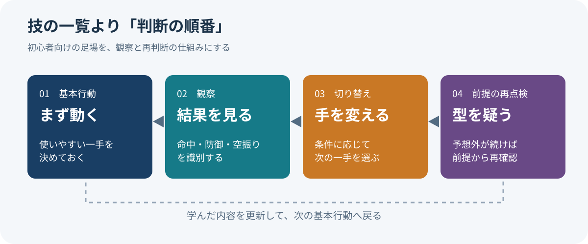
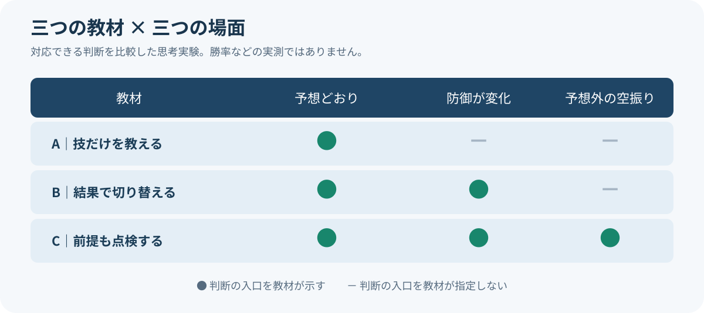

# 12分教えた攻略法を、講師は最後に使わないと言った

*2026年11月5日｜調査→再調査→構造化／事実・解釈・提案を分けた論考*

At the end of a twelve-minute beginner tutorial, the instructor says he will no longer use the control method he has just explained. 講座の結末としては妙に自由だ。But the odd ending opens a deeper question: what should a beginner actually learn?

題材は『ストリートファイター6』のエレナ。プロゲーマーのアクア（ACQUA）は[2025年6月のtutorial](https://www.youtube.com/watch?v=jqFhyP1FBzc)で、初心者向けにModern controls（モダン操作）を説明する。ところが[11分53秒ごろ](https://www.youtube.com/watch?v=jqFhyP1FBzc&t=713s)、「僕は今モダンエレナをもう触んないです」と言う。The entry point he teaches is not the method he now prefers.

This may be honesty, not contradiction. 初心者のchoicesを減らしても、それがforever optimalだとは言わない。A good lesson might need to teach not only what to do but when to stop doing it.

*画像：カプコンが[公式発表（Steam）](https://steamcommunity.com/games/1364780/announcements/detail/534348484694770027)に掲載したエレナの設定画。©CAPCOM。ゲーム内の現行性能を示す図ではない。*

## 1｜リサーチ：技のリストではなく、観察の順番を教えていた

I reread the transcript as a decision sequence, not a move list. 主力の中攻撃を軸に、hitなら追撃、guardなら切り替え、jumpには対空、projectileには別の対応を置く。[講師の時刻別ノート](https://acqua-souken.com/v/jqFhyP1FBzc/)にも、observable cues（観察できる兆候）が並ぶ。

Knowing a hundred moves does not mean knowing when to use one. 少数の技でも、結果を見てreselectできれば戦える。The lesson teaches a sequence of attention: which signals should matter next.

Psychology calls「もしXならY」an implementation intention（実行意図）。ゴルヴィッツァー（Peter M. Gollwitzer）とシーラン（Paschal Sheeran）の[2006年の統合分析](https://doi.org/10.1016/S0065-2601(06)38002-1)は94件の独立検証でd＝0.65を報告した。This is general goal-achievement evidence, not an experiment on Elena players.

But an if–then rule works only if the cue is identified correctly. 条件を誤読すれば、a tidy routine can produce confident mistakes. So the next question is how learners notice that a rule no longer fits.

*図1：筆者作成。講座から抽出した判断設計の概念図であり、技の性能や勝率の実測結果ではない。*

## 2｜次のリサーチ計画：『疑え』を本当に使える言葉へ変える

The first hypothesis was to teach a basic action alongside a switching condition. しかし「失敗したら変えよう」はtoo vague。何がfailureなのか、execution errorとbad ruleをどう区別するのかを明確にしなければならない。

- Check the empirical scope of if–then planning（条件付き行動計画）。
- Find evidence for overusing successful routines（成功した型の使いすぎ）。
- Test whether generic advice to question assumptions works.
- Define observable signals（観測できる兆候）for meetings and training.

This is not a claim that fighting games, medicine, and workplaces have identical outcomes. 横断的なtransferの対象は結果ではなく、testable questions（検証可能な問い）である。That distinction keeps analogy from becoming false evidence.

## 3｜再リサーチ：反省のための確認表は、万能薬ではなかった

Learning science exposes the other face of successful routines. シュワルツ（Daniel L. Schwartz）らは、old successes can cause overzealous transfer（過剰な転用）と論じた。[2012年論文](https://eric.ed.gov/?id=EJ974017)。His [later essay](https://doi.org/10.1080/00461520.2024.2397389) distinguishes routine performance from the capacity to learn when something new appears.

Would saying "question your assumptions" be enough? 米国医療研究品質庁（AHRQ）の[review](https://www.ahrq.gov/diagnostic-safety/resources/issue-briefs/dxchecklists-3.html)では、ある研究でcontent-specific checklist（具体的な診断候補の確認表）は難しい症例に効果があった一方、generic debiasing checklistは有意な改善を示さなかった。The [AHRQ conclusion](https://www.ahrq.gov/diagnostic-safety/resources/issue-briefs/dxchecklists-6.html) is that evidence remains mixed and clinical adoption is premature.

A medical study does not prove a gaming tutorial effective. ここから得られるのはmodest design insightだ。「疑う」だけでなく、which cue triggers which checkを指定すること。The proposal is to make re-evaluation operational, not merely virtuous.

## 4｜意外な接続：会議の進行表にも『技が当たらない条件』がある

Imagine a junior marketer taught「売上が落ちたら広告を増やす」。It's easy to act on, but sales can decline because of fewer new customers, lower repeat purchase frequency, or checkout abandonment. A polished discussion of ad creative can hide the fact that the problem was never diagnosed.

Add two conditions: check new-customer volume and purchase frequency before raising spend; pause the decision if the cause remains unclear. Then the manual changes purpose. 指示の再現だけではなく、when not to execute itを教え始める。A procedure can teach restraint as well as action.

The video ending now sounds different. The instructor offers a beginner's scaffold, then says he prefers another for his own goals. これはuniversal rankingではなくpersonal judgmentだが、the willingness to disclose a method's limits is educationally significant.

## 5｜やりすぎの思考実験：三つの教材を同じ場面で比べる

Consider a desk experiment, not a human study. 教材Aは「主力技を使う」。B adds「hitなら続行、guardなら切替」。C also says「unexpected resultsならrecheck assumptions」。Apply them to expected behavior, changing defense, and an unexpected whiff.

A only specifies a routine. B names a switching cue. C names a trigger to review the premise. ただしこれはcoverage of instructionsであって、C wins more gamesという実証ではない。Too much branching may slow a novice down.

*図2：筆者作成。記号は教材に判断の入口があるかを示す。勝率・反応時間などの測定結果ではない。*

A real test should randomly assign beginners to three instruction types and compare accuracy, response time, and persistence with a failing rule across familiar and changed tasks. そこで初めて、how many exceptions to teachという教育上の問いに答えられる。

## 6｜構造化：空・雨・傘で『手順を卒業する条件』を設計する

Before researching, I thought the value was simply fewer moves. Now the deeper value seems to be learning where a move works and where it fails. 標準化はdecisionを消すだけではなく、where judgment mattersを見えるようにできる。

- 【空・Evidence】動画はbaseline actionとhit / block / adaptationの分岐を教える。If–then plansには研究がある一方、generic debiasing promptsの効能は限定的だ。
- 【雨・Interpretation】Expertise includes recognizing the limits of routines, not merely memorizing more routines. これはcross-domain hypothesisであり、実証済みの普遍法則ではない。
- 【傘・Action】手順書をbaseline action、observable cue、switching response、review triggerの4要素で設計し、new situationsで効果を測る。

For a meeting, add three lines: What customer change does our action assume? What evidence would contradict it? When should we pause? この小さなdesign changeは議論を遅くするためではない。It prevents a team from efficiently solving the wrong problem.

## 7｜限界と結末：『もう使わない』と言える教材

This article is documentary research based on the supplied transcript, timestamp notes, and academic sources. 講師への新規取材も、novice trialsも実施していない。His 2025 classic preference is not a universal claim for all players in 2026; clinical evidence cannot be used to prove effects in games or business.

Return to the tutorial. The instructor gives us an entrance and also points toward an exit. A manual that teaches when not to follow it may be the first manual that truly prepares its reader to leave it behind.

## 参考文献と検証範囲

- [Original ACQUA tutorial](https://www.youtube.com/watch?v=jqFhyP1FBzc)／[timestamp notes](https://acqua-souken.com/v/jqFhyP1FBzc/)
- [Official Capcom Elena material](https://steamcommunity.com/games/1364780/announcements/detail/534348484694770027)
- [Gollwitzer & Sheeran（2006）, implementation intentions](https://doi.org/10.1016/S0065-2601(06)38002-1)／[2025 planning review](https://doi.org/10.1146/annurev-psych-021524-110536)
- [Schwartz et al.（2012）, overzealous transfer](https://eric.ed.gov/?id=EJ974017)／[Schwartz（2025）, adaptive learner](https://doi.org/10.1080/00461520.2024.2397389)
- [AHRQ checklist comparison](https://www.ahrq.gov/diagnostic-safety/resources/issue-briefs/dxchecklists-3.html)／[AHRQ conclusion](https://www.ahrq.gov/diagnostic-safety/resources/issue-briefs/dxchecklists-6.html)
- [Eric Hayot / エリック・ハイヨ『The Elements of Academic Style』](https://cup.columbia.edu/book/the-elements-of-academic-style/9780231168014/)：Uneven U（非対称のU字）を段落と記事全体の展開に参照。
