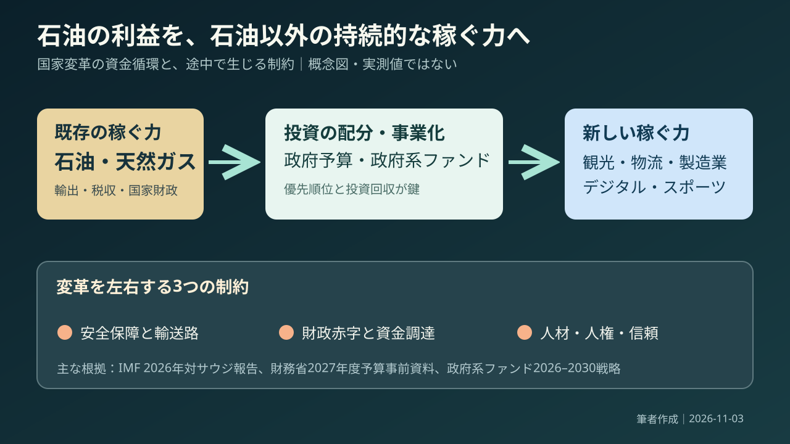
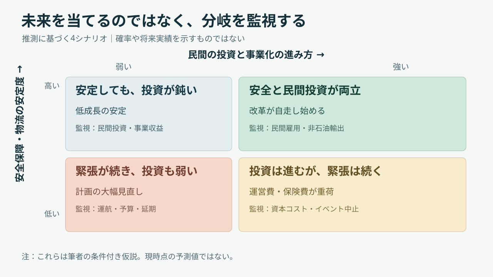

# 石油で稼いだ国は、石油に頼らない未来を買えるのか

*English Mix版：日本語の論旨を保ちながら、平易な英語で主要概念を学べるようにした。*

## 30秒で結論：改革の成否は、巨額投資より自走する経済にある

Saudi Arabia is trying to build a future beyond oil（石油の先の未来）。石油収入を観光、物流、製造業へ投じる国家の事業転換が進むが、2026年は戦闘、輸送混乱、財政負担が重なった。The key question is not just how much money the state spends. **公的資金が減っても民間が自走できるか**が成否を分ける。

One number makes the trade-off visible. サウジ財務省の2027年予算事前資料では、歳入1兆2,020億リヤル、歳出1兆3,920億リヤルで、約1,900億リヤルの赤字見込み。A state deficit is not the same as a company's loss. 注目点は赤字の大小だけでなく、限られた資源をどこへ配るかという**resource allocation（資源配分）**。出典：[財務省](https://mof.gov.sa/en/w/saudi-ministry-of-finance-announces-pre-budget-statement-for-fy2027-expenditures-estimated-at-sar-1-392-bn-and-revenues-at-sar-1-202-bn)。

## リサーチ：ニュースだけでは、国の全体像は見えない

One headline cannot explain an entire country. 最初のリサーチでは、①政治制度、②石油と予算、③改革、④security（安全保障）、⑤労働と権利を分けて確認した。するとサウジは、政府が資金提供者・発注者・安全保障の担い手を兼ねる特殊な構造として見えてくる。This changes the measurement problem. 経済成長率だけでは成果を判定できない。

This is Riyadh in 2022, not a photo of the 2026 conflict. 撮影：Thesadcactus／[原画像](https://commons.wikimedia.org/wiki/File:Riyadh_skyline.jpg)／[CC BY-SA 4.0](https://creativecommons.org/licenses/by-sa/4.0/)。改変なし。The skyline shows buildings, not returns. 建設の規模と生活改善・投資回収は別の問題である。

## 次のリサーチ計画：何を比べれば、改革の実力が分かるか

The next research question is more precise: What does 'less oil-dependent' mean? 輸出、税収、GDPのどれを測るかで答えが違う。政府投資がprivate investment（民間投資）を呼ぶか、事業変更が失敗なのか合理的な選択なのかも調べる。Then the real test becomes business independence（事業の自立性）, not building size.

I compared government plans with the International Monetary Fund（国際通貨基金）, independent reporting, and human-rights reviews. 公式資料は国家の計画を、外部資料は費用や制約を映す。Disagreement can be useful evidence. 見解の不一致から追加で検証すべき論点が見える。

## 再リサーチ：2026年の成長予測は、時点によって大きく変わった

In July 2026, the IMF forecast **+1.7%** real GDP growth for Saudi Arabia in 2026. しかし9月30日のサウジ財務省の暫定見通しは**−3.6%**で、石油関連活動の落ち込みと非石油活動の**+3.2%**が並んだ。These are different vintages of forecasts, not simultaneous facts. 数値の差は、情勢変化と前提の違いを調べる入口になる。出典：[IMF](https://www.imf.org/en/news/articles/2026/07/29/pr26267-saudi-arabia-imf-concludes-2026-aiv)、[財務省](https://mof.gov.sa/en/w/saudi-ministry-of-finance-announces-pre-budget-statement-for-fy2027-expenditures-estimated-at-sar-1-392-bn-and-revenues-at-sar-1-202-bn)。

The government reports a **57.3%** non-oil share of GDP in the first half of 2026. ただし構成比は、石油部門の縮小によっても変わる。Share is not the same as competitiveness. 比率の改善だけで新産業の競争力が証明されるわけではない。次に必要なのは雇用、輸出、投資回収のデータである。出典：[財務省](https://mof.gov.sa/en/w/saudi-ministry-of-finance-announces-pre-budget-statement-for-fy2027-expenditures-estimated-at-sar-1-392-bn-and-revenues-at-sar-1-202-bn)。

## 守①：サウジアラビアは、どこにある、誰が治める国か

Start with the map and government. サウジアラビアはアラビア半島の大部分を占め、首都はリヤド。紅海とペルシャ湾に面し、メッカとメディナを擁する。King Salman（サルマン国王）が国家元首、Mohammed bin Salman（ムハンマド・ビン・サルマン）が皇太子兼首相。This is a monarchy（君主制）. 国家方針は企業投資にも強く影響する。出典：[政府](https://my.gov.sa/en/content/govmechanism)、[豪州政府](https://www.dfat.gov.au/geo/heads-of-government/saudi-arabia)。

Calling it simply a religious country misses the point. 聖地を守る役割、政治の正統性、若者の仕事、生活費、国際投資が重なっている。Tourism reform is also social change. 改革の速度と、人々がそれをどう受け止めるかは同じではない。

## 守②：石油で豊かになった国が、なぜ改革を急ぐのか

Saudi Arabia was founded in 1932 and grew wealthy through oil development. しかしoil prices（原油価格）は国の意思だけでは決まらない。2016年のSaudi Vision 2030（サウジ・ビジョン2030）は産業と雇用の多角化を目指す。It is not about abandoning oil tomorrow. 石油収入を使って、石油価格の下落にも耐える経済を作る構想である。出典：[IMF](https://www.elibrary.imf.org/view/journals/002/2026/210/article-A001-en.xml)。

A useful term is economic diversification（経済の多角化）: building more than one source of income. 非石油部門のGDPが伸びても、財政や輸出の石油依存が消えたわけではない。IMFは2025年の主要輸出品に占める石油・石油製品を約69％と示す。Progress is real, but the transition is incomplete. 出典：[IMF](https://www.imf.org/en/news/articles/2026/07/29/pr26267-saudi-arabia-imf-concludes-2026-aiv)。

## 守③：政府系ファンドは、国が持つ巨大な投資会社に近い

The Public Investment Fund（公共投資基金、PIF）はsovereign wealth fund（政府系ファンド）の一つ。国が持つ資金を長期投資し、観光、物流、産業を育てる。But spending is not profit. 新規事業が外部顧客と継続収入を獲得できるかを見なければならない。出典：[PIF戦略](https://www.pif.gov.sa/en/strategy-and-impact/our-strategy/)。

This is an original conceptual diagram, not measured cash-flow data. 石油→政府資金→新産業の途中には財政、安全保障、人材と信頼の制約がある。New sectors must eventually stand on their own. 矢印の先に自走する企業が生まれて初めて改革が進む。

## 守④：外交と安全保障は、油田だけでなく運搬の問題でもある

Security is also a logistics problem. サウジは米国と関係を保ちながら周辺国と外交を行う。11月2日にはイエメンのフーシ派が発射したミサイルの迎撃が報じられた。The Strait of Hormuz（ホルムズ海峡）is a key oil route; サウジは紅海へ通じる東西パイプラインも使う。Security means keeping supply chains running（供給網を止めないこと）. 出典：[ロイター](https://www.reuters.com/world/middle-east/saudi-civil-defence-sounds-all-clear-after-alerts-southern-cities-2026-11-02/)、[IMF](https://www.imf.org/en/news/articles/2026/07/29/pr26267-saudi-arabia-imf-concludes-2026-aiv)。

Do not treat every actor in the region as one side. 紛争には複数の主体と目的があり、ひとくくりにはできない。What we can verify is disruption to exports, infrastructure, and travel. 企業にとって重要な安全は、明日も操業できるという予見可能性である。

## 守⑤：経済改革の数字と、人々の権利は別々に点検する

Some reforms have measurable results. IMFは女性の労働参加や民間部門の拡大を評価する。一方、Human Rights Watch（ヒューマン・ライツ・ウォッチ）は言論制限、死刑執行、移民労働者への虐待を問題にしている。More jobs do not automatically mean full rights. 経済の進歩と権利の保障は別々に検証する必要がある。出典：[IMF](https://www.elibrary.imf.org/view/journals/002/2026/210/article-A001-en.xml)、[HRW](https://www.hrw.org/world-report/2026/country-chapters/saudi-arabia)。

Large events have a hidden workforce. スタジアムの裏側には建設、警備、清掃、物流の仕事がある。Due diligence（デューデリジェンス、事前調査）は利益だけでなく労働条件とリスクを確かめること。The supply chain has people in it. 事業評価には人々の安全も含まれる。

## 破①：政府系ファンドが「造る」から「稼がせる」へ移る

PIF's 2026–2030 strategy shifts from growth to value realization（投資資産から価値を生む段階）。投資先を三つの区分で管理し、長期収益や民間協業を重視する。Portfolio management（ポートフォリオ管理）means deciding which investments deserve more capital and which should wait. 巨大な国家計画にも撤退・縮小の判断が必要になる。出典：[PIF](https://www.pif.gov.sa/en/strategy-and-impact/our-strategy/)。

A project delay does not prove national failure. 2026年10月、ロイターはNEOM（ネオム）に関連するワールドカップ用スタジアム計画の棚上げを報じたが、報道は政府による最終決定の正式発表とは区別する。The better question is capital discipline（資本規律）. 他案件と比較して、投資の採算と優先順位を見直せるか。出典：[ロイター](https://www.reuters.com/sports/soccer/saudi-arabia-quietly-shelving-neom-stadium-one-2034-world-cup-venues-2026-10-04/)。

## 破②：アジアカップ延期は、国家戦略を一試合の運営に引き戻す

On November 3, 2026, Reuters reported that the AFC Asian Cup in Saudi Arabia was moved from January–February 2027 to **December 23, 2027–January 21, 2028**, subject to FIFA approval of the new dates. 10月26日には当初日程の試合会場と時間が発表されたばかりだった。A large budget cannot guarantee an event date. 国家投資と実際の開催能力は別だ。出典：[ロイター](https://www.reuters.com/sports/soccer/asian-cup-postponed-until-december-2027-afc-says-2026-11-03/)、[サウジ通信社](https://www.spa.gov.sa/en/N2710627)。

Postponement affects tickets, travel, broadcast, sponsors, and workers. 具体的な損失額は確認できないが、影響の道筋は明らかだ。Sports investment depends on operations（運営）and trust（信頼）, not only venues. 2034年W杯でも施設だけでなく、緊急時の判断と代替手段が問われる。

## 破③：未来を予言せず、四つの条件付きシナリオで備える

Scenario planning（シナリオ分析）is not fortune-telling. 先を当てるのではなく、条件別の行動を準備する。横軸は民間投資と新事業の進展、縦軸は安全保障と物流の安定度。Four plausible paths emerge. 大切なのはそれぞれの可能性を見分ける指標を持つことだ。

This is a hypothesis diagram, **not a probability forecast**. 航路、航空便、攻撃、非石油輸出、民間雇用、政府支出、延期計画をmonitor（監視）する。Security without private growth is not enough; growth without security is costly. 産業政策と外交は、同じ成長戦略の条件としてつながる。

## 離①：日本の企業から見れば、遠い戦争ではなく仕入れの問題になる

For Japanese companies, geopolitics reaches procurement（調達）. 日本の2025年原油輸入は約94％が中東由来。JETROによれば2026年4月の中東からの輸入量は前年同月比67.2％減だった。A distant conflict can change local costs and delivery times. 国際情勢は仕入れ先の選択に直結する。出典：[JETRO](https://www.jetro.go.jp/biz/areareports/special/2026/0501/bbdf8eef23bb46ab.html)。

Do not stop at 'use more suppliers.' 調達先を変えれば価格、品質、物流、在庫コストまで変わる。Resilience（レジリエンス、回復力）means staying operational and recovering after a shock. 平時の安さと有事の継続性を両立させる設計が必要になる。

## 離②：スポーツビジネスでは、スター獲得より仕組みの持続性を測る

A football league cannot live on star signings alone. サウジ・プロリーグは2026年、選手獲得支援を四年間の仕組みへ更新し、財務の持続性を重視すると表明した。Sustainable growth（持続的成長）requires clubs, fans, sponsors, and broadcasting businesses. 制度の狙いと成果の実績は区別すべきである。出典：[サウジ・プロリーグ](https://www.spl.com.sa/en/news/next-phase-of-pace-to-drive-sustainable-growth-and-global-competitiveness)。

Nation branding（国家の知名度向上）and a repeatable fan business are different. 前者は大型予算で始められても、後者には毎週の来場と満足が必要だ。Track repeat attendance, local fans, sponsor renewal, and operating profit. それで初めて一時的な注目が地域の事業に変わったかを判断できる。

## コンサル実務：依頼を受けたら、まず一枚で何を整理するか

A consultant should not jump to 'enter' or 'avoid.' まずmarket attractiveness（市場魅力）、entry conditions（参入条件）、execution risks（実行リスク）、economics（採算）を分ける。Then ask: If public funding shrinks, will private customers still pay? この問いで魅力的な国家構想と、成立する事業計画を区別できる。

A practical two-week check covers five topics: buyer budgets, competitors, contracts, security, and worker conditions. 経営指標には民間売上比率、粗利益率、代金回収日数、中断日数、労働問題の是正状況を置く。Use interviews and real contracts to validate assumptions. 本稿では架空の市場規模を実在の数字として扱わない。

## 対立する見方と限界：成功にも失敗にも、早すぎる判定がある

There is evidence for both progress and criticism. 非石油活動や女性の雇用は改善してきた。一方で財政、治安、人権には重大な問題が残る。Both can be true. 改革の進展と、その持続性・公正さの不足は両立する。出典：[IMF](https://www.elibrary.imf.org/view/journals/002/2026/210/article-A001-en.xml)、[HRW](https://www.hrw.org/world-report/2026/country-chapters/saudi-arabia)。

This article uses public information available on November 3, 2026. 戦況と大会予定は変わり得る。2026年の成長と2027年予算は確定実績ではなく、四つのシナリオも仮説である。Separate forecasts, official statements, and independent reports. 人権の問題を成長率の中に埋め込まない。

## 覚えたい専門用語は五つだけ

**①Economic diversification（経済の多角化）**＝収入源を増やすこと。**②Sovereign wealth fund（政府系ファンド）**＝国の資産を投資する仕組み。**③Portfolio management（ポートフォリオ管理）**＝投資先の組み合わせを評価し、資金配分を決めること。

**④Scenario planning（シナリオ分析）**＝複数の条件付き未来を用意すること。**⑤Resilience（レジリエンス、回復力）**＝混乱しても機能を維持し、回復する力。With these five terms, you can ask not only how much a country spends, but whether its investments can last. 投資の持続性まで分析できる。

## 結論：サウジを理解するとは、「お金の大きさ」から「条件の組み合わせ」へ視点を変えること

Saudi news seems to contain different stories: megaprojects, missiles, and postponed sports events. しかしそれらは石油収入を次の競争力へ変える同じ過程でつながっている。Money alone cannot create durable value without security, customers, and rights. The final question is: Who will keep paying when public spending slows? これは国家経営にもスポーツビジネスにも通じる問いである。

## 出典・確認範囲と、この先の再リサーチ

**Official and institutional sources（公的・国際機関）**：[Saudi Ministry of Finance（財務省）](https://mof.gov.sa/en/w/saudi-ministry-of-finance-announces-pre-budget-statement-for-fy2027-expenditures-estimated-at-sar-1-392-bn-and-revenues-at-sar-1-202-bn)／[IMF review（審査）](https://www.imf.org/en/news/articles/2026/07/29/pr26267-saudi-arabia-imf-concludes-2026-aiv)／[IMF report（詳細報告）](https://www.elibrary.imf.org/view/journals/002/2026/210/article-A001-en.xml)／[PIF strategy（戦略）](https://www.pif.gov.sa/en/strategy-and-impact/our-strategy/)／[Government（政府制度）](https://my.gov.sa/en/content/govmechanism)。

**Independent reporting and reviews（報道・批判的資料）**：[Reuters・Yemen（イエメン情勢）](https://www.reuters.com/world/middle-east/saudi-civil-defence-sounds-all-clear-after-alerts-southern-cities-2026-11-02/)／[Reuters・Asian Cup（延期）](https://www.reuters.com/sports/soccer/asian-cup-postponed-until-december-2027-afc-says-2026-11-03/)／[Reuters・stadium project（スタジアム計画）](https://www.reuters.com/sports/soccer/saudi-arabia-quietly-shelving-neom-stadium-one-2034-world-cup-venues-2026-10-04/)／[Human Rights Watch（人権）](https://www.hrw.org/world-report/2026/country-chapters/saudi-arabia)／[JETRO（日本の調達）](https://www.jetro.go.jp/biz/areareports/special/2026/0501/bbdf8eef23bb46ab.html)／[Saudi Pro League（サウジ・プロリーグ）](https://www.spl.com.sa/en/news/next-phase-of-pace-to-drive-sustainable-growth-and-global-competitiveness)。

**Next checks（次の検証）**：2026年の確定統計、FIFAによる日程承認、物流復旧、PIFの営業収入・民間出資、人権と労働安全。Unverified facts remain unverified. 構成にはEric Hayot（エリック・ハイヨ）のUneven U（不均等なU字型の論証構造）を参考にした。参考：[University of Wisconsin Writing Center（ウィスコンシン大学）](https://writing.wisc.edu/handbook/processandstructure/revisinglongprojects/)。確認日：2026年11月3日。
