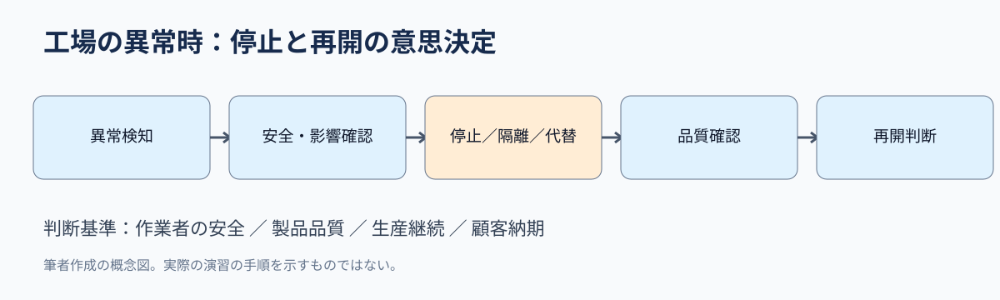
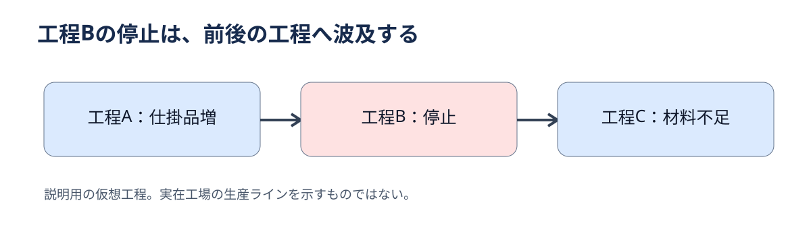

# 工場のサイバー訓練は「止める権限」を問う――運営管理から考える生産継続

2026年10月28日の仙台での机上演習から学ぶ、生産統制・制約工程・事業継続計画

**配信枠：2026年11月3日13:00｜担当科目：運営管理｜ニュース対象日：2026年10月28日**

## 問い

A cyber drill at a factory is not only about data leaks. It also concerns shutdown decisions, alternative production, and customer communication. On October 28, 2026, a tabletop exercise for operational technology (OT) incident response was held in Sendai. The question is: Who decides when to stop production, and on what basis?

## 30秒で結論

Incident response requires more than restoring equipment. Safety, quality, delivery, and information protection must be considered together. Decision rights and fallback procedures should be defined in advance. This article analyzes a training event, not an actual cyberattack.

## ニュースの事実

According to the Information-technology Promotion Agency (IPA), an OT incident-response tabletop exercise was held in Sendai from 14:00 to 17:00 on October 28. Organizers included the Tohoku Bureau of Economy, Trade and Industry, a regional IT association, and IPA. The public listing confirms the event, not its outcomes or participants' weaknesses.

## なぜ工場の事故対応は情報システム部門だけに任せられないのか

Operational technology (OT) monitors or controls physical production processes. Unlike office IT, a failure may affect equipment, product quality, or worker safety. The unit of analysis is therefore not one computer but the production process and its dependencies.

## 守：試験で押さえる3概念

Three concepts matter. Production control tracks plans, progress, and capacity. A bottleneck constrains the throughput of an entire process. A business continuity plan (BCP) prioritizes essential operations, alternatives, and recovery order. Together, they turn a shutdown decision into three questions: What stops? What is delayed? What must continue?

## 図解：異常検知から再開までの判断は直線ではない

This is an original decision model, not a reconstruction of the actual exercise. After detection, the team checks safety and scope, decides on shutdown, isolation, or fallback operation, and then verifies quality before restarting. A narrow focus on recovery speed can overlook quality assurance.

*Original conceptual diagram; source: author's analysis based on IPA guidance. Not an actual exercise record.*

## 図解：工程の依存関係が損失の大きさを変える

Assume a production line A → B → C. If B stops, work-in-process may accumulate before B while C may run short of input. This is a hypothetical example, not a participating factory's actual process. Recovery planning must consider inventory, alternative machines, outsourcing, and delivery commitments.

*Original conceptual diagram; source: author's analysis based on IPA guidance. Not an actual exercise record.*

## 破：停止を避けるほど安全になるとは限らない

Keeping machines running does not always protect delivery performance. It assumes that equipment remains safe and product quality can be assured. Continuing under uncertainty may amplify damage; stopping everything may also create unnecessary losses. The key is agreed thresholds, scope, and decision ownership.

## 離：診断士なら最初に何を聞くか

A consultant should ask: Which process creates the largest loss when stopped? Who approves shutdown and restart? Are fallback production, customer communication, and quality checks documented? A proposed first step is a process dependency map and decision table, tested in a half-day tabletop drill. Track decision time, fallback feasibility, and completion of quality checks before restart.

## 確認問題：生産統制と事業継続を区別できるか

【Multiple choice】Which response is best? A. Skip quality checks to recover faster. B. Let only the IT team approve restart. C. Assess safety, quality, and production impact, then use predefined decision rights. D. Stop every process for the same duration. Answer: C. A ignores quality, B excludes operations, and D ignores different levels of exposure.

## 事例問題：50字で助言する

【Case exercise】A parts maker has a critical process whose failure halts downstream operations, but shutdown and restart authority is unclear. What should be done first? Model answer: Map process impact and fallback options; document safety and quality thresholds and decision rights; validate them through a drill. Scoring: process impact, criteria, authority, and testing.

## 英語で覚える3語

Production control（生産統制）: Production control connects the plan with actual progress.／Bottleneck（制約工程）: A bottleneck limits the whole line.／Business continuity plan（事業継続計画）: A business continuity plan sets recovery priorities. These terms connect technical incidents to management decisions.

## 調査前後で何が変わるか

At first, a factory cyber drill sounds like a technical defense exercise. From an operations-management perspective, it is also about the ability to stop safely and preserve essential work. IPA's guidance separates executive responsibilities from practical procedures. Resilience depends on organizational decisions as well as technology.

## 出典と確認範囲

Primary source: IPA seminar listing (updated October 30, 2026): https://www.ipa.go.jp/security/seminar/sme/supportseminar.html. Supporting source: IPA's SME information-security guideline, version 4.0 (updated September 30, 2026): https://www.ipa.go.jp/security/guide/sme/about.html. Related: https://www.ipa.go.jp/security/support/incident-support.html. Checked November 3, 2026. No outcomes, participant details, or actual incidents are asserted.

