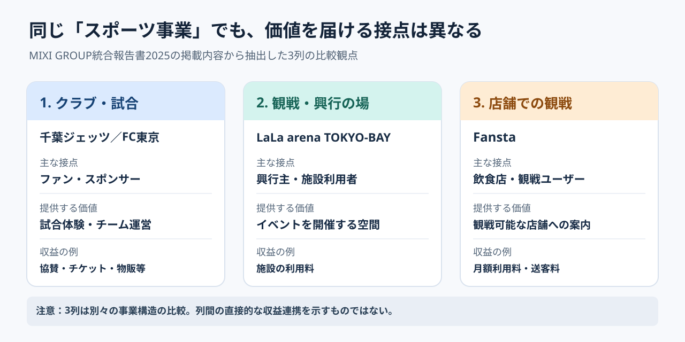

# MIXIのスポーツ事業図解｜3つの異なる事業をなぜ横並びにしたのか

**2026年11月8日 21:38 JST｜試験実行・学習ID 2026-11-08/2138｜読了約4分**

## 1. 企業と対象スライド

株式会社MIXIは、ゲーム「モンスターストライク」や家族向けサービス「みてね」のほか、sports business（スポーツ事業）などを展開する。スポーツ領域にはプロクラブ、施設運営、観戦支援サービス、公営競技関連サービスがあり、revenue model（収益の仕組み）は一様ではない。今回見るのは、2025年8月発行の『MIXI GROUP統合報告書2025』11ページに相当する「SPORTS／スポーツセグメント」のビジネスモデル図である。

この資料は投資家を含むstakeholders（関係者）に、グループの価値創造や事業を説明する統合報告書。今回のページは業績の増減ではなく「各事業で誰と何をやり取りしているか」を説明する役割を持つ。

## 2. 実物を先に見る

[SlideLandの掲載画像を開く](https://www.slideland.tech/slide_img/mixi1/mixi1_12.webp)。First, look at the real slide（まず実物を見る）。掲載画像では、左から「千葉ジェッツ・FC東京」「LaLa arena TOKYO-BAY」「Fansta」の3列が並ぶ。各列はロゴ・登場人物と矢印の図・説明文からなる。画像は引用元にある実物であり、以下の独自図とは異なる。

## 3. 20秒の問い

**なぜ、プロクラブ、アリーナ、観戦店舗の検索サービスという異質なものを、同じ3列の形式で並べたのだろうか？** また、各列のarrows（矢印）は「何が移動しているか」を同じ基準で読めるだろうか。答えを先に読まず、原図の共通点を一つ探そう。

## 4. 4つの視点で解剖する

**情報（Information）：**左のクラブはスポンサー・チケット・物販など、中のアリーナは利用料と所有・運営の関係、右のFanstaは放映権者・店舗・ユーザーの間の情報・予約・月額利用料や送客料などを描く。revenue streams（収益源）も相手も異なることが読み取れる。

**構造（Structure）：**各事業について「事業名→関係者と矢印→補足説明」の順番が共通している。3列は事業を同じ分類に押し込めるというより、異なる収益構造を同じreading order（読み順）で比較できるようにした配置、と解釈できる。

**視覚（Visual）：**上の大きな「BUSINESS MODELS」、赤系の枠、3列の幅、ロゴの配置により、一つのセグメントの複数の事業と分かる。重要なやり取りは各列の中央で線と矢印に整理され、下に文章が付く。

**判断（Decision）：**読み手は「クラブ保有だけがスポーツ事業ではない」と理解できる。ただし、この1枚だけでは事業別利益率や事業間のsynergy（相乗効果）が証明されたことにはならない。

## 5. 優れている点と限界

**優れた点は、別々の事業を「登場人物とやり取り」というshared visual grammar（共通の図解文法）に翻訳したこと。** 企業紹介で事業名を羅列するよりも、誰が誰に何を提供するのかが具体的になる。

**限界はinformation density（情報密度）。**各列の矢印に「スポンサー収入」「施設利用料」「情報提供」など異なる種類の関係が混在するため、投影した会議室では読み取りにくい。とくに「収益の流れだけを比較したい」という目的なら、矢印をすべて同じ意味で読める収益対応表の方が適する。

## 6. 別案の図解｜価値を生む接点で比較する

以下は**原図の再掲載・複製ではなく、touchpoints（顧客接点）を比較するために独自作成した模式図**。クラブは「試合」、アリーナは「場」、Fanstaは「観戦できる店舗との接続」に焦点を絞り、各列を「主な相手／提供価値／収益の例」に置き換える。

**原図が優れる条件：**具体的な事業関係者・権利・所有・サービスの流れを説明するとき。**別案が優れる条件：**複数の事業の違いをquick comparison（短時間の比較）で捉え、投資家や経営層と論点をそろえるとき。3列の並列は、事業間で直接収益が連携している証拠ではない。

## 7. PowerPointで再現する4手順

1. まず各事業について「誰に／何を／どう収益化するか」を一文ずつ書き出し、3列のcolumn headers（見出し）を固定する。
2. Windows版PowerPointで同じ幅の長方形を3枚作り、各列の上に事業名、中央に相手と価値、下に収益の例を置く。
3. 文字や形を整える前に、比較項目がすべて同じreading order（順番）で並ぶか確認する。必要な関係矢印だけを同一列の内部に引く。
4. 「主な収益」「主要な関係者」など意味が異なるものを同じ矢印で表現しない。詳しいtransaction flow（取引の流れ）が必要なら別ページに分ける。

**時短の核心：**一つ目の列を完成させてduplicate（複製）し、内容だけ差し替える。ただし構造化する前から装飾を始めない。

## 8. 実務転用｜スポーツクラブの収益構造説明

スポーツクラブの事業説明資料なら、見出しを「ファンとのtouchpoints（接点）ごとに収益構造は異なる」とし、3列を**試合日（チケット・飲食）／日常接点（会員・物販）／法人接点（スポンサー・施設活用）**に置き換える。各列で「顧客／提供価値／収益の例」を同じ位置に配置する。なお、この収益分類はtraining example（練習用）であり、特定クラブの実績や会計区分を示すものではない。

## 9. 60秒課題と解答例

**課題：**「クラブ運営、アリーナ運営、動画配信」の3事業を説明するなら、同じ3列の形式と、customer journey（顧客の移動）を示す一本のフロー図のどちらを選ぶ？ **判断基準：**独立した事業モデルの違いを伝えるなら3列。実際の利用者がサービス間を移動する仕組みを実証できるならフロー図。両者を混同しない。

**解答例：**今回のようにrevenue streams（収益源）と相手が異なる事業の説明なら3列。利用者が「動画を見てから会場で観戦する」割合などの実測がある場合だけ、接点の遷移を示すフローを検討する。**別解：**権利・資金の流れを重視する場合は関係図が適切。

## 10. 出典と今日の一言

参照：[SlideLand｜MIXI GROUP統合報告書2025掲載例](https://www.slideland.tech/docs/company/mixi1)／[MIXI公式｜統合報告書2025発行](https://mixi.co.jp/news/2025/0829/44534/)／[MIXI GROUP統合報告書2025（原資料PDF）](https://pdf.irpocket.com/C2121/hGOm/a0fB/UmHx.pdf)。出典画像の再配布は行わず、original source（原典）へのリンクを案内した。

**今日の一言：**同じ形にそろえるべきなのは、事業そのものではなく「比較する問い」である。 **Simple English:** Compare different businesses using the same questions. **日本語訳：**異なる事業を、同じ問いで比較しよう。