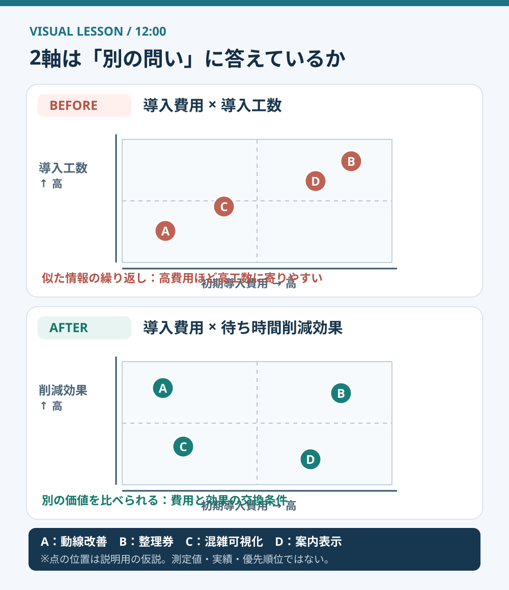
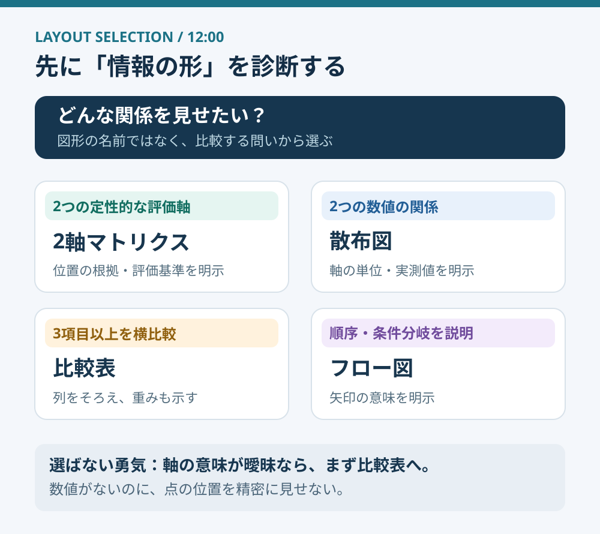

# 2軸マトリクスは、軸を決める前に疑う

**2026-11-02 12:00 JST｜学習ID 2026-11-02/1200｜レイアウト・図解｜3〜5分**

## 今日の結論

**今日の技：2軸の重複チェック。** 2-axis matrixを描く前に、X-axisとY-axisが**different questions（別の問い）**に答えているか確かめる。似た軸を並べても、見栄えは整うがdecision insight（判断の手掛かり）は増えない。

## 守｜2軸マトリクスは「分類」ではなく「違い」を見せる

2-axis matrixは、2つのcriteria（評価基準）で候補を配置する図。「導入費用」と「導入工数」は別の言葉でも、案件次第では一緒に増える。点が対角線に寄ったら、**redundant axes（情報が重複する軸）**を疑う。

ここでのindependenceは、統計学上の厳密な独立性ではない。**Does the second axis add information?（2本目の軸は新しい情報を足すか）**という実務上の問いだ。

図1は売店改善案A〜Dの**illustrative example（説明用の仮説）**。Afterではcost（費用）とexpected waiting-time reduction（待ち時間削減への期待）を比較する。両者も関連しうるが、同じ情報を繰り返すよりtrade-off（交換条件）が見えやすい。実測値ではない。

## 破｜作る前に確認する4ステップ

1. **Fix the question.** 「売店の待ち時間を減らす施策を選ぶ」とdecisionを一文で定める。
2. **Define the axes.** X＝初期費用（円）、Y＝待ち時間削減見込み（分）。数値がなければhigh／lowの判断基準を文章で書く。
3. **Check redundancy.** 同じcostでもeffectが異なる候補、同じeffectでもcostが異なる候補を想像できるか。できなければ軸を見直す。
4. **Label the evidence.** 点の位置がmeasured／estimated／judged／hypotheticalのどれか示し、未検証なら「暫定」と書く。

Exception：2つのmeasured variables（測定値）があるなら、2×2の象限図より**scatter plot（散布図）**。3つ以上のcriteriaならcomparison table（比較表）、順序や条件分岐ならflowchart（フロー図）を選ぶ。

## Before→After｜図を変えると、会議の質問が変わる

**Before：**cost×implementation effort。高費用の案が高工数にも寄り、known impression（既知の印象）の再確認になりがち。**After：**cost×expected waiting-time reductionへ変更し、value for cost（費用に対する価値）を比べる。推定根拠の明示は必須。

図2は**layout decision guide（図解の選び分け）**。SlideLandのmatrix examplesは実在の資料を探す入口。ただしこの図は転載ではなく、information type（情報の性質）から図を選ぶ独自のガイドだ。

## 離｜図を疑うことは、評価基準を疑うこと

競合比較では「機能数×対応機能数」のようなoverlapを避け、「対象顧客×提供価値」のようにdifferent perspectivesを考える。人材評価も「勤続年数×経験年数」だけでは新しい視点が乏しい。**Choosing axes means choosing what matters.（軸選びは価値判断）**

## 失敗例と60秒課題

**Failure mode：** データがないのに点を精密に散らし、false precision（根拠のない精密さ）を演出する。評価基準と未検証を明示し、必要ならcomparison tableに戻す。

**60-second challenge：** スポーツ施設のvideo servicesを「価格×導入難易度」で比べる案を改善。Answer exampleは「annual total cost×staff hours saved」。**Pass criteria：** 2つのaxesの意味が異なり、how to measure（測り方）を説明できる。測れないなら仮説の比較表を使う。

## 参考資料・Simple English

Sources： [SlideLandのマトリクス作例](https://www.slideland.tech/docs/schematic/matrix/2)／[Microsoft公式SmartArtガイド](https://support.microsoft.com/ja-jp/office/graphics-visuals/choose-a-smartart-graphic)。Microsoftは目的によってlist／process／hierarchy／relationship／matrixを選ぶと説明する。axis redundancy checkは公式機能名ではなく、今回の実務手法。

**Simple English：Choose axes that tell different stories.** ／ **日本語：それぞれ違う情報を伝える軸を選ぼう。**
