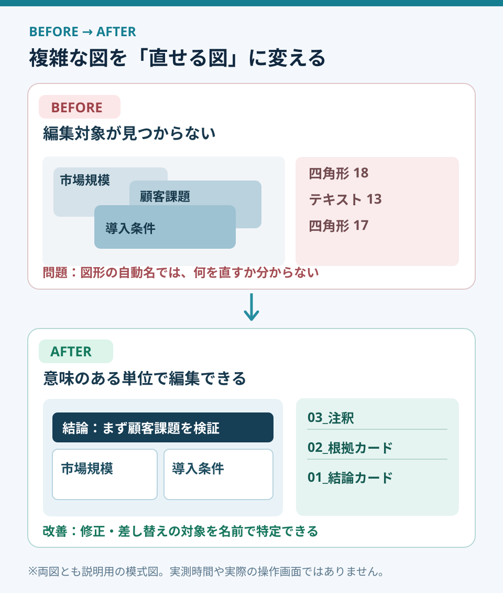

# 選択ウィンドウで、修正に強いスライドを作る

**2026-11-02 15:00 JST｜学習ID 2026-11-02/1500｜PowerPoint実装・時短｜3〜5分**

## 今日の結論

**今日の技：Selection Paneで図形をmeaningful namesで管理する。** 重なったオブジェクトの中から修正対象をすぐ見つける。Creation speedだけでなく、client feedback後のrevision speedを上げる技だ。

## 守｜見える図と直せる図は違う

PowerPointの**選択ウィンドウ（Selection Pane）**は、図形・画像・テキストをlistで管理する機能。Rename、layer order、show/hide、groupingを使える。完成したスライドでも、overlapが多いと別の図形を誤選択しやすい。そこで「見る人のためのvisual structure」と「直す人のためのediting structure」を分けて考える。

背景帯・半透明の強調枠・注釈・矢印が重なるbusiness modelや競争優位性の図で特に有効。文字が2つだけなら全部renameするのはoverkill（やり過ぎ）。**Revision frequencyとoverlap**で使いどころを決める。

図1はWindows版PowerPointのconceptual diagram（模式図）で、actual screenshotではない。**Alt＋F10**でSelection Paneを開き、一覧の対象を選択して**F2**でrenameできる。Microsoft公式の説明で確認した。

## 破｜Windowsで使う4ステップ

1. **Open：** Windows版で**Alt＋F10**。Ribbonなら［ホーム］→［選択］→［選択ウィンドウ］。Object listとlayer orderが見える。
2. **Rename：** よく直す要素を選んで**F2**。例：「01_結論カード」「02_根拠カード」「03_注釈」。番号はsuggested naming conventionであり公式仕様ではない。
3. **Hide temporarily：** 前面の帯や注釈が邪魔なら、一覧のshow/hideを使う。下の文字を直したら必ずshowに戻す。Hideはdeleteではない。
4. **Group：** 関連図形をCtrl＋クリックで複数選択し、［図形の書式設定］→［グループ化］。必要ならgroup nameを付ける。最後にall visible、layer order、text overflowを確認する。

**Exception / alternative：** 位置ずれだけならSelection Paneより［図形の書式設定］→［配置］→［整列］が適切。Groupの内外を同時に選びにくい場合はgroupingを最後にする。Ribbon labelsはversionやlanguageで異なる場合があるので、ここではWindows版Microsoft 365の公式説明を基準にした。

## Before→After｜事業機会の図を修正しやすくする

**Before：** スポーツ映像サービスの機会を「市場規模・顧客課題・導入条件」の3層で見せても、Selection Paneには「四角形18」「テキスト13」などのauto-generated namesしかない。Revision requestのたびに対象を探す。**After：** 「01_結論カード」「02_根拠カード」「03_注釈」とsemantic namingを行い、関連要素をgrouping。「導入条件の注釈だけ変更」などの依頼から対象へdirect accessできる。架空の編集例であり、time savingsは実測していない。

図2のpointは、見た目のredesignより**editing pathの短縮**。SlideLandの「階層・レイヤー」にはpublic slide examplesがあるが、この図は転載ではなく、revision workflowを説明するoriginal diagramだ。

## 離｜資料は「見る人」と「直す人」の二重の設計

図解はaudienceの理解を助けるが、現場では繰り返しupdateされる。Webサービスのfront-endとadmin viewを分ける発想に近い。再利用が多いチームほど、visual qualityだけでなく**maintainability（修正しやすさ）**が品質になる。事業計画のassumptions、施設の稼働率、TAM計算根拠など、frequently updated elementsからrenameしよう。

## 失敗例｜隠した図形を戻し忘れる

**Failure：** 背景帯をtemporarily hideしたまま納品する。Microsoftもhidden objectsを忘れやすいと注意している。**Fix：** 最後にvisibilityを確認し、Slide Showで1枚全体をチェック。Over-groupingで個別修正が難しい場合は、change unit（変更単位）でgroupを切り直す。

## 60秒課題｜3つだけ名前を付ける

**60-second challenge：** PowerPointの1枚でAlt＋F10を押し、今後直しそうな3要素をmeaningful namesへ変更。**Pass condition：** 別の担当者が「注釈だけ変更」と言われても、canvasを探さずlistから対象を見つけられること。曖昧なら「注釈_契約条件」のようにspecificにする。

## 参考資料・Simple English

Sources： [Microsoft公式｜Selection Pane](https://support.microsoft.com/ja-jp/powerpoint/use-the-selection-pane-to-manage-objects-in-documents)／[Microsoft公式｜Align and arrange](https://support.microsoft.com/ja-jp/office/graphics-visuals/align-or-arrange-objects)／[SlideLand｜階層・レイヤー](https://www.slideland.tech/docs/schematic/layer)。Alt＋F10、F2、hide/show、groupingはMicrosoftのWindows instructionsで確認。SlideLandはvisual referenceであり、操作手順のevidenceではない。

**Simple English：Name objects by their role, not their shape.** ／ **日本語：図形の形ではなく、役割で名前を付けよう。**
