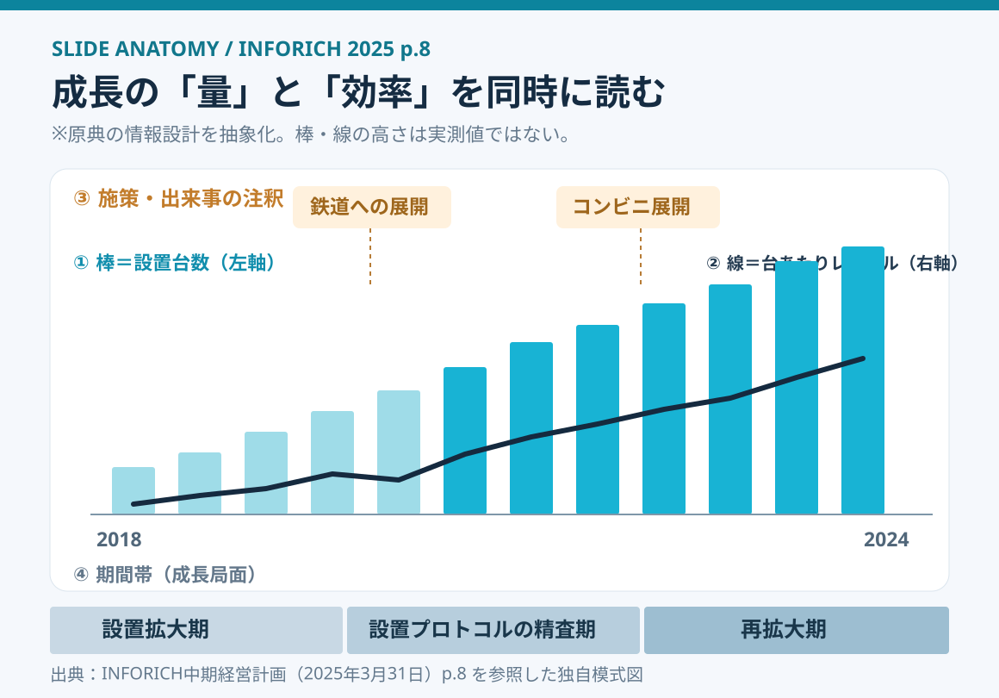
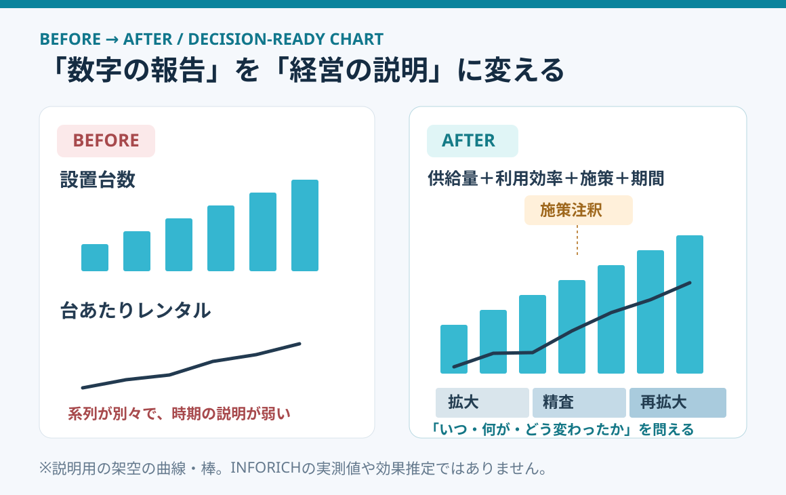

# INFORICHの成長グラフを解剖する｜量・効率・施策を1枚で読む

**2026-11-02 18:00 JST｜学習ID 2026-11-02/1800｜名作スライド解剖｜3〜5分**

## 今日の結論

**今日の技：Combo chart（複合グラフ）にeventsとgrowth phasesを重ねる。** 設置台数というscale（量）と、1台あたり利用というefficiency（効率）を同じtimelineで見ると、成長の仕組みを議論しやすい。ただし、annotationsは施策のcausal impact（因果効果）の証明ではない。

## 守｜原典の1枚は何を説明しているか

**実在資料：**株式会社INFORICHの「中期経営計画（VISION 2030）」（2025年3月31日公開）p.8「ChargeSPOT国内の成長」。SlideLandにはこのdeckの掲載一覧があり、今回は[original PDFの8ページ](https://f.irbank.net/pdf/20250331/140120250331504661.pdf#page=8)を直接確認した。SlideLandのgallery listingを、このページのdesign intentの説明文とはみなさない。

**Purpose & claim：**2018年4月のlaunch後、コロナ禍を経ても成長し、設置密度と台あたりレンタルの増加を説明する。水色のbarsは**設置台数（left axis）**、黒いlineは**台あたりレンタル（right axis）**。テレビCM・鉄道・コンビニ展開などのeventsと、3つのgrowth phasesも同じtimelineに重ねている。

**Visual trick：**①scaleを示すbars、②efficiencyを示すline、③施策のannotations、④3 phasesのbandを**4 layers**として組み合わせる。吹き出しと期間帯がraw numbersをmanagement story（経営の物語）に接続する。

## 破｜4ステップで再現する

1. **Define the question.**「設置拡大だけでなく、per-unit usageも伸びたか」。Single metricならcombo chartにしない。
2. **Align the time axis.** 月・四半期をそろえ、bars＝設置台数、line＝台あたりレンタル。Different unitsなのでleft/right axesの名称と単位を明記。
3. **Annotate events.** テレビCMや設置先拡大の実施時期をcalloutsで示す。同時期の変化をcausal effectと断定しない。
4. **Label phases.** 「設置拡大期→設置プロトコルの精査期→再拡大期」を下部bandに置き、headlineにはfinding（発見）を書く。

**How to build in PowerPoint：**［挿入］→［グラフ］でcolumn chartを作り、［グラフの種類の変更］→［組み合わせ］でline seriesをsecondary axis（第2軸）へ。Microsoft公式もdifferent unitsの系列での第2軸を説明している。Calloutsとphase bandは図形で追加する。

## Before→After｜データの羅列を経営の説明へ

**Before：**「設置台数が増えた」「利用が増えた」をseparate chartsで提示。Numbersは読めても、which event or phase changed whatが分かりにくい。**After：**shared timelineにscale・efficiency・events・phasesを重ねる。「単なる量の拡大か、それともper-unit usageも改善したか」を議論できる。

**Limit：**Dual axes（2つの縦軸）はscaleの設定次第で棒と線が近く見え、strong relationshipを錯覚させる。Causalityの検証には地域別比較、導入前後の条件調整、external factorsの確認が必要。純粋な比較なら、上下2段のsmall multiples（分割グラフ）がより安全な場合もある。

## 離｜スポーツ施設の事業評価へ転用する

スポーツ施設では**「運営施設数（supply）」×「1施設あたり月間利用件数（efficiency）」**へ転用できる。開業、予約システム変更、広告出稿などをannotationsに置けば、expansionとexisting-site improvementを分けて話せる。これはtransfer ideaであり実測データではない。

**New lens：**よいgrowth chartはcelebrationで終わらず、next hypothesisを生む。Efficiencyが停滞するなら立地や導線、efficiencyだけ伸びてsupplyが増えないなら設置制約を調べる。

## 失敗例｜出来事を原因と断定する

**Failure：**広告開始の直後にusageが伸びたため「広告が原因」と言い切る。**Fix：**「同時期に増加」と記し、seasonality・supply expansion・regional differencesを別途検証する。Annotations are context, not causal proof.（注釈は文脈であって因果の証明ではない。）

## 60秒課題｜2つの系列と1つの出来事

**60-second challenge：**「scale metric」「per-unit efficiency」「one event」を1つずつ選ぶ。例：動画の公開本数／1本あたり平均視聴時間／thumbnail改善の開始日。**Pass：**unitsとtime periodsがそろい、why these two metricsが一文で説明でき、causal effectを断定していない。

## 参考資料・Simple English

Sources：[SlideLand｜INFORICH中期経営計画の掲載一覧](https://www.slideland.tech/docs/company/inforich)／[INFORICH「VISION 2030」2025年3月31日公開・p.8](https://f.irbank.net/pdf/20250331/140120250331504661.pdf#page=8)／[Microsoft公式｜secondary axis](https://support.microsoft.com/ja-jp/office/excelexp/add-or-remove-a-secondary-axis-in-a-chart-in-excel)。SlideLandの画像は転載せず、図1・図2は原典のvisual structureを学習用に抽象化したoriginal schematics（独自模式図）。

**Simple English：Show scale, efficiency, and context together.** ／ **日本語：事業の規模・効率・背景を一緒に示そう。**
