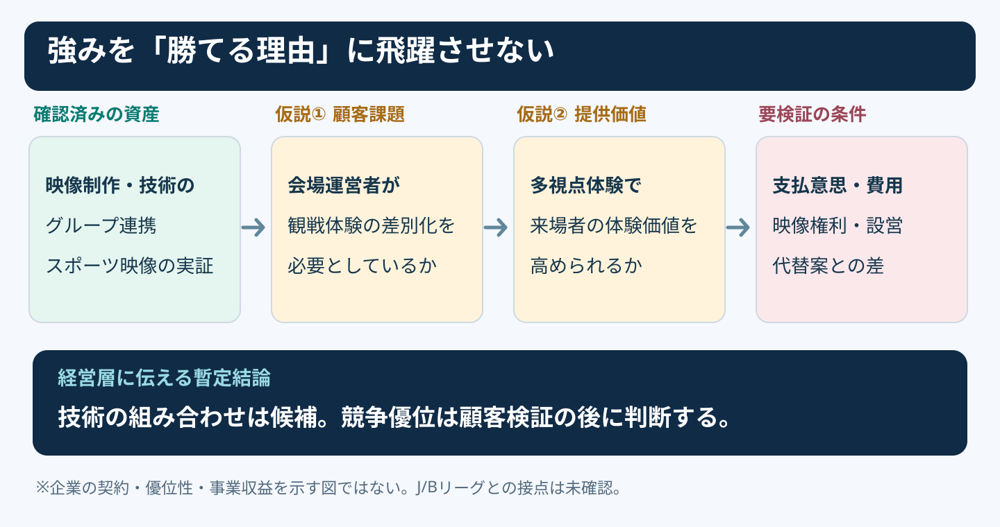
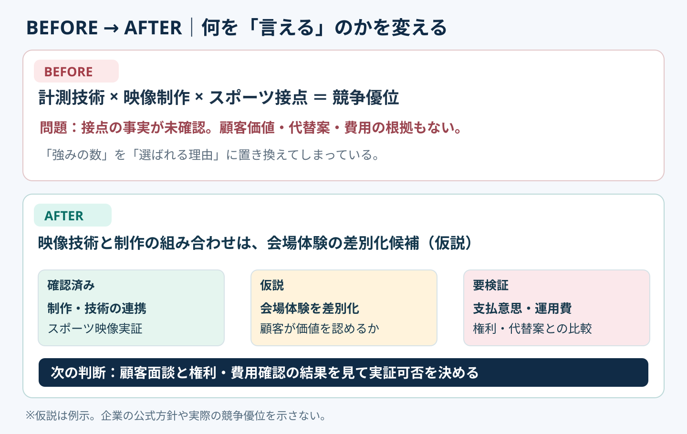

# 強みの羅列を競争優位の検証図に変える｜4段階の論理橋

**2026-11-02 21:00 JST｜学習ID 2026-11-02/2100｜コンサル実務応用｜3〜5分**

## 今日の結論

**今日の技：assets（保有する強み）とcompetitive advantage（競争優位）の間に「customer problem・value・proof」を挟む。** 技術や接点を並べるだけでは、why we win（なぜ選ばれるか）は説明できない。経営層向けの1枚では、confirmed factsとhypothesesを分け、投資判断に必要なproofまで示すと手戻りが減る。

## 守｜強みは出発点であって結論ではない

**Competitive advantage（競争優位）**は、顧客に選ばれる理由を競合より有利に実現できる状態。撮影技術はasset（資産）でも、customer value（顧客価値）、alternatives（代替案）との比較、delivery（継続提供）は別の問いになる。

**Confirmed facts：**IMAGICA GROUPは公式に「クリエイティブとテクノロジー」「ワンストップサービス」を強みとし、2024年4月にスポーツのvolumetric video（人物の動きと立体形状を取得する映像）の体験型実証を公表している。ただし、sports marketでのadvantageやJ/Bリーグとの契約を示す証拠ではない。

**How to read：**左端のassetは一次資料で確認済み。中央のproblemとvalueはhypotheses（仮説）、右端はproof to collect（必要な検証）。矢印はcausalityの証明ではなく、論理をつなぐbridge（橋）を表す。

## 破｜5手順で投資判断用の1枚にする

1. **Define the decision.**「スポーツ会場のmulti-view video experienceを小規模実証する価値はあるか」。General capability deckに広げない。
2. **List verified assets.**「映像制作・技術の連携」「スポーツ向け実証の公表」。出典のないJ/B league accessや契約実績は書かない。
3. **State the customer hypothesis.**「アリーナ運営者が観戦体験をdifferentiate（差別化）したい」。Budget owner（予算決裁者）は未確認。
4. **Compare alternatives.**「既存の大型ビジョン演出」「外部制作への単発発注」と比較し、relative value（相対価値）を仮説で示す。
5. **Set proof gates.** 顧客面談→experience test→権利・設営・費用→paid pilotの意思確認。検証前に「competitive advantage established」と書かない。

**PowerPoint layout：**上25％にdecision headline、中央55％に「asset｜customer problem｜value｜proof gate」の4 columns、下20％にnext decisionと検証。Arrowsには「仮説」とラベルを付ける。

## Before→After｜IMAGICA GROUPの事業機会

**Before：**「計測技術・映像制作・スポーツ接点がある。Therefore, we have an advantage」。Assetsからadvantageへlogical leap（論理の飛躍）があり、特にsports accessの実態が不明。**After：**「技術と制作の組み合わせはvenue experienceを差別化するcandidate。ただしcustomer value・operations・rights・alternativesを検証してからpilot判断する（仮説）」。

**How to read：**Beforeはasset listで止まる。Afterは「confirmed」「hypothesis」「to validate」を色とラベルで分ける。Headlineはstrengthの自慢ではなく、**next decision（次の判断）**を伝える。

## 離｜売り先が変わると、優位性の条件も変わる

同じvideo capabilityでも、**club**には選手育成・fan experience、**league**にはrights management・横展開、**venue operator**にはutilization・operational burdenが重要になる可能性がある。Customerが変わればalternativesもrequired evidenceも変わる。これはdiscovery前のhypothesesであり事実認定ではない。

SlideLandの[horizontal flow references](https://www.slideland.tech/docs/schematic/flow)は、processやlogicの図解を探す入口。今回は「fact vs hypothesis」の境界を示すため、**four-column flow＋status labels**を選ぶ。単なるasset comparisonならtable、2軸評価ならmatrixが適する。

## 失敗例｜「グループシナジー」で説明を終える

**Failure：**「Group synergy creates unique value」と書いて終える。Who pays, what improves, compared with what, and how to prove itが抜ける。**Fix：**「whose problem→what improves→compared with what→what evidence」の4 questionsを注釈にし、証拠がないclaimはhypothesisと表示する。

## 60秒課題｜強みを検証可能な仮説へ

**60-second challenge：**「当社はhigh-precision video technologyを持つ」をexecutive slide用の1行へ。**Sample answer：**「高精度映像によるmulti-view venue experienceはdifferentiation candidateだが、willingness to pay・operating cost・rightsは未検証」。**Pass criteria：**customer、value、hypothesis boundary、next proofが読み取れること。

## 参考資料・Simple English

Sources：[IMAGICA GROUP｜3つの強み](https://www.imagicagroup.co.jp/about/)／[IMAGICA GROUP｜sports volumetric video pilot](https://www.imagicagroup.co.jp/volumetric/)／[SlideLand｜horizontal flow examples](https://www.slideland.tech/docs/schematic/flow)。Diagramsはoriginal illustrationsであり、企業のbusiness plan・contracts・profitabilityを示さない。

**Simple English：A strength is not yet an advantage.** ／ **日本語：強みがあるだけでは、まだ競争優位とはいえない。**
