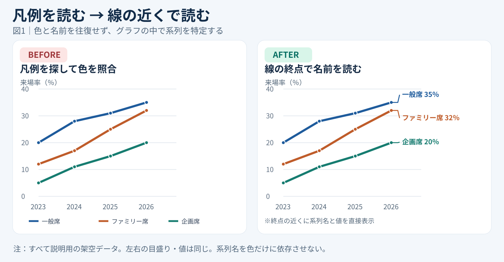
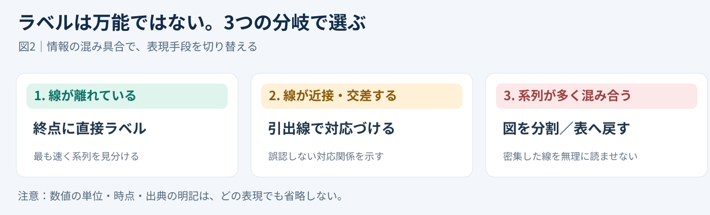

# 凡例を消して線の終点に名前を置く｜直接ラベルの60秒改善

**2026-11-03 06:00 JST｜学習ID 2026-11-03/0600｜基礎技・今日の小さな改善｜3〜5分**

## 今日の結論

**今日の技：legend（凡例）をline endpoint（線の終点）の近くに置き換えるdirect labeling（直接ラベル）。** 色を見比べるためのeye movement（視線移動）を減らし、which line is which（どの線か）をその場で読めるようにする。朝の1分でできるsmall improvementだ。

## 守｜凡例は情報だが、視線の移動も生む

**Legend（凡例）**は色や線とseries name（系列名）の対応表。下に離れていると「look at line→check legend→return to line」の往復が起きる。**Direct label（直接ラベル）**なら、線の近くに「一般席35％」と置けるため、matching work（照合の手間）が減る。

Harvard Universityのaccessibility guidance（アクセシビリティ指針）も、可能ならdataの近くにlabelを直接置く方法を紹介している。Color alone（色だけ）に依存しないため、色の見え方が異なる人にも役立つ。数値を変える技ではなく、**reading effort（読み解く負荷）を下げる**技術だ。

## Before→After｜3本の線を読む

例は「一般席・ファミリー席・企画席のattendance rate（来場率）」。2023〜2026年の数値は**すべて架空データ（illustrative only）**。実際のticket salesや来場実績ではない。左右のchartsはsame data, same scaleを使う。

**Before：**下のlegendで色を覚えてlineを探す。**After：**終点に「一般席35％」「ファミリー席32％」「企画席20％」を表示。Series nameとlast valueを同時に読める。狙いは「which series?」の迷いをなくすこと。

## 破｜PowerPointで4手順

1. **Choose the chart.**2〜4本程度のline chartで、右端にlabel spaceがあるものから試す。重要な時点が終点以外なら、そのpointに付ける。
2. **Add a label.**Windows版PowerPointでchartを選択し、［グラフのデザイン］→［グラフ要素を追加］→［データラベル］。Single data pointだけを選んで付ける方法もある。
3. **Show name and value.**［データラベルの書式設定］でseries nameとvalueを選び、必要ならdragして位置を調整。Cellsからラベルを参照する方法もある。
4. **Remove the legend.**線とlabelが一意に対応するのを確認してから凡例を削除。Zoom outしてoverlapや読みにくさがないか確かめる。

**Exception：**Endpointsが近いならleader line（引出線）、seriesが多いならsmall multiples（分割グラフ）かtable（表）へ。データ更新が多いなら手入力のtextboxよりlinked data labelを優先する。

## 離｜図を直すとは、読む動作を設計すること

Time savingは作り手だけの話ではない。読み手がすぐ理解できれば、会議中の「Which one is the blue line?」も減る。スポーツの来場率だけでなく、department salesやservice contractsにも転用できる。ただし、系列が多いのにdirect labelsを増やすとclutter（混雑）が生じる。**Goal is not removing legends; goal is reducing misreading.**

## 失敗例｜ラベルが重なって逆効果

**Failure：**Endpointsが近いのにlabelsを詰め、どの線か分からなくなる。**Fix：**Leader linesで対応づけるか、chartを分割する。Colorだけでなくlabelとunit（単位）を残す。

## 60秒課題｜既存の1枚を改善

**60-second challenge：**手元のline chartを1枚選び、legendなしでもseriesが分かる位置に名前を仮置きする。**Pass criteria：**Zoom outしてもlineとnameが1回で対応する。重なる場合は「table is better」と判断できても合格。

## 参考資料・Simple English

Sources：[SlideLand｜line graph examples](https://www.slideland.tech/en/graph/line-graph/2)／[Harvard University｜accessible data visualization](https://accessibility.huit.harvard.edu/data-viz-charts-graphs)／[Microsoft公式｜data labels](https://support.microsoft.com/en-us/office/add-or-remove-data-labels-in-a-chart)。SlideLandはvisual reference、Harvardはdirect labelingの原則、MicrosoftはWindowsを含む操作確認に使用。

**Simple English：Label the line where people look.** ／ **日本語：線を見る場所に、その線の名前を書こう。**
