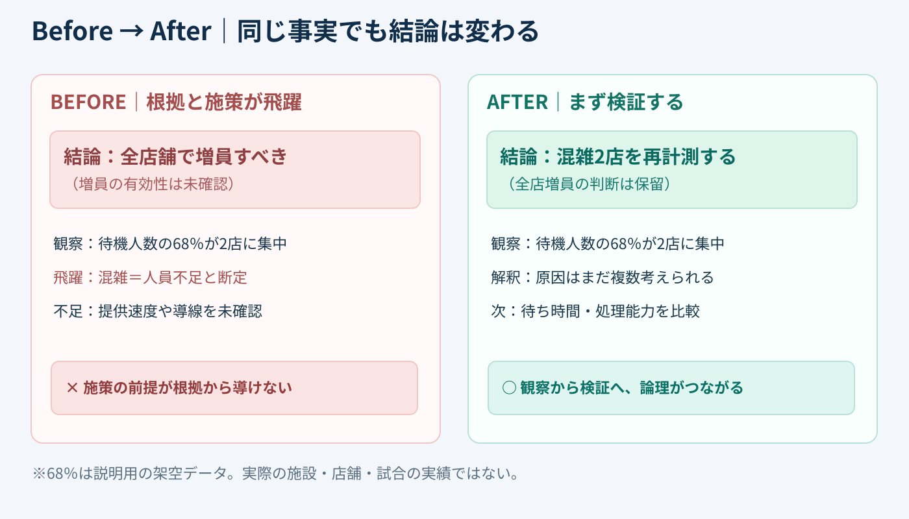
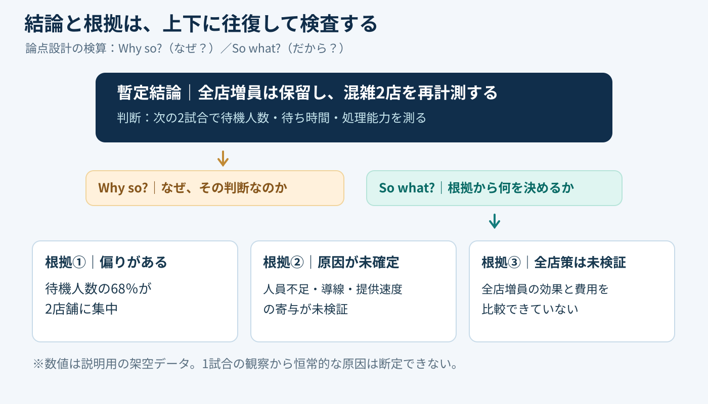

# 結論を「なぜ？」「だから？」で往復検査する｜論理の接続チェック

**2026-11-03 09:00 JST｜学習ID 2026-11-03/0900｜構想・論理｜3〜5分**

## 今日の結論

**今日の技：結論からWhy so?（なぜそう言える？）、根拠からSo what?（だから何を決める？）を往復する。** Visual designに入る前にこのtwo-way check（双方向検算）をすると、「そのdataからそのactionは言えない」という手戻りを減らせる。

## 守｜主張と根拠は、上下に論理でつなぐ

バーバラ・ミントの**Pyramid Principle（ピラミッド原則）**は、single point（一つの主張）を頂点に置き、supporting ideas（根拠となる考え）を下に整理する方法。接続を検算する二つの問いは、**Why so?（なぜ？）**で結論から根拠へ、**So what?（だから？）**で根拠から判断へ戻る。

例えば「売店のqueueが長い」だけでは「全店staffを増やす」とは言えない。原因はorder flow（注文導線）、service speed（提供速度）、peak concentration（時間帯の偏り）かもしれない。**Observationとactionの間にhidden leap（隠れた飛躍）がないか**を調べる。

## Before→After｜スタジアム売店の提案を直す

以下は**すべて架空データ（illustrative only）**。ある1試合のpeak timeに観察した待機人数の68％が2店舗に集中したと仮定する。これだけで「increase staff at every shop（全店増員）」と結論づけるのはlogical leap（論理の飛躍）だ。

**Before：**「Long queues→increase all staff」。**After：**「混雑が一部に集中→全店増員はholdし、次の2試合で2店舗のqueue size・waiting time・throughput（処理能力）を測る」。**Match the strength of your claim to the strength of your evidence.** 根拠に見合う判断へ修正する。

## 破｜4ステップで論理を検算する

1. **Write a provisional answer.**「全店増員はholdし、混雑2店の追加計測を優先」と、decisionが分かる一文にする。
2. **Go down with Why so?**理由を列挙する。「混雑は2店に集中」「root cause（原因）は未確定」「全店増員のcost-effectivenessは未検証」。同義の言い換えは別の根拠と数えない。
3. **Go up with So what?**それぞれの理由から「追加計測を優先」が本当に導けるかcheckする。無理ならclaimを弱めるかmissing dataを明らかにする。
4. **Read only the headlines.**問い→provisional answer→evidence→next decisionがつながるか通読する。PowerPointの［表示］→［アウトライン］はtitleとbody textの見直しに使える。

**Alternative：**Evidenceが不足しているなら、断定的なaction titleではなく「混雑原因の特定が先決（暫定）」とする。ピラミッド図を描かず、text hierarchy（文章の階層）だけで検算してもよい。

## 離｜資料の速さは、図を描く前に決まる

このcheckはTAM（市場規模）、sports video serviceの導入判断、スポンサー施策のeffect reviewにも使える。「Large market（市場が大きい）」から「We can win（自社が勝てる）」へ飛ぶなら、customer acquisition・pricing・competition・executionの根拠が抜けている。**Find a small logic gap before drawing a large diagram.**

SlideLandのpyramid examplesは、hierarchy（階層）の見せ方の参考になる。ただし、**A pyramid-shaped graphic is not necessarily a logical pyramid.** まず文章でclaimとevidenceをつなぎ、後からlayoutを選ぶ。

## 失敗例｜相関や一度の観察を原因と決めつける

**Failure：**「待機人数の68％が2店に集中→staff shortage（人員不足）が原因」と断定する。これはhypothesisをfactに変えてしまう。**Fix：**「concentration（集中）」はobservation、「人員不足」はhypothesisと分け、throughput・order flow・other matchesで再現性を調べる。

## 60秒課題｜結論の飛躍を1つ見つける

**60-second challenge：**「Video views are down. So we should post more.」をWhy so?とSo what?で検算する。**Answer example：**「Views低下のroot causeが不明。投稿本数を増やす前にimpressions・CTR（クリック率）・retention（視聴維持率）を比較する」。**Pass criteria：**observation・unknown cause・next decisionを区別できること。

## 参考資料・Simple English

Sources：[Barbara Minto公式｜Pyramid Principle](https://www.barbaraminto.com/)／[SlideLand｜pyramid examples](https://www.slideland.tech/docs/schematic/pyramid)／[Microsoft公式｜PowerPoint outline view](https://support.microsoft.com/ja-jp/powerpoint/create-and-print-a-presentation-in-outline-view)。Minto公式はsingle pointとsupporting ideas、SlideLandはvisual reference、Microsoftはoutline操作の確認に使用した。

**Simple English：Ask why, then ask what follows.** ／ **日本語：なぜそう言えるかを問い、その根拠から何が言えるかを確かめよう。**
