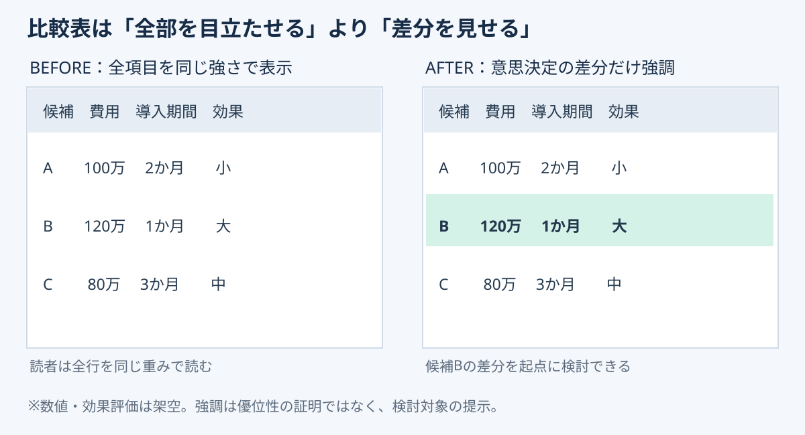

# 比較表は「差分だけ」を強調する｜判断を速くする表の設計

**2026-11-03 12:00 JST｜学習ID 2026-11-03/1200｜レイアウト・図解｜3〜5分**

## 今日の結論

**A comparison table should guide attention, not color everything.** 表では判断に効く差分を1か所だけhighlightすると、読み手が比較点を探す時間を減らせる。

## 守｜比較表の目的は一覧ではなく差分の発見

3候補の費用・導入期間・期待効果を比べるとき、全セルを強調するとvisual hierarchy（視覚的な優先順位）が消える。Highlightは結論の代わりではなく、comparisonの入口だ。見出しには「候補Bは費用が高いが、短期導入と高い期待効果が特徴（仮説）」と書く。

## Before→After｜強調するのは一つの差分

以下は説明用の架空データ。Aは100万円・2か月・効果小、Bは120万円・1か月・効果大、Cは80万円・3か月・効果中。Bの行だけを淡色でhighlightする。**Costを隠さず、導入期間とexpected impactの差を同時に見せる**ことが大事だ。

*図：Beforeは全行が同じ重み、Afterは検討対象Bだけを淡色で示す。色は優劣の証明ではない。*

## 破｜4ステップで作る

1. **問いを決める。** 「どの候補をpilot test（小規模実証）するか」とdecisionを一文にする。
2. **比較条件をそろえる。** Costの範囲、期間の起点、効果の評価基準を明記する。
3. **差分を選ぶ。** 判断に関係する1行か1列だけをsoft highlightする。
4. **PowerPointで実装する。** Windows版ではセルを選択し、［テーブルデザイン］の［網かけ］でshadingを設定。モノクロでも識別できるよう太字やlabelも使う。

## 離｜表より適切な図もある

数値を正確に比べるならtable、費用と効果の関係ならscatter plot（散布図）、時間変化ならline chart（折れ線）、手順ならflow（流れ図）。表を描く前に、読者が見るのはvalue・relationship・sequenceのどれかを決める。

## 失敗例と60秒課題

失敗はrecommended optionを先に色付けし、都合のよい項目だけを並べること。Exclusion criteria（除外条件）と評価基準を先に固定し、未検証の期待効果は「仮説」と書く。

**60秒課題：** 既存の比較表で重要な1行を選び、残りの色を薄くする。表題を「比較表」からdecisionを示す一文に直す。**合格基準：** highlightの理由を説明でき、他候補の情報を隠していないこと。

## 参考資料とSimple English

- [Microsoft公式｜表の外観を変更する](https://support.microsoft.com/ja-jp/powerpoint/change-the-look-of-a-table)
- [Microsoft公式｜表の網かけ](https://support.microsoft.com/en-au/office/add-or-remove-shading-in-a-table)
- [SlideLand｜公開スライドの図解研究](https://www.slideland.tech/)

**Simple English:** Highlight the difference, not everything. **日本語：** 全部ではなく、判断に必要な違いを強調しよう。
