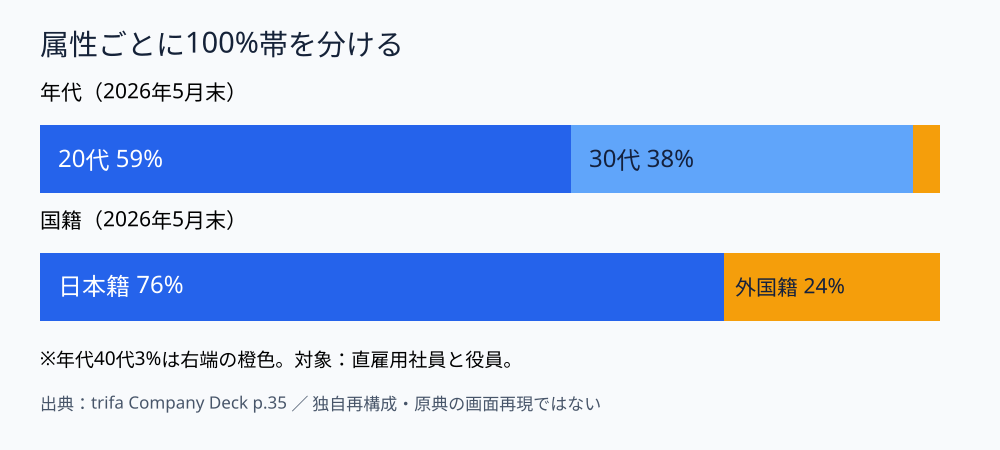

# トリファの人員構成ページを解剖する｜属性を混ぜない100%帯

**2026-11-03 18:00 JST｜学習ID 2026-11-03/1800｜名作スライド解剖｜3〜5分**

## 今日の結論

**Proportionsは、属性を混ぜず、same scaleで並べる。** 年代と国籍の比率を別々の100%帯にすると、組織の特徴が短時間で伝わる。

## 守｜実在の資料と原理

株式会社トリファの公開資料「trifa Company Deck」（2026年6月9日版）35ページ「Team Member」は、若年層を中心とした組織と外国籍メンバーの採用について説明する。2026年5月末時点の年代は20代59%、30代38%、40代3%。国籍は日本籍76%、外国籍24%。対象は直雇用社員・役員。SlideLandにも同資料が階層・レイヤーの参考事例として掲載されている。ただし、SlideLandがこの35ページを階層図として分類したとは確認できない。

**ページの目的**は組織の特徴の紹介。**主張**は若手中心で国際性も持つ組織であること。**構造**は男女比・年代比・国籍の並列表示。**視覚的工夫**として重要なのは属性を混同させないこと。公開テキストで数値は確認できるが、ここで示す図の配色や配置が原典と同じだとは主張しない。

## 破｜再現する4ステップ

1. **Define the question。** 採用候補者に組織の特徴を伝えるのか、経営層に採用の偏りを示すのかで指標を選ぶ。
2. **Fix the denominator and date。** 直雇用社員・役員など対象を脚注に明記する。
3. **Separate the attributes。** 年代と国籍を別々の100%帯にして、幅を割合に比例させる。
4. **Label small segments outside。** 3%の区分は内部に文字を詰めず、外側の注釈にする。人数の規模が重要なら実数付きの表を併用する。

## Before→After｜羅列から比較へ

**Before：**「20代59%、30代38%、40代3%、日本籍76%、外国籍24%」を箇条書き。属性が混ざり、大小関係を読むのに時間がかかる。**After：**図1のように年代と国籍を別々の同幅帯へ。読み手は属性ごとの構成比を比較できる。原典のスクリーンショットは転載せず、独自の模式図で再現した。

## 離｜スポーツ領域に転用

来場者を「年代」「居住地」「来場回数」の3つの100%帯で表すと、客層を簡潔に説明できる。ただし、年代別割合と居住地別割合だけでは「若年層かつ県外」の割合は分からない。掛け合わせの議論にはクロス集計が必要だ。

## 失敗例と限界

**失敗：**帯の長さを属性ごとに変えて、割合を誤認させる。**回避：**100%帯の全長をそろえ、数字と分母を必ず記載する。資料の目的が採用判断なら、構成比だけでは不十分で、必要人材・応募者・採用実績との比較も必要になる。

## 60秒課題

架空の観客データ「初回来場20%、再来場80%／県内65%、県外35%」を紙に2本の100%帯で描く。**合格基準：**帯の全長が同じ、各帯の合計が100%、属性を混ぜない。

## 参考資料・Simple English

[SlideLand｜階層・レイヤー](https://www.slideland.tech/docs/schematic/layer)／[trifa Company Deck・35ページ](https://speakerdeck.com/trifa2024/trifa-company-deck-faaff7d7-7bc3-44a2-958e-1c288428a866)／[Microsoft PowerPoint公式サポート](https://support.microsoft.com/ja-jp/powerpoint)。

**Simple English: Compare proportions on the same scale.** ／ **日本語：構成比はsame scaleで比較しよう。**

