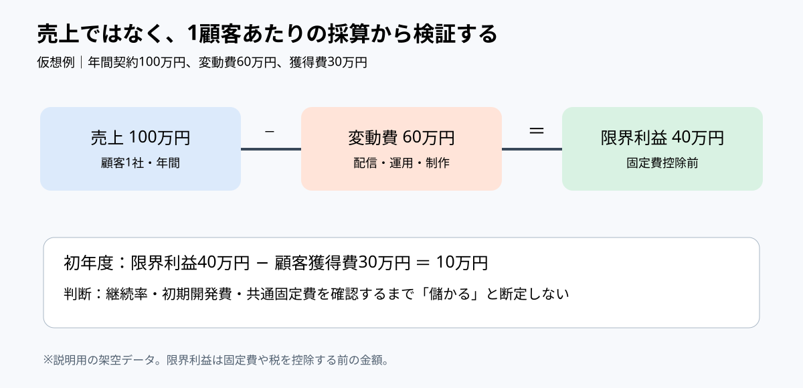

# 市場規模より先に採算の分岐を描く｜スポーツ映像サービスの単位経済

**2026-11-03 21:00 JST｜学習ID 2026-11-03/2100｜コンサル実務応用｜3〜5分**

## 今日の結論

**Today's technique：** TAM（市場全体の規模）より先にunit economics（顧客単位の採算）を図にする。A big marketとprofitable growthは別問題。経営層にはwhat to validate before scaling（拡大前の検証条件）を示す。

## 守｜市場規模と単位経済を混同しない

**Unit economics（単位経済）**は1 customer・1 contractごとの売上と費用を見る考え方。**Contribution margin（限界利益）**はrevenueからvariable costを引いた額で、fixed costsやtax控除後のprofitとは異なる。映像サービスではcamera setup・processing・supportのうち契約に応じて増える費用を分ける。

**図の読み方：**売上100万円から変動費60万円を引き、限界利益40万円を求める。さらに初年度獲得費30万円を別段で引く。固定費は未控除。

## 破｜4手順で採算の判断図を作る

1. **Define the unit.**「1クラブ・年間1契約」。Monthlyとannualを混ぜない。
2. **Map revenue and variable cost.** 仮想例：annual revenue 100万円、delivery・production・operations 60万円。Contribution marginは40万円。
3. **Separate acquisition cost.** First-year customer acquisition costが30万円なら、40−30＝10万円。ただしbefore fixed costs。
4. **Set decision gates.** Retention、development、shared overhead、equipment renewalを確認してからscaleする。Costsが段階的に増えるならscenario analysisを使う。

## Before→After｜スポーツ映像サービスの事業機会

**Before：**「スポーツ市場は大きく、video analyticsに成長余地がある」。Market size aloneでは採算を説明できない。**After：**「仮想1社でrevenue 100万円−variable cost 60万円＝contribution margin 40万円。Acquisition cost 30万円を引くと10万円。Retentionとoverheadがnext validation」。Headlineは**「拡販前にunit economicsとretentionを検証する」**。PPT layoutはtop 20% headline、middle 55% three boxes、bottom 25% acquisition costとdecision gates。

## 離｜売り方が変わると費用の形も変わる

Annual SaaS contractとevent-by-event productionではcost structureが異なる。前者はretentionとonboarding、後者はproduction hoursとutilizationが重要。AI processing costが下がってもcustom operationsが増えればmarginは改善しない。**Automation rateよりincremental variable costを見る**。

## 失敗例｜粗利と利益を混同する

**Failure：**contribution margin 40万円を「profit 40万円」と表現。Developmentやoverheadを見落とす。**Fix：**「before fixed costs」「illustrative data」を図に明記し、break-even contractsは別に計算する。

## 60秒課題｜初年度の貢献額を計算する

**60-second challenge：**Revenue 120万円、variable cost 75万円、acquisition cost 35万円。初年度のmargin after acquisition costは？ **Answer：10万円。** 120−75−35を計算し、net profitと呼ばないこと。

## 参考資料・Simple English

Sources：[SlideLand｜図解分類](https://www.slideland.tech/)／[Microsoft｜PowerPoint charts](https://support.microsoft.com/en-us/powerpoint/training/use-charts-and-graphs-in-your-presentation)。PowerPointのInsert→Chartを利用し、frequently updated dataならExcel linkを検討する。All figures are illustrative, not real company results.

**Simple English：A big market does not guarantee good unit economics.** ／ **日本語：市場が大きくても、顧客単位の採算が良いとは限らない。**