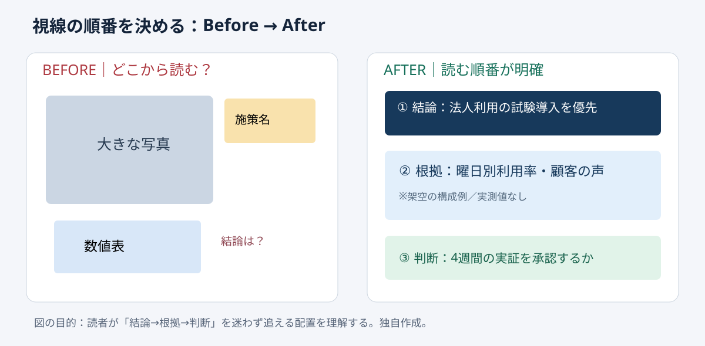

# 視線の順番を先に決める｜3点読み順テスト

**2026-11-04 06:00 JST｜学習ID 2026-11-04/0600｜基礎技・今日の小さな改善｜3〜5分**
## 今日の結論

**Decorationの前にreading path（読む順番）を「結論→根拠→判断」の3点に決める。** Same informationでもfirst glance（最初の視点）が明確なら、説明とrevision（修正）の手戻りを減らしやすい。

## 守｜読み順はレイアウトの前提

**Visual hierarchy（視覚的階層）**とは、size・position・spacing・contrastで読む順番を示すこと。Importance（重要度）と目立ち方が逆なら、読者は情報を探し回る。今回は①claim（結論）、②evidence（根拠）、③decision（判断）の3点。Universal eye-tracking lawではなく、意思決定資料を点検するpractical ruleである。

## Before→After｜スポーツ施設の改善提案

架空のスポーツ施設でweekday attendance（平日集客）の施策を説明する。**Before**は大きなphoto、左下の売上表、右上の施策名が競合し、main messageが見えない。**After**は上部に「平日は法人利用の試験導入を優先」、中央に曜日別利用率と企業ヒアリングの要点、下部に「4週間のpilot（小規模実証）を承認するか」を置く。Actual measured dataは使っていないため、実在の効果を主張しない。

## 破｜4ステップで制作する

1. **Sketch three boxes.**紙に「結論／根拠／判断」を先に書き、decorationは後回し。
2. **Choose the first glance.**上部をaction title（結論型見出し）にする。「平日施策」ではなく「法人利用の試験導入を優先」。
3. **Group the evidence.**数値・比較・観察を中央にまとめ、競合する大きなdecorationsを減らす。
4. **End with a decision.**下部に「何を承認するか」「何を検証するか」を記す。PowerPointでは［表示］→［ガイド］でalignment（配置軸）を確認できる。

## 例外と別解｜読む順番は固定の型ではない

Timelineならleft-to-right flow、2案の選択ならside-by-side comparisonが自然な場合もある。それでもfirst→nextの理解順を先に決める。写真がevidenceとなる事故現場や製品紹介では、photo-firstでもよい。大きさをhabit（習慣）で決めない。

## 離｜会議の時間も設計する

Reading pathは見た目だけでなくmeeting flowも変える。Evidenceよりproposalが先に目立つと、議論が賛否から始まりやすい。Decision questionを定め、必要なevidenceだけを置けば、資料はinformation storageからdecision toolへ変わる。営業・採用・自治体施策にも使える。

## 失敗例｜矢印を増やして読み順を説明する

**Failure：**読みにくさをarrowsの追加で補う。**Fix：**まずposition・font size・spacingを調整。矢印はcause-and-effectやprocessなど、関係そのものを示すときに使う。

## 60秒課題｜今ある1枚を診断

手元のslideで①first glance、②evidence、③decisionを声に出す。**Pass criteria：**迷わず指せて、主張と無関係な大きな要素がない。迷ったらdecorationsを足さず、title・position・spacingを一つ変える。

## 参考資料・Simple English

参考：[SlideLand｜公開スライドの構成事例](https://www.slideland.tech/)／[Microsoft公式｜ガイドとスマートガイド](https://support.microsoft.com/en-us/powerpoint/training/guides-for-arranging-things-on-a-slide)／[Microsoft公式｜整列と均等配置](https://support.microsoft.com/en-us/office/graphics-visuals/align-or-arrange-objects)。SlideLandはcomposition examples、MicrosoftはWindows版を含むguidesとalignmentの操作確認に使用した。

**Simple English: Design the reading path before the slide.** ／ **日本語：スライドを飾る前に、読む順番を設計しよう。**
