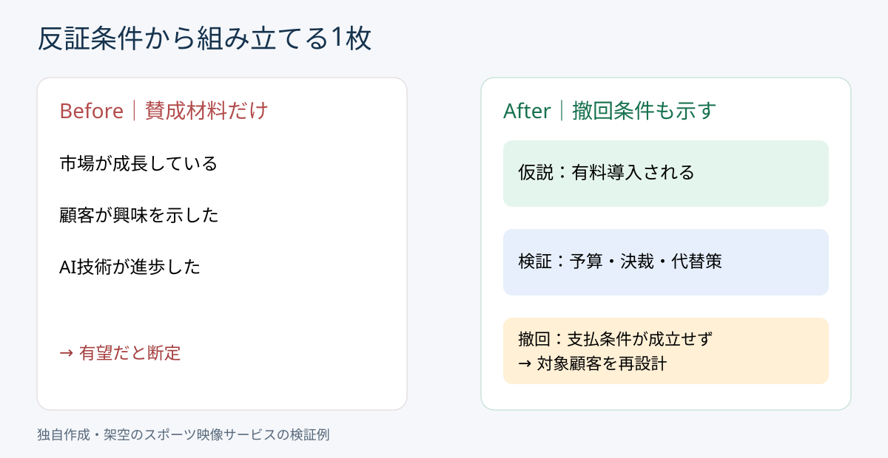

# 仮説を反証条件から設計する｜結論を守る資料から検証する資料へ

**2026-11-04 09:00 JST｜学習ID 2026-11-04/0900｜構想・論理｜3〜5分**

## 今日の結論

**Decide what would change your mind（何が分かったら仮説を撤回するか）を、調査前に決める。** 支持材料を無制限に探すより、検証の優先順位と資料の完成条件が明確になる。

## 守｜仮説と反証条件を区別する

Hypothesis（仮説）は、まだ確かめていない暫定的な説明。Falsification criteria（反証条件）は、観察された場合に仮説を修正・棄却する判断基準。「スポーツクラブ向けAI動画編集サービスは売れる」という仮説に対し、「興味がある」という声だけでは不十分。予算、決裁者、現行の代替手段、有料導入の意思を確かめる。これは科学的な厳密な反証実験ではなく、実務上の仮説検証の設計である。

## Before→After｜事業機会を1枚で説明

**Before（改善前）：**「市場成長」「AI技術進歩」「顧客の関心」を並べて「新サービスは有望」と結論付ける。**After（改善後）：**上部に「有償導入は未検証。予算と決裁の確認を先行する」。中央に仮説と検証項目、下部に棄却・修正条件を置く。調査前に需要が証明されたとは書かない。

## 破｜4ステップで調査とスライドをつなぐ

1. **Narrow the decision（判断の問いを絞る）。**「開発するか」ではなく「有償実証に進むか」。
2. **仮説を一文にする。**「対象クラブに有償外注需要がある」と暫定的に置く。
3. **撤回条件を事前に書く。**「予算と決裁経路が確認できなければ対象顧客か提供価値を見直す」。成功基準を結果に合わせて変更しない。
4. **Choose the smallest test（最小の検証を選ぶ）。**現行制作費、予算、決裁者、代替手段を聞く。PowerPointでは上段に仮説、中央に検証、下段に判断条件を置く。

## 例外と別解｜二択にできない場合

顧客課題自体が未発見なら、仮説を無理に確定せず現場観察から始める。反証されなかったことは仮説が証明されたことを意味しない。調査対象の偏りや質問方法も点検する。

## 離｜資料作成の遅さは調査の終了条件に潜む

スライドを作りながら調査を増やし続けると終わらない。反証条件は「どの情報を集めれば判断できるか」というstop rule（停止条件）にもなる。スポンサー提案なら関心だけでなく予算・決裁・運用負荷、採用施策なら応募数だけでなく採用単価・定着を検証する。

## 失敗例｜結果を見てから成功条件を変える

**Pitfall（失敗）：**ヒアリング後、好意的な回答だけを「成功」と数える。**Fix（回避）：**対象、質問、判断条件を調査前に記録する。小規模ヒアリングを統計的な市場証明と混同しない。

## 60秒課題｜撤回条件を1つ書く

「AIハイライト制作サービスは売れる」を①仮説②必要な証拠③修正条件に分ける。**解答例：**①一定のクラブが有料導入する、②現行費用・予算・決裁者・有償実証意向、③予算と決裁の障壁が解消できなければ対象顧客・提供方式を見直す。③が実際の調査行動につながれば合格。

## 参考資料・Simple English

参考：[SlideLand｜ピラミッド図解](https://www.slideland.tech/docs/schematic/pyramid)／[StrategyU｜ピラミッド原則と仮説思考](https://learn.strategyu.co/)／[StrategyU｜論点ツリーとMECE](https://strategyu.co/case-interview-frameworks/)。図は独自作成であり、公開作例の転載ではない。

**Simple English: Decide what would change your mind.** ／ **日本語：何が分かれば考えを変えるか、先に決めよう。**