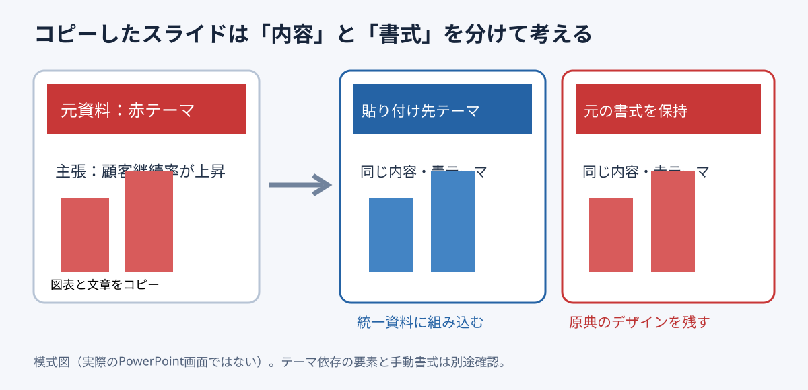

# スライド流用は貼り付け時のテーマ選択で手戻りを防ぐ

**2026-11-04 15:00 JST｜学習ID 2026-11-04/1500｜PowerPoint実装・時短｜3〜5分**

## 今日の結論

**Reuse content, choose the theme first（内容を流用するならテーマを先に決める）。** 別資料のスライドを貼るとき、Use Destination Theme（貼り付け先のテーマを使用）かKeep Source Formatting（元の書式を保持）かを先に選ぶ。後から色とフォントを直す手戻りを減らせる。

## 守｜テーマと書式は別物

Theme（テーマ）は色・フォントなどのdesign system（デザイン体系）。貼り付け先に合わせるか、source formatting（元の書式）を維持するか選択できる。ただし手動設定した図形の色や文字まで必ず変わるわけではない。貼り付け後のvisual check（目視確認）が必要だ。

## Before→After｜流用後の見た目を設計する

Before：赤い営業資料の1枚を青い経営会議資料へそのまま貼り、色と文字が浮く。After：Use Destination Themeを選び、強調色・見出し・凡例を点検する。ブランド表現を原形で残す場合はKeep Source Formattingを選ぶ。

## 図解｜選択の分岐

*図：同じcontent（内容）でもtheme（テーマ）の選択で見た目が変わる。PowerPointの実画面ではなく独自模式図。*

## 破｜Windows版PowerPointで4ステップ

1. **Decide the purpose（目的を決める）。** 自社資料へ統合するなら貼り付け先テーマ、原典として示すなら元書式保持を候補にする。
2. **Copy the slide（スライドをコピー）。** 元資料のサムネイルを選びCtrl+C、貼り付け先でCtrl+V。
3. **Choose Paste Options（貼り付け方式を選択）。** Use Destination ThemeまたはKeep Source Formattingを選ぶ。Microsoft公式が両方を説明している。
4. **Check manual formatting（手動書式を点検）。** 見出し・色・フォント・グラフ・ロゴ・配置を確認。崩れたら元書式保持で再挿入し、必要部分だけ修正する。

## 離｜流用はデザイン移植ではなく意味の移植

Reuse is not just design transfer（流用はデザインの移植だけではない）。元ページのlogic（論理）が新しい問いに答えるかを先に確認する。公開資料の引用では出典と利用条件も確かめる。

## 失敗例｜貼り付け後に一括で色を変える

**Failure（失敗）：** 大量に貼ってからtheme mismatch（テーマ不一致）に気づく。**Fix（回避）：** 最初の1枚で両方式を試し、見出し・図表・ロゴを確認してから残りを移す。

## 60秒課題｜どちらを選ぶ？

ケースA：社内の分析図を新テンプレートへ移す。ケースB：提携企業の公式スライドを原形のまま示す。**Answer（判断例）：** AはUse Destination Theme、BはKeep Source Formatting。ただし手動書式・権利・論理の適合性を確認する。

## 参考資料・Simple English

Microsoft公式：[スライドのコピーと貼り付け](https://support.microsoft.com/en-us/powerpoint/copy-and-paste-your-slides)／[スライドの再利用](https://support.microsoft.com/en-us/powerpoint/reuse-import-slides-from-another-presentation)。図解研究の入口：[SlideLand](https://www.slideland.tech/)。特定作例の再現ではない。

**Simple English: Reuse the content, then choose the right theme.** ／ **日本語：内容を再利用し、目的に合うテーマを選ぼう。**

