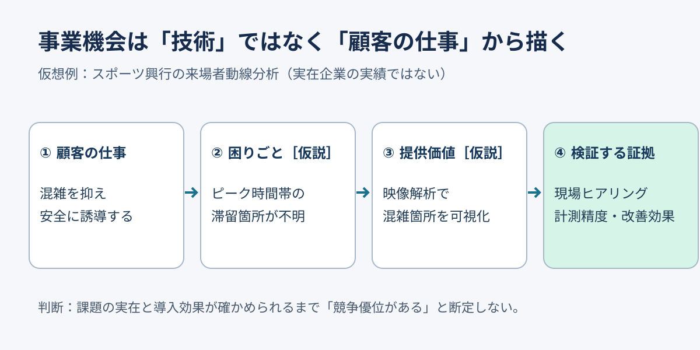

# 技術の強みを顧客課題の証拠につなぐ｜事業機会の検証マップ

**2026-11-04 21:00 JST｜学習ID 2026-11-04/2100｜コンサル実務応用｜3〜5分**

## 今日の結論

技術を列挙するより、**customer job→pain→value→evidence**を1枚につなぐ方が、投資判断のnot yet verified事項が明確になる。市場の魅力や技術の優秀さだけで、購入理由を説明しない。

## 守｜顧客の課題と自社の解決策を分ける

**価値提案キャンバス（Value Proposition Canvas）**は、顧客が達成したい仕事・困りごと・望む成果と、自社が提供する解決策を別々に整理する道具。observed customer factsと、自社の提案・推測を混ぜないことが基本。たとえば興行主の仕事は「カメラを導入する」ではなく「来場者を安全に誘導する」。困りごとがnot yet verifiedなら［仮説］と明記する。

**図が示すこと：** Technologyからbusiness opportunityへ飛躍せず、customer painとvalidationを挟む。

## 破｜4段階で判断に使えるスライドを作る

1. **顧客を1種類に絞る。** 興行主と施設運営者は意思決定者も予算も異なるため、同じ課題欄に混ぜない。
2. **仕事と困りごとを書く。** 「ピーク時の滞留を減らす」「どこで滞留するか把握できない［仮説］」のように、技術名を使わず書く。
3. **技術をvalue propositionへ翻訳する。** 「映像計測ができる」ではなく「混雑箇所を時間帯別に可視化できる可能性」。精度・導入費はnot yet verifiedとする。
4. **validation evidenceを右端に置く。** 現場担当への聞き取り、既存の混雑記録、試験計測の誤差、導入前後の誘導時間を挙げる。導入効果が測れなければ、まず現場観察を優先する。

## Before→After｜スポーツ興行の混雑解析

**Before：**「高精度カメラ、映像制作、リーグ接点を組み合わせて新事業を創出」。これはsupply-side asset listであり、顧客がなぜ支払うかを説明していない。**After：**「混雑箇所を把握しづらいという仮説が正しければ、映像解析の可視化価値をfield validationする」。PPTの上部にこの結論を置き、中央に図の4箱を左から並べ、下部に「次の検証：興行運営担当3〜5人への探索的聞き取り（調査計画例）」と記す。人数は統計的代表性を意味しない。

## 離｜技術起点の議論を購買起点へ反転する

同じ計測技術でも、施設管理者は安全、広告主は接触機会、制作会社は撮影効率を買う可能性がある。**技術は同じでもcustomer jobが変われば、スライドも分ける。** さらに利用者と支払者が違う場合、利用価値と予算承認の根拠を別の列にする。

## 失敗例｜顧客課題を想像で事実化する

**失敗：**「スタジアムは混雑データが取れていない」と断定する。既存のセンサーや運営記録がある施設も想定される。**回避：**「現状把握の方法を確認する」と書き、既存代替手段・精度・費用を聞く。

## 60秒課題｜顧客の仕事を1行にする

「AIカメラを販売する」をcustomer jobへ言い換えよう。**解答例：**「試合終了後の退場動線を安全かつ円滑に運用する」。decision criterionは、技術名が消え、顧客の成果が残っていること。

## 参考資料・Simple English

参照：[資料1](https://www.strategyzer.com/library/5-common-mistakes-to-avoid-when-using-the-value-proposition-canvas)／[資料2](https://www.strategyzer.com/library/roadmap-to-test-your-value-proposition)／[資料3](https://www.slideland.tech/docs/page/market)。SlideLandは市場環境の公開スライド分類の参照先。図は本教材の独自作成で、すべて仮想例。**Simple English: Start with the customer's job, not your technology.** ／ **日本語：技術ではなく、顧客が果たしたい仕事から考える。**