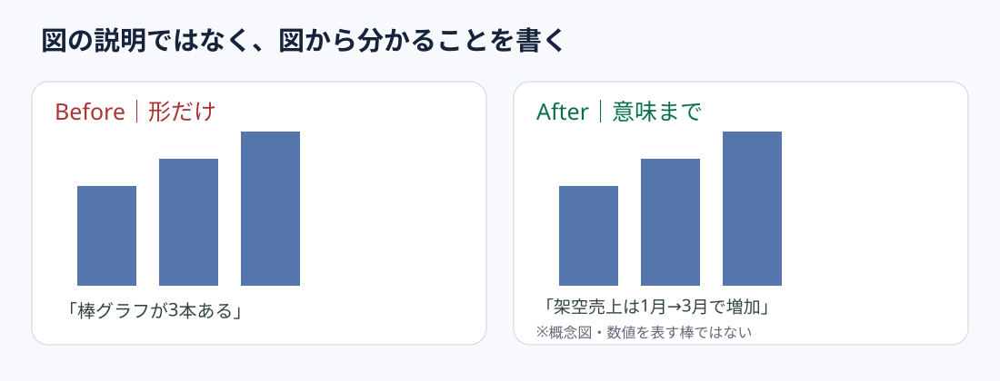

# 代替テキストは図の形より結論を書く

**2026-11-05 06:00 JST｜学習ID 2026-11-05/0600｜基礎技・今日の小さな改善｜3〜5分**

## 今日の結論

**Alt text（代替テキスト）にはvisual appearanceよりkey insight（重要な発見）を書く。** 説明できない図はslide messageとの関係が曖昧かもしれない。Accessibility（情報へのアクセスしやすさ）と図解の品質確認を同時に進める。

## 守｜代替テキストの役割

Alt textはscreen readerなどで図のmeaning（意味）を伝える文章。Microsoftはcontentとpurposeを簡潔に述べ、chartではshapeだけでなくinsightを伝えることを推奨。Complex chartでは本文やdata tableで補う。

## Before→After｜架空の売上推移

**Before：**「青い棒が3本並ぶ」。**After：**「架空の月次売上は1月から3月にかけてincrease（増加）。Causeはこの図だけでは分からない」。概念図なので金額や増加率は主張しない。

## 破｜4ステップで直す

1. 図のpurposeをcomparison・trend・composition・processから選ぶ。
2. Observable fact（観測可能な事実）を一文で書き、causalityを推測で加えない。
3. Windows版PowerPointで右クリック→［代替テキストの表示］から入力。UI labelsは版によって異なる場合がある。
4. Text-onlyでkey messageが伝わるか確認し、必要なら本文に数値・単位・sourceを置く。

## 例外と別解｜飾りは説明しない

意味を持たないdecorative lineは「装飾としてマーク」できる。Complex scatterplotではaltにmain insight、本文や表にexact numbersを置く。

## 離｜図を言語化すると分析の飛躍が見える

来場者数のtrendに「イベント効果」と書きたくても、before-after comparisonだけならcausal proofはない。「イベント後に増加、増分の原因は未検証」と書けばfactとhypothesisの境界を点検できる。

## 失敗例｜結論を盛りすぎる

**Failure：**図にないcauseやforecastを書く。**Fix：**observed changeとhypothesisを分離し、追加検証は本文へ。

## 60秒課題｜手元のグラフを一文に

手元のchartで「何が／いつ・どこと比べて／どう違う」を20〜40字にする。**Pass criteria：**chart typeの説明だけで終わらず、units・comparison・claimが整合する。

## 参考資料・Simple English

参考：[Microsoft公式｜効果的な代替テキスト](https://support.microsoft.com/en-gb/accessibility/office-accessibility/everything-you-need-to-know-to-write-effective-alt-text)／[Microsoft公式｜PowerPointのアクセシビリティ](https://support.microsoft.com/en-us/accessibility/powerpoint/make-your-powerpoint-presentations-accessible-to-people-with-disabilities)。

**Simple English: Describe the insight, not just the chart.** ／ **日本語：グラフの形だけでなく、そこから分かることを説明しよう。**
