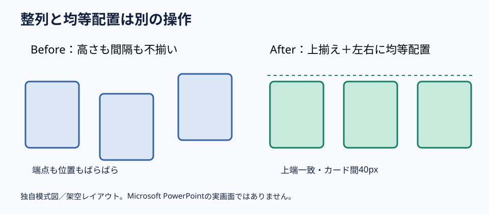

# 3つの図形は上揃えと均等配置を分けて整える

**2026-11-05 15:00 JST｜学習ID 2026-11-05/1500｜PowerPoint実装・時短｜3〜5分**

## 今日の結論

**Align first, distribute second（整列してから均等配置する）。** 端をそろえるalignmentと、間隔をそろえるdistributionを別工程にすると、目視での手戻りを減らせる。

## 守｜整列と均等配置の違い

Alignment（整列）は左端・上端・中心を同じ線に置く操作。Distribution（均等配置）は3つ以上の図形のgap（間隔）を等しくする操作。横並びの比較カードなら、上端をそろえてから左右を均等配置する。幅が違うカードではcenter spacingと実際の余白が一致するとは限らない。

## Before→After｜比較カード3枚

Before：事業A・B・Cのcards（カード）を目視で置き、上端と間隔がばらつく。After：幅・高さを統一し、Align Top（上揃え）とDistribute Horizontally（左右均等配置）を実行する。同格の比較であることが伝わる。

## 図解｜2つの操作を順番に使う

*図：整列は上端、均等配置は隣接する図形間の余白をそろえる。数値は架空のレイアウト例。*

## 破｜Windows版PowerPointで4ステップ

1. **Select（選択）。** Ctrlを押しながら3枚のカードをクリックする。
2. **Set reference（基準設定）。** ［図形の書式］→［配置］→［整列］でAlign Selected Objects（選択したオブジェクトを揃える）を選ぶ。Align to Slide（スライドに揃える）に注意。
3. **Align Top（上揃え）。** 上端を同じ線に置く。
4. **Distribute Horizontally（左右均等配置）。** 左右の端点を先に決め、3つを選んで均等配置する。表示名は製品版で異なることがある。

## 離｜見た目の整列は意味の整列でもある

Visual equality should reflect logical equality（見た目の同格は意味の同格を反映する）。同格の比較なら同じ幅・高さ・余白を使う。主案と補助案なら、あえて主案を大きくしてもよい。意味を先に決めてから操作を選ぶ。

## 失敗例｜スライド全体を基準にしてしまう

Failure（失敗）：Align to Slideのまま左揃えを実行し、カードが左端に集まる。Fix（回避）：Align Selected Objectsを確認し、両端の位置を決めてから均等配置する。

## 60秒課題｜3枚を30秒で整える

60-second drill（60秒課題）：同じ幅の長方形3つを横並びにし、上端をずらす。30秒で上揃え、30秒で均等配置。判定は①上端一致②余白一致③スライド全体の左右余白も自然、の3点。

## 参考資料・Simple English

Microsoft公式：[オブジェクトを整列または配置する](https://support.microsoft.com/ja-jp/office/graphics-visuals/align-or-arrange-objects)。図解研究の入口：[SlideLand](https://www.slideland.tech/)。本稿の図は独自模式図であり、特定作例を再現したものではない。

**Simple English: Align the edges, then distribute the gaps.** ／ **日本語：端をそろえてから、間隔を均等にしよう。**

