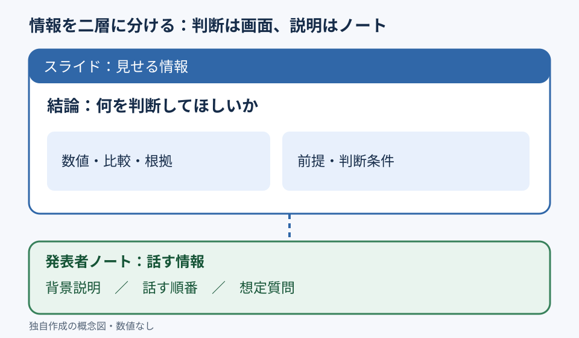

# 説明をノートへ逃がし、スライドは判断に集中させる

**2026-11-06 06:00 JST｜学習ID 2026-11-06/0600｜基礎技・今日の小さな改善｜3〜5分**
## 今日の結論

**Slideはdecision（判断）に必要な情報、speaker notes（発表者ノート）はsupporting explanation（補足説明）に分ける。** 数字や条件を消すのではなく、画面には判断材料を残す。話す順番や補足をnotesへ移すことで読みやすさと修正のしやすさを両立する。

## 守｜情報を二層に分ける

Speaker notesは発表者用メモ。Microsoft公式では［表示］→［ノート］から開ける。Slideにはclaim（結論）、key numbers、comparison、decision conditionsを残す。Notesにはtalking points、背景、想定質問。配布資料なら重要な定義やsourceをnotesだけに置かない。

## Before→After｜架空の来場者調査

**Before：**架空の200人調査について説明文を本文に詰める。**After：**画面には「初回来場者の再来場意向は検証余地がある」と数値欄・対象欄、notesには調査設計と話す順番を置く。200人はillustrative example（架空例）で、実測値はない。

## 図解｜画面とノートの役割

この図は、情報を削除するのではなく、**判断に必要な情報を画面へ、発話を助ける情報をノートへ**振り分けることを示す。

## 破｜4ステップで分ける

1. One-sentence claim（結論）と必要なdecisionを決める。
2. Numbers、comparison axes、definitions、sourcesをslideに残す。
3. Talking order、background、anticipated questionsをnotesに移す。
4. Windows版PowerPointで［表示］→［ノート］を開き、slideだけでも誤読しないかcheckする。

## 例外と別解｜配布資料は自己完結させる

事前配布資料ではnotesにしかない重要情報が見落とされる。Essential assumptionsは短い注釈としてslideへ、詳細はappendix（付録）へ。Notesは情報を隠す場所ではなくoral explanationの設計場所。

## 離｜質疑応答の準備も設計できる

スポーツ事業のTAM（市場規模）なら、slideにformula、assumptions、estimateを置く。Notesには「なぜこのadoption rateか」「sensitivity analysisは？」という想定質問を置く。二層化はweak pointsの発見にもつながる。

## 失敗例｜重要な前提までノートに移す

**Failure：**adoption rateや市場定義をnotesに隠して推計額だけ強調。**Fix：**結論を左右するassumptionsはslideに残す。

## 60秒課題｜文章を二層に仕分ける

「対象施設500件、導入率10%、年間単価100万円、要検証」をslideとnotesへ仕分ける。**Pass criteria：**slideに「500件×10%×100万円＝5,000万円（仮定）」と未検証の注記、notesにvalidation plan。すべて架空の数字。

## 参考資料・Simple English

参考：[Microsoft公式｜PowerPointの基本操作](https://support.microsoft.com/en-us/powerpoint/basic-tasks-for-creating-a-powerpoint-presentation)／[Microsoft公式｜発表者ノートとコメント](https://support.microsoft.com/en-us/accessibility/powerpoint/use-a-screen-reader-to-read-or-add-speaker-notes-and-comments-in-powerpoint)／[SlideLand｜図解・資料の公開事例](https://www.slideland.tech/)。

**Simple English: Show the decision, keep the explanation in notes.** ／ **日本語：判断材料は見せ、説明はノートに置こう。**
