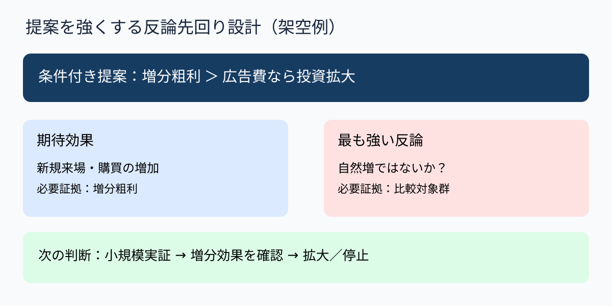

# 反論を先に置くと提案の筋が強くなる｜反証先回り設計

**2026-11-06 09:00 JST｜学習ID 2026-11-06/0900｜構想・論理｜3〜5分**

## 今日の結論

**経営層への提案は、賛成理由だけを並べるより、最も強い反論（strongest objection）を先に特定すると構成の手戻りが減る。** 反論をつぶすのではなく、判断を左右する条件を明示する。

## 守｜反論は提案の敵ではなく品質検査

反論先回り設計（objection-first design）とは、結論への異議を想定し、反論が成立する条件と検証可能な証拠を組み込む方法。たとえば「新規顧客が増えるから広告を増やす」に対して、「既存顧客の自然増では」「粗利が費用に見合わないのでは」という問いを先に置く。反論は思いつきではなく、意思決定の失敗要因から選ぶ。

## Before→After｜架空の集客投資

**Before：**「認知度向上→来場増→広告増額」という一方向の説明。**After：**「追加投資は増分粗利（incremental gross profit）が広告費を上回る場合に限定」とし、上部に条件付き提案（conditional proposal）、中央左に期待効果、中央右に代替説明・費用リスク、下部に小規模実証の判定基準を置く。これは架空の説明例で、実績値を示すものではない。

## 破｜4ステップで反論を設計する

1. **提案を一文にする。**「広告費を増額する」など、判断対象を動詞で明示する。
2. **反論を三方向から出す。**「本当に効果があるか」「他案より優れるか」「実行できるか」。
3. **致命的な反論を一つ選ぶ。**成立すると結論が覆るものを優先し、単なる細かな懸念と分ける。
4. **検証と条件付き結論を記す。**対照群（control group）や増分粗利（incremental gross profit）などを測る。測定不能なら断定を弱め、試験導入を提案する。例外として緊急対応では、事前検証の代わりに停止条件と監視指標を明示する。

## 離｜反論の置き場所で会議の性格が変わる

事業開発では「需要はあるが獲得単価が高い」、システム導入では「省力化できるが例外処理が増える」、人材採用では「人手不足だが教育負荷が重い」といった反論が効く。反論を最後の小さな注記に押し込むより、判断条件（decision gate）として本論に置けば、会議は賛否の応酬から検証方法の合意へ進みやすい。

## 失敗例｜反論を弱く作って勝つ

**失敗：**「多少費用がかかる」という弱い反論だけを置き、実際の問題である採算悪化を避ける。**回避：**反対する役員の立場で、予算を止める理由を具体的な数字・条件で一つ書く。

## 60秒課題｜反論を一つ選ぶ

「AI映像解析サービスを全国展開する」を提案するとき、致命的な反論を一つ挙げる。**解答例：**「撮影許諾と導入運用の負荷により、採算が合う顧客数を確保できない」。判断基準は、反論が真なら展開方針を変更する必要があるかどうか。

## 参考資料・Simple English

参考：[Microsoft公式｜アウトライン表示](https://support.microsoft.com/ja-jp/powerpoint/create-and-print-a-presentation-in-outline-view)／[Microsoft公式｜作業別表示モード](https://support.microsoft.com/en-us/powerpoint/training/choose-the-right-view-for-the-task-in-powerpoint)／[SlideLand](https://www.slideland.tech/)（図解研究の入口。特定作例を模写したものではない）。

**Simple English: Test the strongest objection first.** ／ **日本語：最も強い反論（strongest objection）から検証しよう。**

