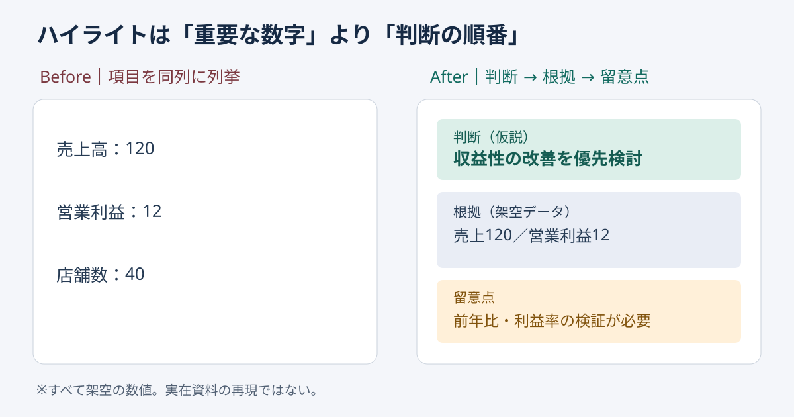

# Goldwin掲載事例から学ぶ｜ハイライトは数字の順位でなく判断の順番で並べる

**2026-11-06 18:00 JST｜学習ID 2026-11-06/1800｜名作スライド解剖｜3〜5分**

## 今日の結論

**ハイライト（要点一覧）は、not the number of metrics（指標の多さ）ではなく、decision order（読み手が判断する順序）で設計する。** 経営層向けには「何を判断するか→どの数字が支えるか→何が未確認か」の三段にすると、説明の往復と修正を減らせる。

## 守｜公開事例の確認範囲

SlideLandの「ハイライト・サマリー」分類には**Goldwin Integrated Report 2025**が掲載され、統合報告書・ハイライト・ブラックなどの分類タグが確認できる。これは**verified listing（掲載の事実）**であり、原典の個別ページにある文字・数値・具体的配置を検証したことを意味しない。以下の解剖は、この分類を入口にした**original design analysis（独自の設計分析）**である。

**ページの目的**はscan the big picture（全体像を短時間で把握）させること。**主張**は読者に残す一つの判断。**構造**は判断→根拠→留意点。**視覚的工夫**は三段の強弱をつけること。**作り方**は先に結論を決め、数字を後から選ぶこと。**転用条件**は根拠の定義がそろっていること。**限界**は詳細な因果や監査情報を一枚に収められないこと。これらは掲載資料の実際のページを描写したものではない。

## 図解｜数字の羅列を判断の階層に変える

*図：左は数字を並列表示、右は意思決定に沿った三段構造。数値はすべて架空。何を理解させるか：視線の順序と意思決定の順序を一致させる。*

## 破｜制作する4ステップ

1. **decision question（読み手の問い）を一つ決める。** 「成長したか」ではなく「次期は拡大投資か、利益改善か」のように選択肢を置く。
2. **答えを暫定的に書く。** 「収益性の改善を優先検討」など、検証前なら仮説と明記する。
3. **数字を最大二〜三点選ぶ。** same period and unit（同じ期間・単位）の根拠を置き、売上・利益・店舗数を無条件に同列にしない。
4. **open questions（未確認条件）を下段に置く。** 前年比や利益率が不足していれば「要検証」と示す。結論を断定するには追加資料が必要。

**別解：**事実を網羅することが目的なら一覧表、時間変化を示すなら折れ線、事業別の寄与を示すなら構成比図を選ぶ。ハイライトは詳細分析の代用品ではない。

## Before→After｜架空の業績説明

**Before：**「売上120、営業利益12、店舗数40」と三つの数字を同じ大きさで配置する。単位・期間も曖昧で、判断が残らない。**After：**上段に「収益性の改善を優先検討（仮説）」、中央に「売上120／営業利益12（架空の同一期間・同一通貨単位）」、下段に「前年比と利益率の検証が必要」。実務では数字の単位・対象期間を明記してから提示する。

## 離｜スポーツビジネスへの転用

ホームゲームの経営報告なら「来場者数・売上・客単価」を三つ並べる前に、経営会議の問いが**集客拡大か、収益性改善か**を確認する。同じ数値でも、the decision changes the order（意思決定によって順序が変わる）。要約スライドはinformation compression（情報の圧縮）ではなく、**判断に必要な情報を選び直す作業**である。

## 失敗例と限界

**失敗：**最大の数字を最も目立たせ、その数字が意思決定に重要だと錯覚させる。**回避：**「Would this change the decision?（この数字が変わると判断が変わるか）」を各指標に問う。変わらなければ補足へ移す。比較対象がない単年数字から改善を断定しない。

## 60秒課題

架空のスポーツ施設で「利用者1万人、売上5,000万円、稼働率70％」がある。投資判断を求められたとき、どれを最上段に置くか。**答えの基準：**数字を即決せず「投資回収の判断に必要な利益・追加投資額・需要余地が未提示」と先に明記できれば合格。指標の羅列を結論にしない。

## 参考資料・Simple English

公開分類：[SlideLand｜ハイライト・サマリー](https://www.slideland.tech/docs/page/highlight)。図解分類：[SlideLand｜カテゴリ一覧](https://www.slideland.tech/docs/category-list)。操作の確認先：[Microsoft公式PowerPointサポート](https://support.microsoft.com/ja-jp/powerpoint)。

**Simple English: Lead with the decision, then show the evidence.** ／ **日本語：判断を先に示し、次に根拠を見せよう。**
