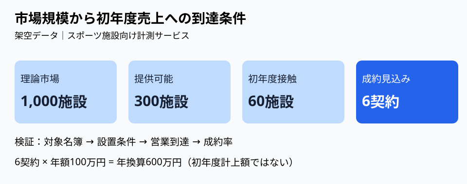

# 市場規模から初年度売上へ飛ばない｜到達可能性の三段ブリッジ

**2026-11-06 21:00 JST｜学習ID 2026-11-06/2100｜コンサル実務応用｜3〜5分**

## 今日の結論

**A big market is not a first-year forecast（大きな市場は初年度売上の予測ではない）。** TAMから売上へ飛ばず、target customers（対象顧客）→reachable customers（接触可能顧客）→won customers（成約顧客）を順に検証する。市場推計と営業計画の混同を防げる。

## 守｜TAMは売上予測ではない

TAM（総潜在市場）は理論的な市場機会。SAM（提供可能市場）はservice constraints（提供条件）に合う範囲、SOM（獲得可能市場）は競争や営業能力を考えた獲得見込み。各段階のassumptions（計算条件）を明記する。**SOMと初年度売上計画も別物だ。**

## 破｜4手順で市場から営業の橋を架ける

1. **Choose the unit（単位を決める）。** 仮想のスポーツ施設向け計測サービスを「施設数×年間単価」で計算。施設と契約法人の重複を確認する。
2. **Narrow the scope（対象を絞る）。** 仮に1,000施設のうち設置条件を満たす300施設。実測値ではない。
3. **Estimate reach（営業到達を仮置き）。** 300施設のうち初年度に接触できる60施設。営業経路と担当者数を検証する。
4. **Test conversion（成約率を感度分析）。** 10%なら6契約、年額100万円なら年換算600万円。5%なら300万円、20%なら1,200万円。初年度の計上額は導入時期などで変わる。

## Before→After｜市場の大きさを意思決定につなぐ

**Before：**「1,000施設×年100万円＝10億円。初年度売上1億円」。到達条件が欠落。**After：**「理論市場10億円に対し、reachable 60施設を起点に成約率を検証。仮置き10%なら年換算600万円」。PPT上部は結論、中央は絞り込み図、下部は「施設リスト／接触率／試用後成約率」の検証課題。

## 図解｜三段ブリッジを同じ単位で描く

**Visual takeaway（図が示すこと）：** 市場規模と営業能力の間には複数の条件がある。数値はすべて架空データ。図形の長さは規模を厳密に表していない。

## 離｜市場調査より先に営業の制約を調べる

スポンサー営業、自治体向けSaaS、学校写真販売にも応用できる。販売パートナーが100社でも、提案できる担当者や決裁期が限られれば契約は増えない。**Find the path to the first ten deals（最初の10件が成立する経路を探す）**ことで調査の優先順位が変わる。

## 失敗例｜率を掛ければ精度が上がると思う

根拠のない到達率20%・成約率10%を掛けてもforecast accuracy（予測精度）は上がらない。各率に［仮説］を付け、顧客名簿、商談実績、導入期間など更新に使う証拠を明記する。

## 60秒課題｜最初の6件を逆算する

年額100万円で初年度6契約、仮置き成約率10%なら必要な商談母数は？ **答え：60件。** 商談化率が別に必要なら、さらに上流の接触数を逆算する。施設数、商談数、契約数を混ぜない。

## 参考資料・Simple English

参照：[SlideLandの事業計画スライド分類](https://www.slideland.tech/docs/material/business-plan)／[Microsoft公式：図形の整列](https://support.microsoft.com/en-us/office/graphics-visuals/align-or-arrange-objects)。図は独自作成。**Simple English: A big market is not a sales forecast.** ／ **日本語：大きな市場が、そのまま売上予測になるわけではない。**
