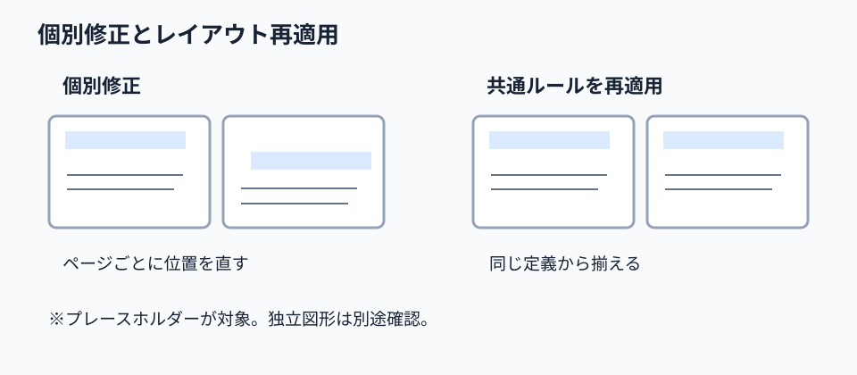

# ずれたスライドは手で直す前にレイアウトを再適用する

**2026-11-07 06:00 JST｜学習ID 2026-11-07/0600｜基礎技・今日の小さな改善｜3〜5分**
## 今日の結論

**When titles drift across slides, try reapplying the layout before moving each box.** shared layout ruleに戻す方が、修正漏れを減らしやすい。ただし、通常のテキストボックスなどレイアウト外の図形まで自動整列するわけではない。

## 守｜配置の規則と個別の図形を区別する

PowerPointのlayout（レイアウト）は、タイトルや本文のplaceholder（内容を入れる定型の枠）の位置・書式を定める。Microsoft公式は、スライドマスターでレイアウトを変更した後、対象スライドにそのレイアウトを**reapply（再適用）**するよう案内している。［Reset（リセット）］は既存レイアウトの状態へ戻す別操作で、内容を削除しない。最初に「共通の枠の問題か、個別の図形の問題か」を見分けよう。

## Before→After｜提案資料の見出し位置

**Before：**10ページの提案書でタイトルの開始位置が少しずつ異なり、各ページの文字枠を手で動かしている。**After：**共通のタイトル枠を使うページは同じレイアウトを再適用し、個別の装飾だけを点検する。10ページは操作例の架空設定で、時間削減の実測値ではない。

## 図解｜共通の枠から直す

図が示すのは、**When the issue is a shared placeholder,、ページ単位ではなく定義側から揃える**という考え方。実際のPowerPoint画面の再現ではなく概念図である。

## 破｜4ステップで修正する

1. ずれた要素がtitle/body placeholdersか、独立した図形かを選択して確認する。
2. Windows版PowerPointの［ホーム］→［レイアウト］でappropriate layoutを選ぶ。
3. レイアウト自体を変更した場合は［表示］→［スライドマスター］で定義を編集し、マスター表示を閉じる。
4. 対象スライドを選択し［ホーム］→［レイアウト］から編集したレイアウトを**reapply（再適用）**。必要に応じて［ホーム］→［Reset（リセット）］を試し、見た目と内容を確認する。

## 例外と別解｜すべてを再適用しない

意図的に動かしたプレースホルダーは戻る可能性があるため、まず1ページで試す。independent text boxesやグラフの位置ずれは再適用で直らない場合があり、そのときは整列操作や個別調整を使う。定型化すべきでない特殊な表紙は別レイアウトにする。

## 離｜修正回数は設計の診断になる

店舗別の営業資料やスポーツクラブ別の提案書で同じ位置ずれが繰り返されるなら、担当者の操作が遅いのではなく、shared templateの設計が弱い可能性がある。個別修正の回数を記録すれば、次に整えるべきレイアウトを発見できる。

## 失敗例｜すべての図形が戻ると思い込む

**Failure：**自作テキストボックスまでレイアウト再適用で揃うと期待し、修正完了と判断する。**Fix：**プレースホルダーと独立図形を区別し、再適用後に全ページを一覧表示して差分を確認する。

## 60秒課題｜最初の一手を決める

タイトル位置が異なるスライドが5枚ある。すべて同じレイアウトのタイトル枠を使っている。最初に何をする？ **Answer：**まず1枚に共通レイアウトを再適用して結果を確認する。手動で5枚を直すのはその後。逆に独立図形なら再適用を万能視しない。

## 参考資料・Simple English

参考：[Microsoft公式｜レイアウトの編集と再適用](https://support.microsoft.com/en-gb/powerpoint/edit-and-re-apply-a-slide-layout)／[Microsoft公式｜レイアウトの適用とリセット](https://support.microsoft.com/en-gb/powerpoint/training/apply-a-slide-layout)／[SlideLand｜公開スライドの参考集](https://www.slideland.tech/)。SlideLandの個別作例は今回の操作根拠には使っていない。

**Simple English: Fix the rule before fixing every slide.** ／ **日本語：各ページを直す前に、共通のルールを直そう。**
