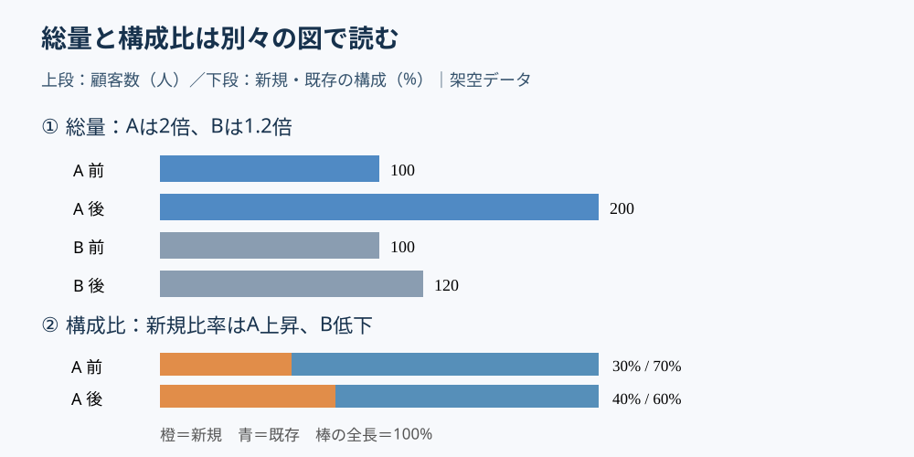

# 構成比の伸びと市場の拡大を混同しない｜二段グラフ

**2026-11-07 12:00 JST｜学習ID 2026-11-07/1200｜レイアウト・図解｜3〜5分**

## 今日の結論

**Size and share are different questions（総量と構成比は別の問い）だ。** 顧客が増えたかを実数の棒、顧客の内訳が変わったかを100%積み上げ棒で二段に分けると、成長と構造変化を混同せず判断できる。図を増やすことが、かえって読む時間を減らす場合がある。

## 守｜比較したい量が違えば図も分ける

A regular bar chart（通常の棒グラフ）は長さで数量を比較する。A 100% stacked bar（100%積み上げ棒）は各対象を同じ長さにそろえ、全体に占める割合を比較する。前者は**規模（scale）**、後者は**構成（mix）**の問いに答える。構成比が上昇しても、母数が減れば実数は減る。逆に構成比が低下しても、母数が増えれば実数は増える。したがって、割合だけで事業成長を説明しない。

## Before→After｜架空の顧客データ

Before（改善前）は「A事業：顧客100→200人、新規比率30→40%。B事業：100→120人、新規比率50→45%」を一つの複雑な複合グラフにする案。After（改善後）は上段に顧客数の横棒、下段に新規・既存の100%積み上げ棒を置く。**Aは顧客数が2倍になり、新規比率も10ポイント上昇した。Bは顧客数が20%増えたが、新規比率は5ポイント低下した。** いずれも架空データであり、増減の原因までは示さない。

*図：規模と構成を分けると、何が増え、何の割合が変わったかを読み分けられる。値は説明用の架空データ。図の下段はA事業の例を示す。*

## 破｜4ステップで制作する

1. **Separate the questions（問いを分離する）。**「顧客数は増えたか」「新規顧客の比率は上がったか」を別の小見出しにする。両方が意思決定に必要か確認する。
2. **Check the base numbers（元データを検算する）。** Aの新規実数は30→80人、Bは50→54人。比率だけでなく、割合×母数で人数を計算する。端数が出る場合は丸め方を注記する。
3. **Show counts above, shares below（上段に実数、下段に構成比を置く）。** 上段はゼロ起点の棒、下段は0〜100%の同じ全長の棒。事業・時点・色の対応をそろえ、単位と凡例を直接記す。
4. **Write an action title（結論を見出しにする）。**「Aは顧客数・新規比率ともに拡大」とし、注記で架空データ・集計期間・新規の定義を示す。PowerPointでは［挿入］→［グラフ］で横棒と100%積み上げ横棒を別々に作成できる。

## 離｜別案を選ぶ条件

**Only size matters（総量だけが重要）**なら通常の棒だけで十分。**Compare absolute counts（内訳の絶対人数を比較）**するなら通常の積み上げ棒が適切。**Long time series（時系列が長い）**なら実数の折れ線と比率の折れ線を上下に分ける。複合グラフの第2軸は便利だが、異なる尺度を重ねると見かけの相関を誤認しやすい。図の目的が「相関の検証」なら散布図と統計的な確認を別途行う。

## 失敗例｜割合の上昇を売上増と呼ぶ

新規比率が30%から40%になっただけで「新規顧客が増えた」と断定するのは危険だ。母数が100人から50人へ減れば、新規実数は30人から20人に減る。**Fix（回避）：割合の分母を必ず示し、実数を計算してから見出しを書く。**

## 60秒課題｜数字の逆転を見抜く

架空のサービスで会員数が200→100人、新規比率が20→30%になった。新規会員の実数は増えたか。**Answer（答え）：40→30人で10人減少。** 割合は10ポイント上昇したが、実数は減っている。この二つを一枚に示すなら二段構成が適切だ。

## 参考資料・Simple English

参考：[SlideLand｜スライド事例と図解の発想](https://www.slideland.tech/)／[Microsoft公式｜PowerPointでグラフを使う](https://support.microsoft.com/en-us/powerpoint/training/use-charts-and-graphs-in-your-presentation)／[Microsoft公式｜グラフの種類を変更する](https://support.microsoft.com/en-us/excel/change-the-chart-type-of-an-existing-chart)。図は独自制作であり、公開事例の転載ではない。

**Simple English: Separate size from share.** ／ **日本語：規模と構成比を分けて示そう。**
