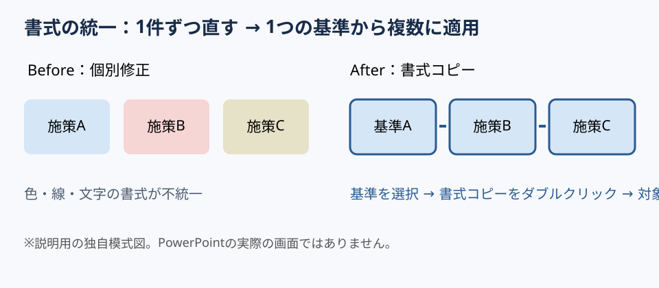

# 書式コピーを連続適用し、修正の往復を減らす

**2026-11-07 15:00 JST｜学習ID 2026-11-07/1500｜PowerPoint実装・時短｜3〜5分**

## 今日の結論

複数の図形の見た目をそろえるときは、**one reference shape（基準の図形）を決めて書式コピーを連続適用**する。色や線を1個ずつ設定する往復を減らせる。配置や文章の内容まで同じにする機能ではない。

## 守｜書式と内容を分ける

Formatting（書式）とは塗りつぶし、線、フォントなどの見た目の設定。Microsoftの**書式コピー（Format Painter）**は元のオブジェクトの書式を別の対象に適用する機能で、通常のクリックは1回、ボタンをダブルクリックすると複数対象に続けて使える。Windows版PowerPoint for Microsoft 365／2024などが公式の対象に含まれる。

## Before→After｜提案書の施策カード

Before（改善前）：施策Aだけ青、施策Bは赤、施策Cは別の枠線。3つを個別に修正し、線の太さやフォントが微妙にずれる。After（改善後）：完成したAを基準に、BとCへ同じ書式を続けて適用。カードの位置と文言は変えず、視覚的な一貫性を得る。

## 図解｜連続適用の操作経路

*図：Beforeは書式がばらばら、Afterは1つの基準を複数に適用。操作画面のスクリーンショットではない。*

## 破｜4ステップで実装

1. **Set the reference（基準を作る）。** 完成形のカードAで塗り・枠線・文字書式を確定する。
2. **Select the reference（基準を選択する）。** カードAの図形全体をクリックし、［ホーム］→［書式のコピー/貼り付け］を**ダブルクリック**する。
3. **Apply repeatedly（対象を順に選ぶ）。** B、Cをクリックして同じ書式を適用する。終わったらEscで解除する。
4. **Check differences（差分を確認する）。** 文字の読みやすさ、線、背景色を点検する。文字列の一部だけを選ぶ場合と図形全体を選ぶ場合ではコピー対象が異なるため、意図した選択になっているか確認する。

## 離｜どこまで自動化すべきか

Reusable design（再利用するデザイン）として同じ見た目の図形が今後も増えるなら、毎回コピーするより**テーマやテンプレート**を整える方が再利用しやすい。既存カードの一括修正なら書式コピー、毎週使う定型資料ならテンプレートが候補。修正対象が1個だけなら通常の1回適用で十分。

## 失敗例｜強調の意味まで消してしまう

Visual hierarchy（視覚的な優先順位）として重要施策だけ色を変えているのに、すべて同じ色へコピーすると情報の優先順位が消える。**回避：先に『同じ意味の要素か』を判定する。** 書式を統一する対象と、意図的に違いを残す対象を分ける。

## 60秒課題｜3枚のカードをそろえる

施策A・B・Cのカードを置き、Aだけ背景・線・文字を整える。Aを選んで書式コピーをダブルクリックし、BとCへ連続適用、Escで終了。**Success check（合格基準）：BとCの書式がAにそろい、各カードの文言は保持される。**

## 参考資料・Simple English

参考：[Microsoft公式｜書式のコピー](https://support.microsoft.com/en-us/word/use-the-format-painter)／[Microsoft公式｜既定のテーマを設定](https://support.microsoft.com/en-US/PowerPoint/set-a-default-theme-for-your-presentations)／[SlideLand｜スライド事例](https://www.slideland.tech/)。本図は独自制作。

**Simple English: Copy the style, not the message.** ／ **日本語：伝える内容ではなく、見た目の設定をコピーしよう。**

