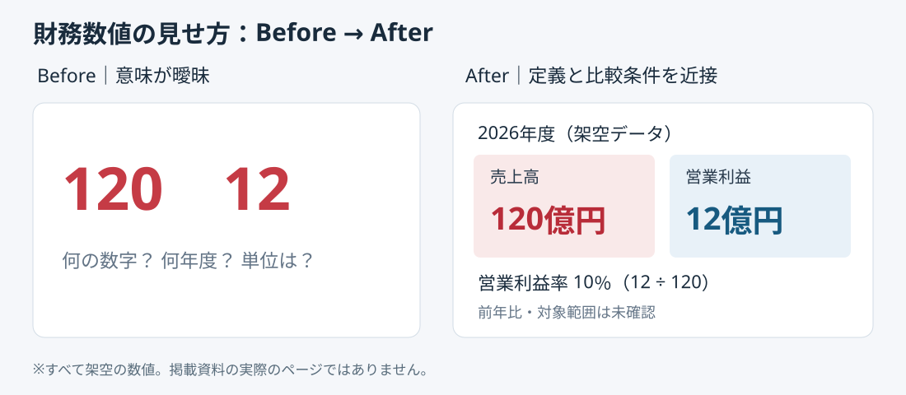

# KAGOME掲載事例から学ぶ｜財務数値は単位と比較条件を隣に置く

**2026-11-07 18:00 JST｜学習ID 2026-11-07/1800｜名作スライド解剖｜3〜5分**

## 今日の結論

**Financial data（財務データ）は数字の大きさより、指標名・期間・単位・比較対象のinformation hierarchy（情報の階層）で読ませる。** 数字だけを強調したスライドより、誤読を防ぎ、経営判断までの確認時間を短縮できる。

## 守｜公開事例と原理

SlideLandの「財務データ」分類に**『KAGOME INTEGRATED REPORT 統合報告書 2026』**が掲載され、「食品」「レッド」「やさしい」のタグが確認できる。個別ページの数値や配置は確認できていないため、以下は**同資料の実ページの再現ではなく、an original layout exercise（独自の設計練習）**である。

財務データの一枚は「何の数値か」「いつの数値か」「何と比較するか」「どう解釈するか」を一緒に示す必要がある。ページの目的はcomparable numbers（比較可能な数字）を伝えること、主張は比較から導く暫定的な判断、構造は見出し→指標→比較→注記。視覚的工夫は数値を目立たせつつ定義を近接させること。転用条件は定義・期間が一致すること、限界は因果関係まで数字だけで証明できないこと。

## 図解｜数値と定義を離さない

*図：左は「120」「12」のみを大きく表示、右は指標・年度・単位・比較をセットで配置。すべて架空の数値。何を理解させるか：大きな数字を読める数字へ変えるには、周辺情報の階層設計が必要。*

## 破｜4ステップで制作

1. **Fix the question（問いを先に固定）。** 例：「利益率の変化を説明できるか」。

2. **比較する数値の定義をそろえる。** 売上と営業利益は同一年度・同一通貨単位で記載。異なる会計基準や対象範囲なら同列比較しない。

3. **visual hierarchy（視覚的階層）をつくる。** 上段に結論候補、中央に指標名→数値→単位、直下に比較期間、下段に注記。数字だけ極端に拡大しない。

4. **読み手に誤読テスト。** 『この12は金額か率か』『前年値はあるか』を10秒で答えられるか確かめる。

**別解：**複数年度の傾向なら折れ線、部門間比較なら共通尺度の棒グラフ、細かい数値確認なら表。二つの数値を大きく置くカード形式は、推移や内訳を示す用途には弱い。

## Before→After｜架空の食品事業

**Before：**『売上120／利益12』だけを大きく配置。単位も年度も不明。**After：**『2026年度の営業利益率は10％（架空・単年度）』を見出しとし、売上高120億円、営業利益12億円を同一年度のカードに配置。下に『営業利益率＝営業利益÷売上高。前年との改善比較は未検証』と明記。**10％は計算結果であり、改善したという主張ではない。**

## 離｜スポーツビジネスへの転用

スタジアムの来場者数と売上を並べるときも、売上の対象がチケットのみか飲食物販込みかで意味が変わる。数値を目立たせる前に、**denominator（分母）と集計範囲を近くに置く**。デザインは飾りではなく、分析の前提を表示する装置になる。

## 失敗例と避け方

**失敗：**単年度の利益率10％を赤い上向き矢印とともに示し、改善した印象を与える。**回避：**前年データがなければ上向き矢印を使わず、『単年度実績』『前年比未確認』と記す。

## 60秒課題

架空データ『売上80億円、営業利益8億円』を1枚に置く。10秒で読み取れる見出しと注記を書こう。**判断基準：**営業利益率10％を計算し、年度・対象範囲が未提示なら仮置きと示し、前年比改善を断定しない。

## 参考資料・Simple English

[SlideLand｜財務データ](https://www.slideland.tech/docs/page/financial-data)／[SlideLand｜赤色](https://www.slideland.tech/docs/color/red)／[Microsoft公式PowerPointサポート](https://support.microsoft.com/ja-jp/powerpoint)

**Simple English: A number needs a label and a context.** ／ **日本語：数字には名前と文脈が必要だ。**
