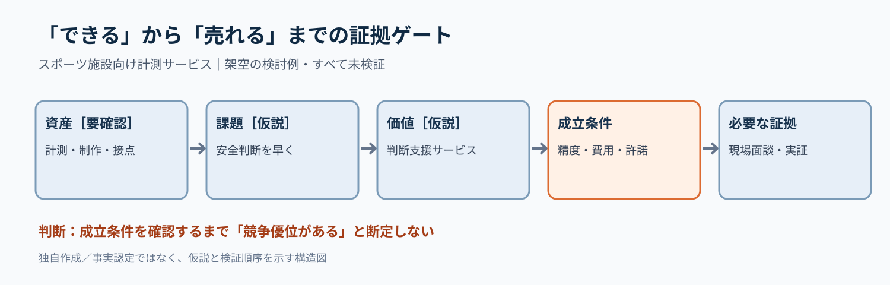

# 新規事業の『強み』を検証可能な参入条件へ変える｜ボトルネック証拠ゲート

**2026-11-07 21:00 JST｜学習ID 2026-11-07/2100｜コンサル実務応用｜3〜5分**

## 今日の結論

**Assets are not proof of advantage（資産は優位性の証拠ではない）。** 「assets（資産）→customer pain（顧客課題）→value（提供価値）→critical conditions（成立条件）→evidence（証拠）」の順に並べると、投資判断に必要な未検証条件が見える。

## 守｜能力と優位を分ける

Capability（実行能力）とcompetitive advantage（競争優位）は別。撮影・計測技術やスポーツ接点があっても、顧客のwillingness to pay（支払意思）は未確認。今回の組み合わせは**検討用の仮説**であり、実在企業の保有資産や優位性を認定しない。

## 破｜5手順で証拠ゲートを作る

1. **Define the decision（判断を決める）。** 「施設向け計測サービスの実証に進むか」。
2. **Separate facts and assumptions（事実と仮説を分ける）。** 技術・接点・運用能力は資料未確認なら［要確認］。
3. **Specify the customer job（顧客の仕事を定義）。** 「安全管理の判断を早くしたい」は［課題仮説］。
4. **Find critical conditions（成立条件を絞る）。** 精度、設置費、許諾、支払意思のうち欠けると止まる条件。
5. **Attach evidence（証拠を結ぶ）。** 誰に何を何件確かめるかとpass criteria（通過基準）を事前合意する。

## Before→After｜資産紹介を投資判断に変える

**Before：**「計測技術×映像制作×スポーツ団体との接点で新規事業」。顧客課題と競争優位が不明。**After：**「施設の安全判断支援は、現場課題・精度・支払意思の3条件が確認できれば実証候補［仮説］」。上部にdecision statement、中央に5列の因果連鎖、下部にnext test（次の検証）を置く。

## 図解｜強みから証拠までを一方向につなぐ

**Visual takeaway（図が示すこと）：** 「できる」と「売れる」の間には複数のtests（検証）が必要。数値・性能を示さない架空の検討例。

## 離｜最も弱い条件から調査を始める

技術の説明を重ねるほど、budget owner（予算保有者）や導入権限が見落とされる。医療機器、教育SaaS、スポンサー商品でも、**the weakest link（最も弱い条件）**を先に調べると調査順序が変わる。

## 失敗例｜証拠のない優位を色で確定させる

「競合が追随できない」を確定色で表示するのはoverclaim（過大な断定）。［事実］［仮説］［未検証］を区別し、競合比較・顧客ヒアリング・実証結果を別に残す。

## 60秒課題｜最初の検証を一つ選ぶ

仮想案件で「精度は高いが施設の予算が不明」。次は技術紹介かbudget-owner check（予算保有者の確認表）か。**答え：予算保有者の確認表。** 投資判断を左右する不確実性を先に解消する。精度も未検証なら並行確認。

## 参考資料・Simple English

参照：[SlideLand：市場環境スライドの分類](https://www.slideland.tech/docs/page/market)／[Strategyzer：ビジネスモデル・キャンバス](https://www.strategyzer.com/library/the-business-model-canvas)／[Strategyzer：顧客価値の設計](https://www.strategyzer.com/library/the-value-proposition-canvas)。**Simple English: An asset is not proof of advantage.** ／ **日本語：資産があるだけでは、優位性の証拠にならない。**
