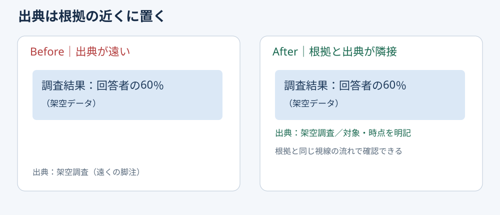

# 数字の出典は根拠の直下に置く

**2026-11-08 06:00 JST｜学習ID 2026-11-08/0600｜基礎技｜3〜5分**
## 今日の結論

**Keep the source close to the evidence（数値や引用の出典は根拠のすぐ近くに置く）。** 発表者が説明しなくても、聞き手が「どこから来た数字か」を即座に確認できる。脚注の有無ではなく、根拠と出典の距離が重要だ。

## 守｜検証の摩擦を減らす

経営層向け資料では、数値の正しさだけでなく、数値を検証できる状態が重要だ。the source is only on the final page（出典が最終ページにしかない）と、読者はページを往復する必要がある。**source proximity（出典近接）**とは、図表の直下などにpublisher・資料名・対象期間を簡潔に添え、詳細URLは必要に応じて補う設計を指す。すべての装飾要素に出典を付けるという意味ではない。

## Before→After｜来場者調査の例

**Before：**「満足度60％」とだけ大きく表示し、出典は巻末の参考文献一覧。**After：**「満足度60％」の直下に「出典：架空の来場者調査／2026年10月／回答者100人」と置く。数字は説明用の架空値であり、実際の調査結果ではない。

## 図解｜出典の位置を変える

この図は**出典の位置だけで検証のしやすさが変わる**ことを示す。架空データのため実在する調査へのリンクはない。

## 破｜4ステップで配置する

1. スライドで最も重要な数字・引用・比較を一つ特定する。
2. 根拠の直下に「出典：組織名／資料名／年月」を短く置く。
3. 対象者・集計範囲・単位など、解釈を左右する条件を必要に応じて併記する。
4. 参照URLやページ番号を確認し、スライド表示サイズで読めるか点検する。

## 例外と別解｜近接させすぎない

同じ資料から取った数値が一つの表に並ぶなら、表の直下に出典を一つ置けばよい。異なる資料を混ぜたグラフでは系列別の出典が必要になることがある。出典文字が多すぎる場合は、短い注記と詳細な参考資料ページを併用する。

## 離｜出典は資料の設計テスト

スポーツ事業の市場規模を示すとき、出典の記載に困るなら、そもそも「市場全体」と「自社が獲得可能な市場」を混同している可能性がある。出典を書けるかは、define the metric（数字の定義を言語化できるか）を試す簡易テストになる。

## 失敗例｜小さすぎる脚注

**失敗：**出典を置いたが、投影時に読めない。**回避：**会議室の表示環境を想定して確認し、詳細URLは補足資料にも置く。

## 60秒課題｜出典を一行で書く

「市場規模は300億円」という仮のスライドに、minimum source note（最低限必要な出典欄）を考える。**判断基準：**「誰の資料か／いつの数字か／何を市場と定義したか」が読み取れること。出典未確認なら数字を確定事実として掲載しない。

## 参考資料・Simple English

参考： [SlideLand｜スライド事例集](https://www.slideland.tech/) ／ [Microsoft｜PowerPointヘルプ](https://support.microsoft.com/powerpoint)。SlideLandは図解事例を探す入口として参照し、本図は独自作成した。

**Simple English: Keep the source close to the claim.** ／ **日本語：出典は主張の近くに置こう。**
