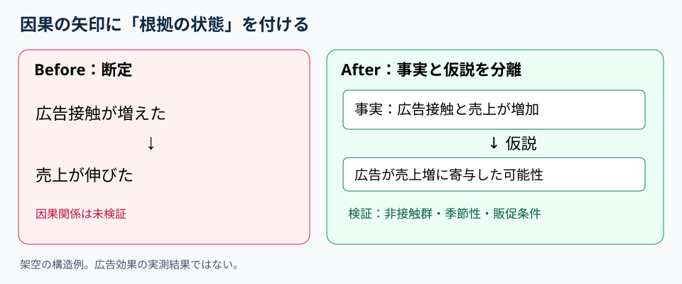

# 因果の矢印を監査する｜事実・仮説・検証を混ぜないスライド

**2026-11-08 09:00 JST｜学習ID 2026-11-08/0900｜構想・論理｜3〜5分**
## 今日の結論

**矢印（causal arrow）で二つの出来事を結ぶ前に、「確認済みの因果」「仮説（hypothesis）」「単なる時間順」を区別する。** これで経営層が推論の強さを誤読せず、次の調査（next research）も明確になる。

## 守｜矢印は証拠ではない

広告接触と売上が一緒に増えたのは**相関（correlation）**。広告が売上を押し上げたという**因果（causation）**とは別。季節性、値引き、競合の休業などalternative explanationsを検討する。スライドでは観測事実（observed facts）と推論を別の箱に置き、矢印へ「仮説」と付ける。

## Before→After｜広告施策の効果説明

**Before：**「広告接触増 → 売上増。だから広告が成功」と断定。**After：**「観測（observation）：広告接触と売上はともに増加」「仮説（hypothesis）：広告が売上増に寄与」「未検証（to test）：非接触群との差、季節性、販促条件」を三段に置く。数値のない架空の説明例であり、実測結果ではない。

## 破｜因果の監査を4ステップで行う

1. **動詞を分解する（separate verbs）。**「増えた」は観測、「増やした」は因果主張として区別する。
2. **矢印を列挙する（audit arrows）。** A→Bごとに根拠を確認し、実験・比較分析・専門家の仮説などevidence typeをメモする。
3. **別の説明を探す（alternative explanation）。** 価格改定、季節変動、顧客構成の変化を疑う。
4. **表現を調整する（calibrate the claim）。** 未検証なら「寄与した可能性」「検証予定」。例外：ランダム化比較試験（randomized trial）でも対象範囲と限界を注記する。

## 離｜組織の議論を速くする

因果の矢印に確度（confidence）を付けると、資料は**検証の優先順位表（testing priority）**になる。採用増→売上増、イベント増→ファン定着、設備導入→生産性向上にも転用できる。確証が薄く経営判断への影響が大きい矢印から調べる。

## 失敗例｜慎重すぎて何も提案できない

**失敗：**すべてを「不明」として結論を放棄。**回避：**観測事実を示し、仮説の確度（confidence）と検証期限を明記した**条件付き提案（conditional recommendation）**にする。区別は意思決定の停止ではない。

## 60秒課題｜断定を直す

「SNS投稿を増やしたので来場者が増えた」を、観測・仮説・検証の3行に直す。**解答例：**「観測（observation）：投稿数と来場者数が増加」「仮説（hypothesis）：投稿が来場を促進」「検証（test）：投稿非接触層との比較、対戦カード・天候・販促施策を確認」。**合格基準：**根拠なしに因果を断定していない。

## 参考資料・Simple English

参考：[McKinsey｜論点を分解する問題解決](https://www.mckinsey.com/careers/life-at-mckinsey/our-culture-and-communities/mckinsey-women-blog/problem-solving-is-for-everyday-life-too)／[SlideLand｜メッセージ型スライド事例](https://www.slideland.tech/docs/page/message/4)。両資料は構造化・表示の参考であり、本稿の広告因果例の検証根拠ではない。

**Simple English: Label assumptions before drawing conclusions.** ／ **日本語：結論を出す前に、仮定を明示しよう。**
