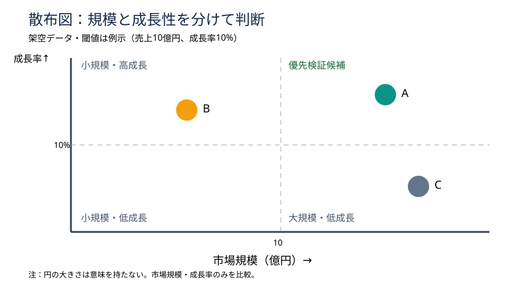

# 散布図の閾値を先に決め、投資候補を誤読させない

## 今日の結論：Decision first

Scatter plot（散布図）は二つの数値の関係を一画面で比較する図。大切なのは点の配置だけでなく、axes（軸）とthresholds（判断の閾値）を先に定義すること。市場規模と成長率を混ぜたランキングより、priority for validation（優先検証）と追加調査を区別しやすい。

## 守：原理と使いどころ

Scatter plotは各対象を二つの連続量に置く。Quadrants（四象限）は縦横の基準線で分けた領域。ただし境界は自然法則ではない。「平均値」「採算ライン」「戦略上の最低条件」のどれを基準にしたか明記する。二指標を同時比較するなら散布図、time trend（時系列）なら折れ線、厳密な順位なら棒グラフが向く。

## 破：制作手順と別解

1. Decision question（意思決定の問い）を先に書く。「次に深掘りする市場はどれか」。
2. 横軸を市場規模（億円）、縦軸を市場成長率（%）とし、調査年と定義をそろえる。
3. Thresholds（閾値）の理由を決める。今回は説明用に規模10億円、成長率10%。実案件では投資条件などから再設定する。
4. 点を置き、direct labels（対象名の直接表示）を使う。重なれば位置を調整する。
5. 右上を「優先検証候補」と強調する。ただし収益性・参入障壁・自社適合性は別途検証。恣意的な閾値なら四象限を外し、分布だけを示す。

## 図解：架空市場の優先検証

この図はscale（規模）とgrowth（成長性）を混同せずに比較する配置例。A・B・Cと閾値はすべて架空。円の大きさに意味はない。

## Before→After

Before：「市場Aは成長性が高い。Bも有望。Cは規模が大きい」と列挙する。これではcomparison criteria（比較軸）が曖昧。

After：タイトルを「規模と成長性の両面からAを優先検証する」とし、中央に散布図、右下に「Next checks：利益率・顧客獲得費用・参入障壁」。投資決定ではなく調査優先順位の仮説と明示する。

## 離：異分野への転用

スポンサー候補なら横軸は契約単価、縦軸は継続率。営業ならdeal size（案件金額）とwin probability（受注確度）。受注確度は主観推定になりやすいので、evidence quality（根拠の品質）を色や注記で区別する。三つ目の変数を円の面積に割り当てるbubble chartは知覚誤差が増えるため必要な場合だけ使う。

## 失敗例と回避

失敗は中央値で切っただけなのに右上をabsolute winner（絶対的な勝者）と呼ぶこと。中央値は母集団で変わる。閾値の出所と判断上の意味を脚注に残し、結論は「優先検証候補」に限定する。

## 60秒課題

候補X：規模20億円・成長率3%、候補Y：規模8億円・成長率18%。どちらを優先するか。Answer depends on the goal（目的次第）。短期売上ならX、高成長市場の探索ならY。ただし利益率・競争・自社適合性がなく、投資判断は保留。

## 参考資料

Slidelandの散布図カテゴリ：https://www.slideland.tech/docs/graph/scatter

Slidelandの図解分類：https://www.slideland.tech/docs/category-list

## Simple English

**Choose the axes before the layout.**／レイアウトを決める前に、比較軸を決めよう。
