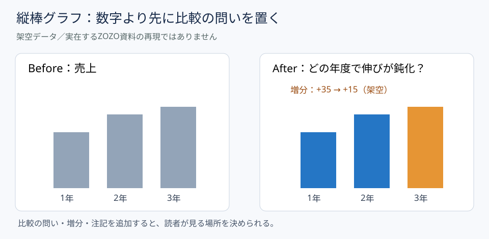

# ZOZO掲載の縦棒グラフから学ぶ｜比較の問いを先に置く

**2026-11-08 18:00 JST｜学習ID 2026-11-08/1800｜名作スライド解剖｜3〜5分**

## 今日の結論

A bar chart（縦棒グラフ）は棒を整える前に「何を比較し、何を判断するか」を一文で決める。グラフの見栄えだけでなく、経営層が確認すべき差分を絞れる。

## 守｜企業と事例、基本原理

ZOZOはファッション通販サイトなどを展開する企業。SlideLandの「縦棒グラフ」分類には『2025新卒開発部門（エンジニア・デザイナー）ZOZO会社説明資料』が掲載されている。確認できたのは掲載名と分類であり、特定ページの棒の色や軸、数値は未検証である。以下の図は実例の複製ではなく、縦棒グラフという図解形式の独自教材。  縦棒グラフは、共通のゼロ基準から高さを比べて規模差を伝える図。適するのは年度別実績や部門別件数。構成比の合計を示すなら積み上げ棒、時間の細かな連続変化なら折れ線も検討する。

## 図解｜問いがあると棒の意味が変わる

*図：架空の3年間の値を同じ尺度で比較。右は増分の鈍化に着目する問いを置いた。ZOZO資料の実ページではない。*

## 破｜4ステップで読み解き、再現する

1. **purpose（資料の目的）を確認する。** 採用向け会社説明なのか、経営判断向けなのかで強調する内容が変わる。
2. **comparison question（比較の問い）を一つ選ぶ。** 「どの年度で成長幅が縮んだか」のように、読み手が答えられる問いにする。
3. **common scale（共通尺度）と増分を確認する。** 棒の起点をそろえ、必要なら前年差を直接記す。差が小さくても縦軸を切って誇張しない。
4. **主張と限界を分ける。** 「増分が縮んだ」は記述。「市場が飽和した」はcausal hypothesis（原因仮説）なので、追加根拠なしには書かない。

## Before→After｜架空の3年売上

**Before：**「売上推移」というタイトルと100、135、150の3本の棒。**After：**「売上は増加したが、年間増分は35から15に縮小（仮想（架空））」を見出しにし、3本の棒の上に数値、下に単位と年度を置く。何が起きたかを示すだけで、原因は断定しない。

## 離｜異分野への転用と限界

スポーツ事業の来場者数でも同じ。3試合の集客を棒で比べるなら、曜日・対戦相手・天候が異なる可能性を注記する。棒の高さが違うことと、施策の効果があったことは別の主張。**図解の目的は因果を作ることではなく、検証すべき差を見つけること**である。

## 失敗例と避け方

**失敗：**最終年度の棒だけ派手にして「成長加速」と記す。実際には増分が減っている。**回避：**絶対値、前年差、増減率を別々に確認し、表題の動詞を数値に合わせる。

## 60秒課題

仮想（架空）の利用者数「1年目100人、2年目140人、3年目150人」を棒で示すとき、結論見出しを一つ作ろう。**判断基準：**「利用者は増加、増分は40人から10人へ縮小」なら妥当。「サービスが失速した」は追加情報なしには強すぎる。

## 参考資料・Simple English

[SlideLand｜縦棒グラフ事例](https://www.slideland.tech/docs/graph/vertical-bar-graph/3)／[SlideLand｜図解カテゴリ一覧](https://www.slideland.tech/docs/category-list)／[Microsoft PowerPoint公式サポート](https://support.microsoft.com/ja-jp/powerpoint)

**Simple English: Ask what the bars should prove.** ／ **日本語：棒が何を示すべきか、先に問いを立てよう。**
