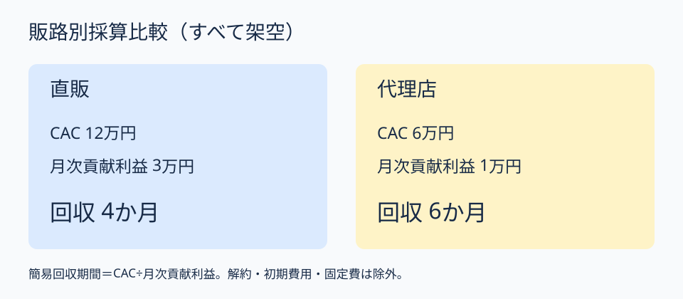

# 販路の広さではなく回収期間で選ぶ｜チャネル別採算ゲート

**2026-11-08 21:00 JST｜学習ID 2026-11-08/2100｜3〜5分**

## 今日の結論

**More channels do not mean better economics（販路の多さは採算を保証しない）。** 顧客獲得費用と月次貢献利益を同じ条件で並べると、営業実証の優先順位を判断できる。

## 守｜単位経済性とは

Unit economics（単位経済性）は、顧客一件ごとの収益性を確かめる考え方。顧客獲得費用（CAC）は一件獲得する営業・広告費、貢献利益は売上から顧客に応じて増える費用を引いた額。簡易回収期間はCAC÷月次貢献利益。ただし解約・初期費用・固定費を省くため、これだけでは投資を決められない。

## 破｜5手順

1. **問いを固定。** 「直販と代理店、どちらを先に試すか」。
2. **費用範囲を統一。** 営業工数と紹介手数料を含める。
3. **仮の数値を置く。** 直販CAC12万円・月次貢献利益3万円、代理店CAC6万円・月次貢献利益1万円（架空）。
4. **回収期間を計算。** 直販4か月、代理店6か月。
5. **検証を設計。** 各販路で商談10件、受注率と獲得工数を記録。

## Before→After｜紹介から判断へ

**Before：**「スポーツ団体との接点を使い、直販と代理店を拡大」。**After：**「架空試算では直販が2か月早く獲得費用を回収。先行実証候補は直販。ただし継続率は未検証」。スライド上部に判断文、中央に2列の採算比較、下部に検証事項を置く。

## 図解｜販路の採算を比較する

**図の狙い：** CACが安くても回収が早いとは限らないことを示す。数字はすべて架空。

## 離｜販路は学習速度も左右する

直販は顧客の不満を直接聞ける一方、営業工数が増えやすい。代理店は接点を使える一方、現場情報が届きにくい場合がある。採算が拮抗したら、顧客仮説をfast validation（早期検証）できる販路を選ぶ観点も必要。

## 失敗例｜CACだけで決める

代理店のCACが半分という理由だけで優先すると、月次利益の低さを見落とす。payback period（回収期間）と継続率を並べ、未確認の前提には［仮説］を付ける。

## 60秒課題｜回収期間を計算

AはCAC9万円・月次貢献利益3万円、BはCAC4万円・月次貢献利益1万円。**答え：Aは3か月、Bは4か月。** 解約率が異なれば判断は変わる。

## 参考資料・Simple English

[SlideLand：市場環境の公開事例](https://www.slideland.tech/docs/page/market)／[Strategyzer：ビジネスモデル・キャンバス](https://www.strategyzer.com/library/the-business-model-canvas)。**Lower acquisition cost does not always mean faster payback.**／獲得費用が低くても回収が早いとは限らない。