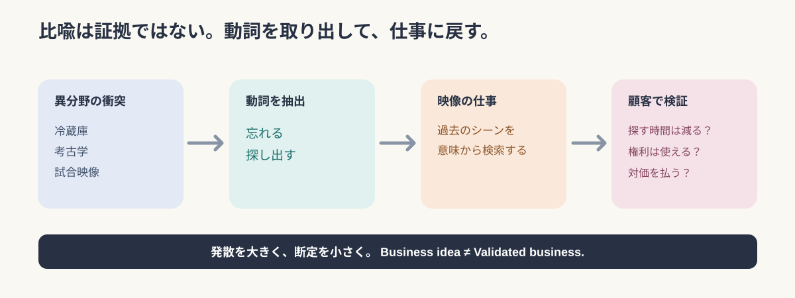

# Five Seconds per Frame?――変な言葉の衝突から映像事業を発掘する30の実験

*2026-11-04｜English Mix / 同じ論考IDで日本語版と切り替え可能*

An airport watches aircraft turnarounds using **one image every five seconds**. Schiphol's Deep Turnaround collects snapshots from cameras at airport stands and uses computer vision to identify operational events. 「飛行機の周囲があれだけ忙しいのに、5秒に1枚で足りるのか」と感じるが、重要なのは撮影の速さではなく、**which decision needs to be made, and when** という問いだ。[Schiphol official explanation](https://www.schiphol.nl/en/aviation-solutions/deep-turnaround-how-does-it-work/)


*Image: [Schiphol's Turnaround Insights](https://www.schiphol.nl/nl/innovatie/blog/een-voorspelbaar-omdraaiproces-met-turnaround-insights/). It is an airport illustration, not evidence that any sports service proposed below is already operating.*

We took thirty strange collisions—jealousy, fungi, fridges, courts, video games, even a dream diary—and forced each back into sports video. These are **hypotheses, not products or proven market opportunities**. ふざけた入口から入っても、出口の検証はふざけない。

## 守｜Better observation does not always mean more frames

A question about an airport is a question about workflow. In football officiating, the critical moment is different: the exact kick point and player positions matter. FIFA's **2022 system** used 12 tracking cameras operating 50 times per second, while the connected ball sensor reported data at 500 Hz. The latter is an inertial sensor, not a camera. 最新構成と混同しないため、これらは2022年方式の値として扱う。[FIFA 2022 technology](https://inside.fifa.com/innovation/world-cup-2022/semi-automated-offside-technology)／[Current overview](https://inside.fifa.com/innovation/innovating-the-game/semi-automated-offside-technology)


*An original comparison of different measurement tasks, not a performance ranking.*

Google DeepMind's TacticAI asks a third kind of question. It models player relationships at corner kicks and predicts or recommends tactical patterns. Liverpool FC experts preferred the AI's proposals in 90% of the studied comparisons. **This is expert preference, not a 90% match-winning rate.** 画面の中でありそうに見えることと、実際に勝てることは別だ。[Research paper](https://www.nature.com/articles/s41467-024-45965-x)／[DeepMind article](https://deepmind.google/blog/tacticai-ai-assistant-for-football-tactics/)

The first principle is simple: **Start with the decision, then choose the observation.** カメラを買う前に、何を判断したいかを決める。

## 破｜Strange metaphors are tools for finding hidden verbs

Fungi and the internet sound unrelated. But both suggest **connect, exchange, depend**. A refrigerator and archaeology suggest **forget, store, rediscover**. Karaoke and embarrassment suggest **practice without an audience**. ここで取り出しているのは分野名ではなく、日常の動詞だ。

The analogy is a question generator, not proof. 「植物に共生があるから映像市場にも共同基盤が成立する」とは言えない。Every collision below needs a real customer problem, a measurable output, and a failure test.



*Original diagram. Always test demand separately from the analogy.*

## 30の衝突実験｜Thirty hypotheses, thirty blind spots

### A｜感情と記憶：Feelings become interfaces

- **01｜選手の相性オークション**〈嫉妬×菌根菌×オークション〉 — Estimate how combinations of players change usable space and coordination; correlation is not a transfer effect. **盲点：**観測した相性を、移籍後の因果効果と取り違えやすい。
- **02｜忘れられた名場面の発掘機**〈忘却×考古学×冷蔵庫〉 — Search forgotten match footage through today's tactical questions; check reuse rights. **盲点：**再利用できる権利と映像品質が揃っているとは限らない。
- **03｜失敗を安全に練習できる映像空間**〈羞恥心×カラオケ×鏡〉 — Overlay personal footage with reference motion for private practice; visual similarity is not training efficacy. **盲点：**映像比較だけでは動作改善や安全性を保証できない。
- **04｜記憶を呼び起こす観戦体験**〈郷愁×香水×タイムカプセル〉 — Recombine seats, crowd sound and personal clips into a match memory; do not infer private feelings from video. **盲点：**映像だけでは本人の感情を確定できない。
- **05｜退屈な試合の隠れた見どころ**〈退屈×宝探し×監視カメラ〉 — Find off-ball moments worth noticing; novelty alone is not sporting importance. **盲点：**奇妙な動きと競技的に重要な動きを混同しやすい。

### B｜自然と運営：Nature becomes operations

- **06｜スタジアム混雑の気象予報**〈台風×株式市場×蟻の行列〉 — Forecast stadium crowd flow like a weather map; movement is not motivation. **盲点：**個人の経路選択理由までは分からない。
- **07｜技術成長の地層**〈地層×複利×スローモーション〉 — Compare years of motion in one view; camera changes can look like skill gains. **盲点：**撮影条件の違いが成長に見えてしまう。
- **08｜スポーツデータ共生ネットワーク**〈菌根菌×インターネット×寄生虫〉 — Connect independent match datasets with common time codes; permissions are the hard part. **盲点：**接続するほど権利や目的外利用の問題が増える。
- **09｜事故の連鎖を予測する映像AI**〈雪崩×ドミノ×保険〉 — Detect chains of risky crowd events; warning signs are not proven injury prevention. **盲点：**前兆の検知と事故削減の実証は別である。
- **10｜スタジアム商圏の生態系分析**〈サンゴ礁×不動産×生態系〉 — Estimate how a stadium affects nearby movement and shops; video does not establish net economic impact. **盲点：**地域売上の増分を映像だけでは識別できない。

### C｜歴史と反実仮想：The past becomes searchable

- **11｜引退選手の動作を次世代へ継承**〈輪廻転生×著作権×ロボット〉 — Preserve athletes' motion for licensed education; a motion model is not the person. **盲点：**人格や能力の『再現』と動作特徴の記録は違う。
- **12｜歴史的判定の再審シミュレーター**〈裁判×タイムマシン×神話〉 — Revisit historical decisions using surviving evidence; missing footage cannot be recovered by confidence. **盲点：**当時の情報欠落と規則の違いは消せない。
- **13｜スポーツの聖地発見ゲーム**〈巡礼×ポケモン×地図〉 — Attach great moments to physical locations for AR tourism; site and footage rights matter. **盲点：**撮影・演出・現地利用には複数の許諾が要る。
- **14｜もしもの試合を無数に試す**〈反実仮想×将棋×映画〉 — Simulate alternative tactics; generated scenes are not alternative history. **盲点：**生成した未来は起きた事実ではない。
- **15｜戦術の進化系統博物館**〈遺跡×DNA×博物館〉 — Search tactical similarities across decades; similarity does not prove influence. **盲点：**似た配置を『影響を受けた証拠』として扱えない。

### D｜日用品と改善：Everyday actions become products

- **16｜映像の賞味期限管理**〈冷蔵庫×賞味期限×データベース〉 — Track when clips are relevant, searchable and licensed; those three clocks differ. **盲点：**話題性の期限と利用許諾の期限は別である。
- **17｜スポーツ動作のレシピ化**〈料理レシピ×工場×スポーツ科学〉 — Turn motion into sequences of training cues; tacit skill is more than a recipe. **盲点：**熟練動作は言語化した順序だけで再現できない。
- **18｜未来の自分を試着する**〈試着室×ゲームキャラ×鏡〉 — Try a hypothetical future form on a video avatar; plausible appearance does not prove safety. **盲点：**見た目が整っても身体への負荷が安全とは限らない。
- **19｜売店配置の戦術AI**〈スーパーの棚割り×サッカー戦術×迷路〉 — Simulate concession-stand layouts with tracked flows; purchasing data is still needed. **盲点：**映像だけでは購買・満足度の原因を特定できない。
- **20｜時間が経つほど価値が増す映像**〈発酵×ブランド×映像アーカイブ〉 — Connect historical clips to today's milestones; age alone creates no demand. **盲点：**古さそのものが視聴需要を保証するわけではない。

### E｜経済と責任：Hidden value needs proof

- **21｜見えない選手価値の変動指数**〈株式市場×オフザボール×気象予報〉 — Estimate non-ball actions that change options for teammates; the metric is not a market price. **盲点：**評価指標を選手の本当の市場価値とは呼べない。
- **22｜スポーツ判定の監査証跡**〈保険×ブラックボックス×審判〉 — Keep an audit trail of decision video and algorithms; records alone cannot define fair rules. **盲点：**記録が完全でも判断基準の妥当性は別途必要。
- **23｜動作データのライセンス市場**〈フリーマーケット×身体動作×特許〉 — License structured motion data by purpose; legal rights require careful design. **盲点：**動作データの法的権利は単純な所有物と同じではない。
- **24｜スポーツAIの健康診断**〈信用スコア×AI×体温計〉 — Test video AI across rain, occlusion and lighting; reference data also has uncertainty. **盲点：**基準データも誤差を含み、評価手法の合意が必要。
- **25｜スポーツ映像AIの共同利用組合**〈共同購入×放映権×クラウド〉 — Share AI tools between clubs under a common contract; centralized buying changes governance. **盲点：**中央契約と個別契約では調達・権利処理の構造が違う。

### F｜未来：Records become reusable worlds

- **26｜消えないアスリート**〈デジタル不死×動作解析×図書館〉 — Archive motion for future learning; data is not digital immortality. **盲点：**身体の記録は本人そのものの再生ではない。
- **27｜夢の中の試合を再現**〈夢日記×VR×並行世界〉 — Create clearly labeled fictional match scenarios in VR; never confuse them with documentary footage. **盲点：**架空映像だと明示しないと記録と誤認される。
- **28｜現実世界の検索エンジン**〈検索エンジン×物理世界×未来の考古学〉 — Search real-world interactions using ordinary language; retrieved clips still need interpretation. **盲点：**検索の一致と、その場面が示す意味は別である。
- **29｜身体動作のバージョン管理**〈GitHub×進化論×身体能力〉 — Version athletes' movement with controlled filming; uncontrolled differences corrupt comparisons. **盲点：**撮影・装備・計測条件が異なると差分は信用できない。
- **30｜スポーツから育てる世界モデル**〈人工生命×宇宙探査×サッカー〉 — Use sports interaction data to evaluate world models; transfer to other industries is unproven. **盲点：**スポーツで学んだ予測が他の現実環境へ転移する保証はない。

## 再リサーチ1｜A camera sees behavior, not a person's reason

Someone turns away from a stadium food queue. Did they dislike waiting, dislike the menu, or remember an appointment? **The footage only shows a pause and a turn.** だから売店の改善を語るには、POS、列の長さ、聞き取りなど別の証拠が必要になる。

For a tactical simulation, the same boundary holds: **prediction is not causation**. A lifelike generated match can be more persuasive than its evidence deserves. 「あり得そう」と「そうなったはず」は違う。Source: [TacticAI research](https://www.nature.com/articles/s41467-024-45965-x).

## 再リサーチ2｜An AI health check could be a separate product

NIST recommends measuring AI performance in realistic contexts, tracking false positives, misses and other error measures, and documenting the conditions under which systems work. A video model is not trustworthy simply because its average score looks good. 「平均精度95%」は説明用の仮想例であり、実際の製品数値ではない。What happens in rain, glare, or overlapping players? [NIST AI RMF Measure](https://airc.nist.gov/airmf-resources/playbook/measure/)

We also need to audit the measuring instrument. Ground truth is not magic. 基準データに誤差があるなら、その誤差も表示する。The business may sell **well-defined limits**, not a promise of perfection.

## 再リサーチ3｜Sometimes the best camera is no new camera

A stadium may already count gate entries digitally. Installing more cameras without checking that data could increase cost and privacy risks while answering the same question. 英国のICOは、映像監視を採用する前に、より侵襲性の低い方法で目的を達成できるか検討するよう勧めている。これは英国の規制資料であり、日本法の直接的な説明ではない。[ICO guidance](https://ico.org.uk/for-organisations/uk-gdpr-guidance-and-resources/cctv-and-video-surveillance/guidance-on-video-surveillance-including-cctv/how-can-we-comply-with-the-data-protection-principles-when-using-surveillance-systems/)

The strange conclusion: **a video business must sometimes recommend less video**. 目的が顧客の判断改善なら、撮影台数は成功指標ではない。

## 離｜Video may become a way to make reality reusable

The thirty ideas collapse into nine verbs: **detect, remember, teach, relate, operate, experience, verify, exchange, simulate**. 同じ映像でも、売るのは「再生」ではなく、発見・証拠・改善・継承かもしれない。

OneCourt's official service turns sports events into tactile vibrations for people with visual disabilities. That is a useful reminder: video-derived information need not end as video. 情報を理解できる形へ翻訳することが体験の価値になる。[OneCourt](https://www.onecourt.io/)

## 実務｜Three small tests before building a platform

1. **Search study:** Give real analysts a fixed set of archived clips and search tasks. Compare search time, relevance and mistakes. 著作権の利用条件も先に確認する。
2. **Queue study:** Compare non-identifying counts, POS and waiting-time logs before deploying new video analytics. カメラが必要な問いを限定する。
3. **AI health check:** Test tracking across rain, lighting, occlusion and changing angles; report conditional errors and limitations. 基準となるデータの誤差も残す。

None of these tests is claimed to have been run. ここでは実験設計の提案にとどめる。

## 事実・解釈・提案を分ける

- **Fact:** The cited airport workflow, FIFA's 2022 measurements, published TacticAI study, NIST guidance, ICO guidance and OneCourt's service description.
- **Interpretation:** Observation should follow the decision's time scale. Strange analogies help reveal useful verbs.
- **Hypothesis:** All thirty products, customer interest, technical integration and monetization.
- **Proposal:** The three small tests above, not completed field research.

## 再利用プロンプト｜Prompt for the next collision

```text
Forget the target market for a moment. Combine three unrelated words from nature,
economics, psychology, ordinary objects, history or art.
Find the VERBS behind those words. Build 30 strange ideas.
Reconnect each to a clear video task: capture, detect, understand, predict,
replay, verify or distribute.
Check official sources. Separate facts, interpretations and hypotheses.
For each idea, name the buyer, the real decision, the blind spot and
the smallest test. End with one question that did not exist at the start.
Keep the article serious about evidence and playful about its entrance.
```

## Sources

- [Schiphol: Deep Turnaround](https://www.schiphol.nl/en/aviation-solutions/deep-turnaround-how-does-it-work/)
- [FIFA: 2022 semi-automated offside technology](https://inside.fifa.com/innovation/world-cup-2022/semi-automated-offside-technology)
- [FIFA: Current technology overview](https://inside.fifa.com/innovation/innovating-the-game/semi-automated-offside-technology)
- [TacticAI paper, Nature Communications](https://www.nature.com/articles/s41467-024-45965-x)
- [Google DeepMind's research explanation](https://deepmind.google/blog/tacticai-ai-assistant-for-football-tactics/)
- [NIST: Measure](https://airc.nist.gov/airmf-resources/playbook/measure/)
- [ICO: Video surveillance principles](https://ico.org.uk/for-organisations/uk-gdpr-guidance-and-resources/cctv-and-video-surveillance/guidance-on-video-surveillance-including-cctv/how-can-we-comply-with-the-data-protection-principles-when-using-surveillance-systems/)
- [OneCourt](https://www.onecourt.io/)

***

A fridge full of forgotten food is a waste. A video archive full of forgotten moments might be a business—but only if those moments help someone decide or act. **The point is not to store everything. It is to make the right part of reality useful again.**