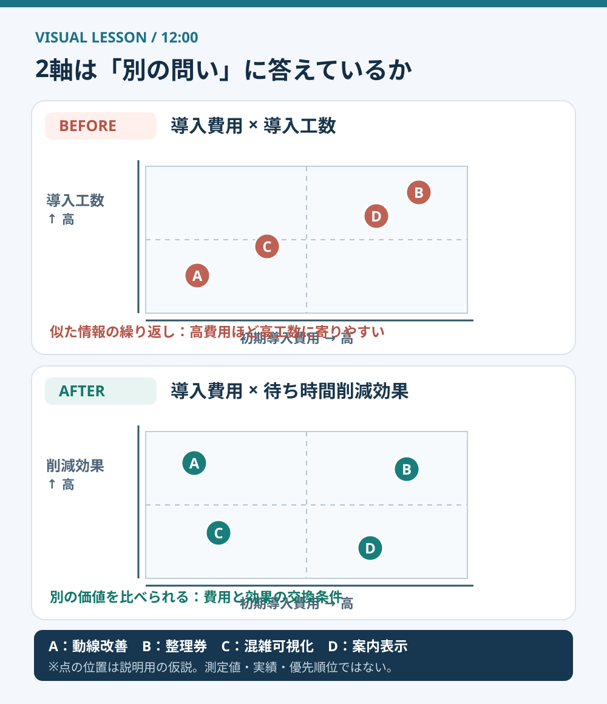
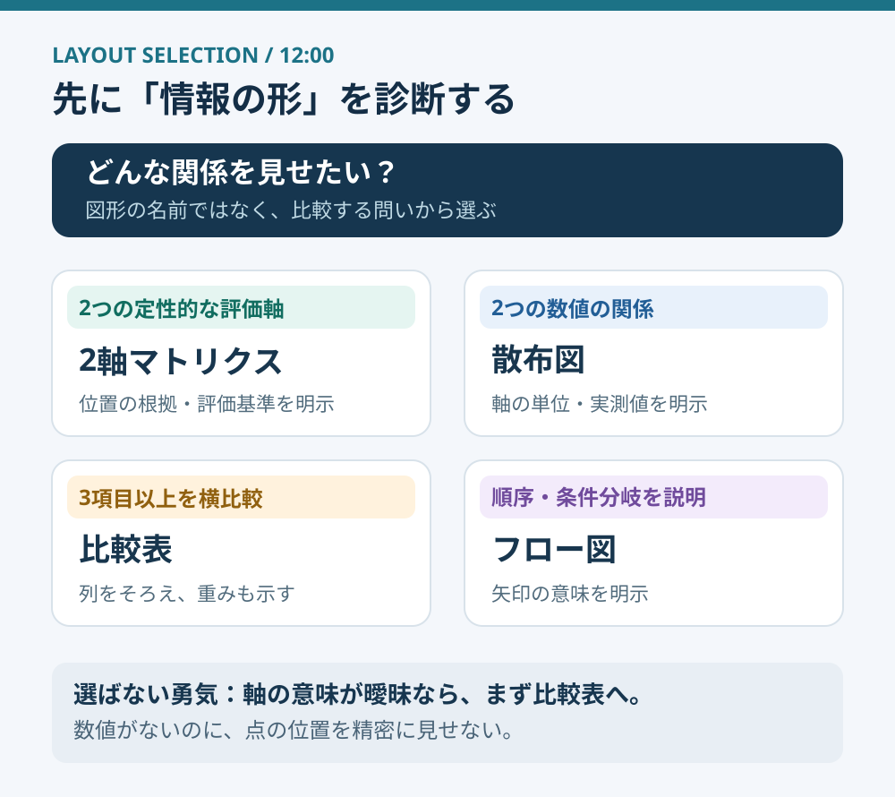

# 2軸マトリクスは、軸を決める前に疑う

**2026-11-02 12:00 JST｜学習ID 2026-11-02/1200｜レイアウト・図解｜3〜5分**

## 今日の結論

**今日の技：2軸の重複チェック。** マトリクスを作る前に「横軸と縦軸は、別々の問いに答えているか」を確かめる。軸が似ていると、きれいな4象限でも新しい判断は生まれない。先に軸を検証すると、レイアウトの作り直しと議論の手戻りが減る。

## 守｜2軸マトリクスは「分類」ではなく「違い」を見せる

2軸マトリクスは、対象を縦横2つの基準で置き、位置関係を比べる図。たとえば「導入費用」と「導入工数」は異なる言葉だが、案件によっては一緒に増えやすい。点が斜めに固まるなら、片方の軸がほぼ同じことを言っていないか疑おう。

ここでいう「独立性」は、統計学でいう厳密な独立ではない。**一方の軸を知っても、もう一方から追加の判断材料が得られるか**という実務上の確認だ。

図1はスポーツ会場の売店改善案A〜Dを使った**架空の配置例**。改善後は「費用」と「待ち時間削減への期待」を比べる。両者は実際には関連しうるが、少なくとも費用と工数の重複より異なる判断を促せる。点の位置に実測の根拠はない。

## 破｜作る前に確認する4ステップ

1. **問いを固定する。** 「売店の待ち時間を減らす施策を選ぶ」など、意思決定を一文にする。
2. **軸を定義する。** 横＝初期導入費用（円）、縦＝待ち時間の削減見込み（分）。まだ数字がないなら「高・低」の判定基準を文章で書く。
3. **重複を試す。** 費用が同じでも効果が異なる候補、効果が同じでも費用が異なる候補を想像できるか。難しければ軸を再設計する。
4. **配置の根拠を記す。** 測定値・試算・担当者評価・仮説を区別し、未検証の点には「暫定」と付ける。

例外：定量的な2変数があるなら、4象限に押し込むより**散布図**が正確。候補を3項目以上で評価するなら比較表、順序や分岐を示すならフロー図が適する。

## Before→After｜図を変えると、会議の質問が変わる

**Before：**「費用×導入工数」のマトリクス。高費用の案は高工数にも寄りやすく、「大変そうな案が右上にある」という既知の印象で終わる。**After：**「費用×待ち時間削減効果」に変更し、費用の割に効果が大きい案を探す。ただし期待効果の推定方法は必ず示す。

図2は**レイアウト選択の診断表**。SlideLandには実際の企業資料を集めた「マトリクス」の作例一覧があるが、ここで示した図はそれらを転載したものではなく、情報の性質に応じた独自の選択手順だ。

## 離｜図を疑うことは、評価基準を疑うこと

競合比較なら「機能数×対応機能数」のような重複を避け、「対象顧客×提供価値」など別の視点を考える。人材評価なら「勤続年数×経験年数」を安易に2軸にしない。**軸の選び方は、何を価値とみなすかという判断そのもの**だ。

## 失敗例と60秒課題

**失敗例：** データがないのに、点を細かく散らして優劣を確定的に見せる。対策は、評価方法と未検証の位置を注記し、必要なら数値を載せない比較表に戻すこと。

**60秒課題：**「スポーツ施設の映像サービス」を「導入価格×導入難易度」で並べる案を改善しよう。解答例は「年間総費用×現場で削減できる作業時間」。**合格基準：**2軸の定義が異なり、どちらも測定・推定方法を説明できること。効果が測れないなら表で仮説を並べる。

## 参考資料・Simple English

参考： [SlideLand｜マトリクスの公開作例一覧](https://www.slideland.tech/docs/schematic/matrix/2)／[Microsoft公式｜SmartArtの種類と使い分け](https://support.microsoft.com/ja-jp/office/graphics-visuals/choose-a-smartart-graphic)。Microsoftは図解の目的によって「リスト・手順・階層・関係・マトリックス」を選ぶよう案内している。今回の「軸の重複チェック」は公式機能名ではなく、本教材の実務上の編集方法。

**Simple English：Choose axes that tell different stories.** ／ **日本語：それぞれ違う情報を伝える軸を選ぼう。**
