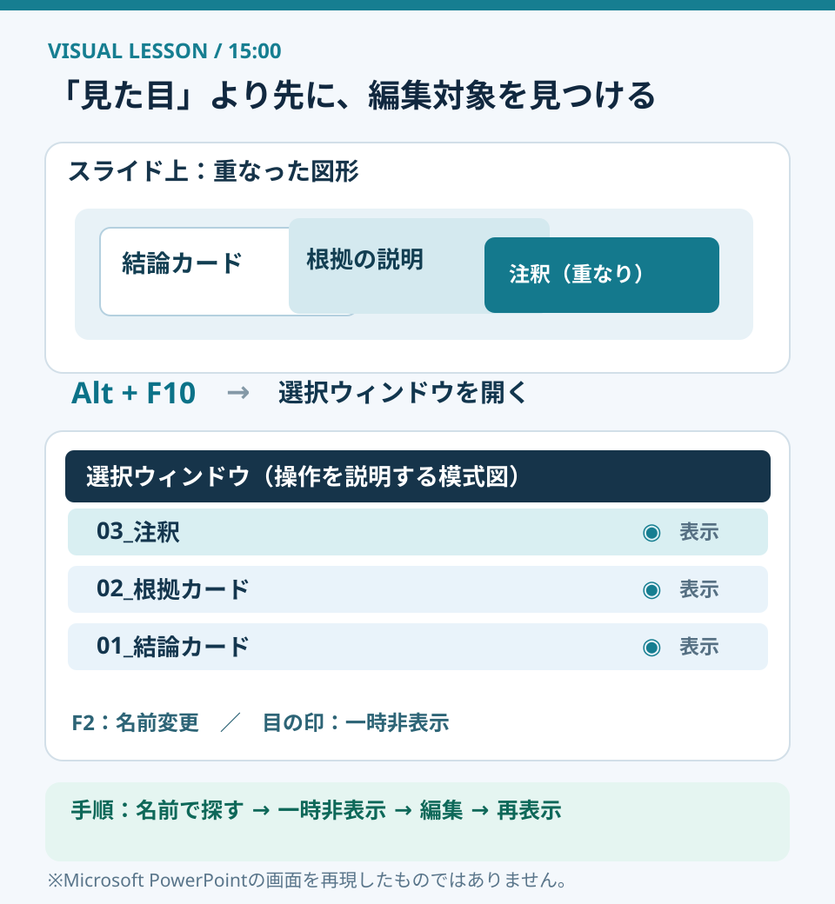
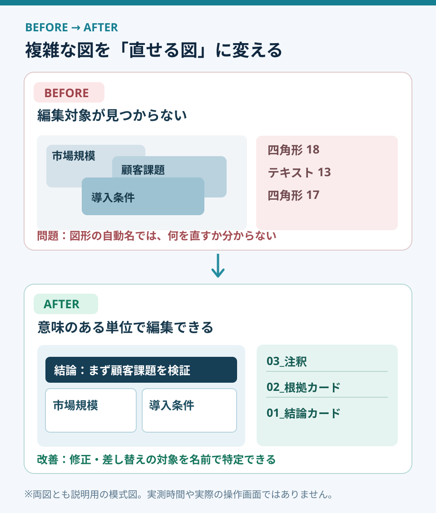

# 選択ウィンドウで、修正に強いスライドを作る

**2026-11-02 15:00 JST｜学習ID 2026-11-02/1500｜PowerPoint実装・時短｜3〜5分**

## 今日の結論

**今日の技：選択ウィンドウで図形を「名前で管理」する。** 図形が重なったスライドで、修正したい文字や矢印を探す時間を減らす。最初の制作速度だけでなく、クライアントからの修正依頼への対応を速くする技だ。

## 守｜見える図と直せる図は違う

PowerPointの**選択ウィンドウ**は、スライド上の図形・画像・テキストなどを一覧で管理する機能。名前の変更、重なり順の調整、表示・非表示、グループ化ができる。見た目は完成していても、オブジェクトが多く重なっていると、修正時に別の図形を選んでしまう。そこで「画面に見える構造」と「編集するための構造」を分けて考える。

特に、背景色の帯・半透明の強調枠・注釈・矢印が重なる、事業モデルや競争優位性の図に向く。逆に、文字が2つしかないスライドに全図形の命名をするのは過剰。**修正の頻度と重なりの多さ**で導入を判断しよう。

図1はWindows版PowerPointの操作概念を示した独自図解で、実際の画面写真ではない。**Alt＋F10**で選択ウィンドウを開き、一覧の対象を選んで**F2**で名前を編集できる。Microsoft公式の操作説明で確認した。

## 破｜Windowsで使う4ステップ

1. **開く：** 修正したいスライドで**Alt＋F10**。リボンからなら［ホーム］→［選択］→［選択ウィンドウ］。図形の名前と前後関係が一覧になる。
2. **名付ける：** 修正頻度の高い要素から、対象を選び**F2**。例は「01_結論カード」「02_根拠カード」「03_注釈」。番号は説明用の命名規則で、PowerPointの必須仕様ではない。
3. **一時的に隠す：** 前面の帯や注釈が邪魔なら、一覧の表示・非表示ボタンで一時的に隠し、下の文字を編集したら再表示する。非表示は削除ではない。
4. **まとまりにする：** 関連する図形をCtrl＋クリックで複数選択し、［図形の書式設定］→［グループ化］でまとめる。必要ならグループに名前を付ける。最後にすべて再表示し、重なりと文字切れを確認する。

**例外と別解：** 位置がずれているだけなら、選択ウィンドウでなく［図形の書式設定］→［配置］→［整列］を使う。グループ内の図形とグループ外の図形を同時に扱いにくい場合は、グループ化を最後に回す。リボン名は製品版・言語設定で表示差がありうるため、ここではWindows版Microsoft 365の公式説明に沿った。

## Before→After｜事業機会の図を修正しやすくする

**Before：** スポーツ映像サービスの事業機会を「市場規模・顧客課題・導入条件」の3層で示したが、選択ウィンドウには「四角形18」「テキスト13」などが並ぶ。修正依頼が来るたびに図形をクリックして探す。**After：** 「01_結論カード」「02_根拠カード」「03_注釈」と意味で命名し、必要なまとまりをグループ化する。例えば「導入条件の注釈だけ変更」という依頼を、名前から対象に直結させる。これは架空の編集例で、短縮時間を測定したものではない。

図2のポイントは**デザインが変わったのではなく、修正作業の経路が短くなった**こと。SlideLandの「階層・レイヤー」には実際の公開資料の作例が並ぶが、本図はそれらを転載したものではなく、編集工程を説明する独自の模式図だ。

## 離｜資料は「見る人」と「直す人」の二重の設計

図解は受け手が理解するためのものだが、制作現場では何度も更新される。これはWeb画面で「表示」と「編集用の管理画面」を分ける発想に似ている。スライドを再利用するチームほど、見栄えだけでなく**変更しやすさ**が品質になる。事業計画の前提値、スポーツ施設の稼働率、TAMの計算根拠など、差し替えが多い要素から名前を付けておこう。

## 失敗例｜隠した図形を戻し忘れる

**失敗：** 背景帯を一時非表示にして文字を直し、そのまま提出してしまう。Microsoft公式も、非表示オブジェクトを忘れやすい点を注意している。**対策：** 最後に選択ウィンドウの表示状態を確認し、スライドショーで1枚を通して見る。グループ化しすぎて個別編集が難しくなる場合は、変更単位を基準に分け直す。

## 60秒課題｜3つだけ名前を付ける

**課題：** 手元のPowerPointを1枚開き、Alt＋F10で選択ウィンドウを表示。今後修正が入りそうな3つの要素を「役割が分かる名前」に変更する。**合格基準：** 他の担当者が「注釈だけ変更」と言われたとき、画面上を探さず一覧から対象を特定できること。難しければ、名前を「注釈_契約条件」のように具体化する。

## 参考資料・Simple English

出典： [Microsoft公式｜選択ウィンドウの操作](https://support.microsoft.com/ja-jp/powerpoint/use-the-selection-pane-to-manage-objects-in-documents)／[Microsoft公式｜図形の整列・配置](https://support.microsoft.com/ja-jp/office/graphics-visuals/align-or-arrange-objects)／[SlideLand｜階層・レイヤーの公開事例](https://www.slideland.tech/docs/schematic/layer)。Alt＋F10、F2、非表示・再表示、グループ化はMicrosoft公式のWindows向け案内で確認。SlideLandは図解の参考例であり、PowerPointの操作手順の根拠ではない。

**Simple English：Name objects by their role, not their shape.** ／ **日本語：図形の形ではなく、役割で名前を付けよう。**
