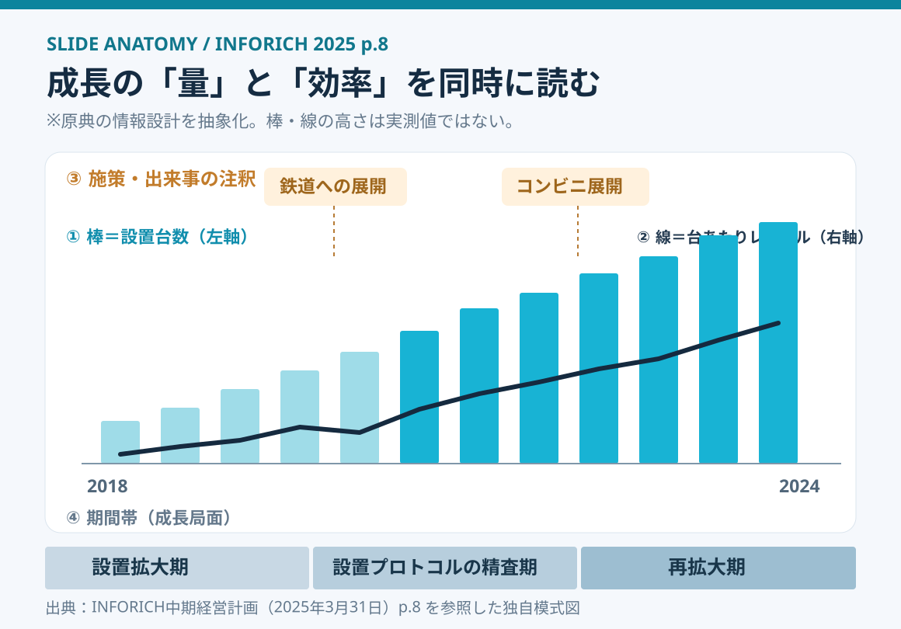
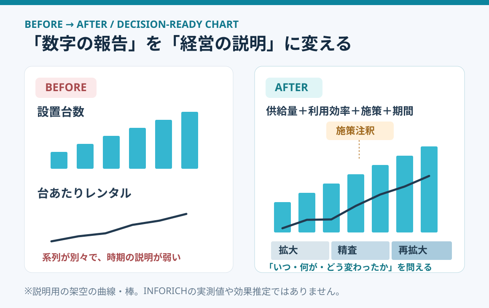

# INFORICHの成長グラフを解剖する｜量・効率・施策を1枚で読む

**2026-11-02 18:00 JST｜学習ID 2026-11-02/1800｜名作スライド解剖｜3〜5分**

## 今日の結論

**今日の技：複合グラフに施策と成長段階を重ねる。** 設置台数のような「事業の量」と、1台あたり利用のような「効率」を同じ時間軸で見せると、成長の仕組みを議論しやすくなる。ただし、施策の効果を証明したことにはならない。

## 守｜原典の1枚は何を説明しているか

**実在資料：**株式会社INFORICHの「中期経営計画（VISION 2030）」（2025年3月31日公開）8ページ「ChargeSPOT国内の成長」。SlideLandにはこの中計の掲載一覧があり、今回は[原典PDFの8ページ](https://f.irbank.net/pdf/20250331/140120250331504661.pdf#page=8)を直接確認して解剖した。SlideLandの掲載一覧そのものを、8ページの制作意図を説明した文章とは扱わない。

**ページの目的と主張：**2018年4月のサービス開始後、コロナ禍を経ても成長し、設置台数の増加による密度向上と台あたりレンタルの増加を説明する。水色の棒は**台数（左軸）**、黒い線は**台あたりレンタル（右軸）**。さらに、テレビCM・鉄道・コンビニへの展開などの出来事と、下部の3つの成長段階が同じ時間軸に置かれている。

**見た目の工夫：**主役は単なる棒グラフではなく、①供給量の棒、②利用効率の線、③施策の注釈、④成長段階の帯という**4層の情報設計**。出来事の吹き出しと3期の帯が、数字を「経営の物語」に接続している。

## 破｜4ステップで再現する

1. **問いを決める。**「設置拡大だけでなく、1台あたりの利用も伸びたか」。問いが1指標なら複合グラフにしない。
2. **2系列を同じ時点でそろえる。**横軸を月・四半期に統一。棒＝設置台数、線＝台あたりレンタル。異なる単位なので左右の軸名・単位を必ず記す。
3. **施策を時系列に載せる。**テレビCMや設置先拡大の実施時期を、注釈の指示線で結ぶ。施策と数値の変化が同時期でも「効果」とは断定しない。
4. **期間帯で解釈を助ける。**「設置拡大期→設置プロトコルの精査期→再拡大期」と下部に帯を置き、見出しには何が分かったかを書く。

**PowerPointでの作り方：**［挿入］→［グラフ］から縦棒を作り、［グラフの種類の変更］→［組み合わせ］で線系列を第2軸へ。Microsoft公式も異単位の系列に第2軸を使う方法を説明している。施策注釈と期間帯は図形で追加する。

## Before→After｜データの羅列を経営の説明へ

**Before：**「設置台数が増えた」「利用が増えた」を別々のグラフで提示。数値は読めても、どの施策・期間に何が変わったかはつかみにくい。**After：**時間軸を共有し、供給量・利用効率・出来事・成長段階を重ねる。聞き手は「量の拡大だけなのか、1台あたりの利用も改善したのか」を問い直せる。

**重要な限界：**2つの縦軸は目盛の取り方で線と棒の重なりが変わり、関係が強そうに見える。因果を検証するには、地域別比較、導入前後の条件調整、外部要因の確認などが別途必要。比較そのものが目的なら、上下2段の小さなグラフの方が誤読を減らせる場合もある。

## 離｜スポーツ施設の事業評価へ転用する

スポーツ施設なら**「運営施設数（供給）」×「1施設あたり月間利用件数（効率）」**で考える。開業、予約システム変更、広告出稿などを注釈に置くと、事業拡大と既存施設の稼働改善を分けて話せる。これは図の転用案であり、実際の施設データではない。

**新しい観点：**よい成長グラフは、成長を祝うだけでなく、次に何を検証するかを生む。効率が伸びないなら立地や導線を、効率だけ伸びて供給が増えないなら設置制約を調べる。

## 失敗例｜出来事を原因と断定する

**失敗：**グラフに「広告開始」と書いた直後に利用が伸びたので「広告で増えた」と結論づける。**回避：**「同時期に増加」と表現し、季節性・供給拡大・地域差を別途検証する。図の注釈は観察の補助であって、因果推論の代わりではない。

## 60秒課題｜2つの系列と1つの出来事

**課題：**自分の仕事から「規模の指標」「1単位あたりの効率」「同時期の施策」を各1つ選ぶ。例：動画の配信本数／1本あたりの平均視聴時間／サムネイル改善の開始日。**合格基準：**単位・期間がそろい、何を説明するための組み合わせか一文で言え、因果を断定していないこと。

## 参考資料・Simple English

確認した出典：[SlideLand｜INFORICH中期経営計画の掲載一覧](https://www.slideland.tech/docs/company/inforich)／[INFORICH「VISION 2030」2025年3月31日公開・8ページ](https://f.irbank.net/pdf/20250331/140120250331504661.pdf#page=8)／[Microsoft公式｜第2軸を追加・削除する](https://support.microsoft.com/ja-jp/office/excelexp/add-or-remove-a-secondary-axis-in-a-chart-in-excel)。SlideLandの画像は転載せず、図1・図2は原典の構造を学習用に抽象化した独自模式図。

**Simple English：Show scale, efficiency, and context together.** ／ **日本語：事業の規模・効率・背景を一緒に示そう。**
