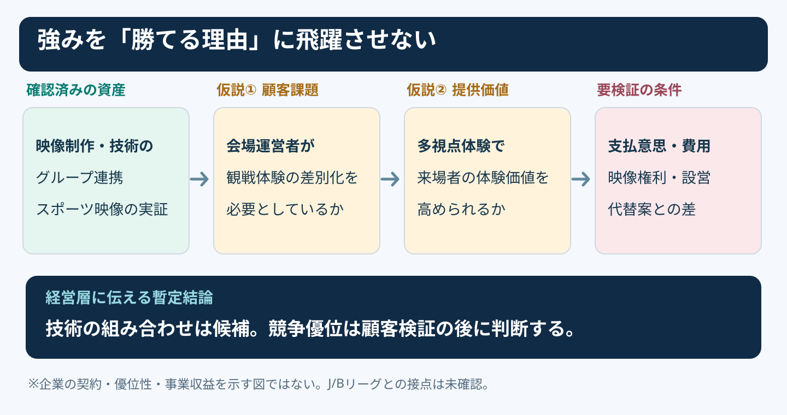
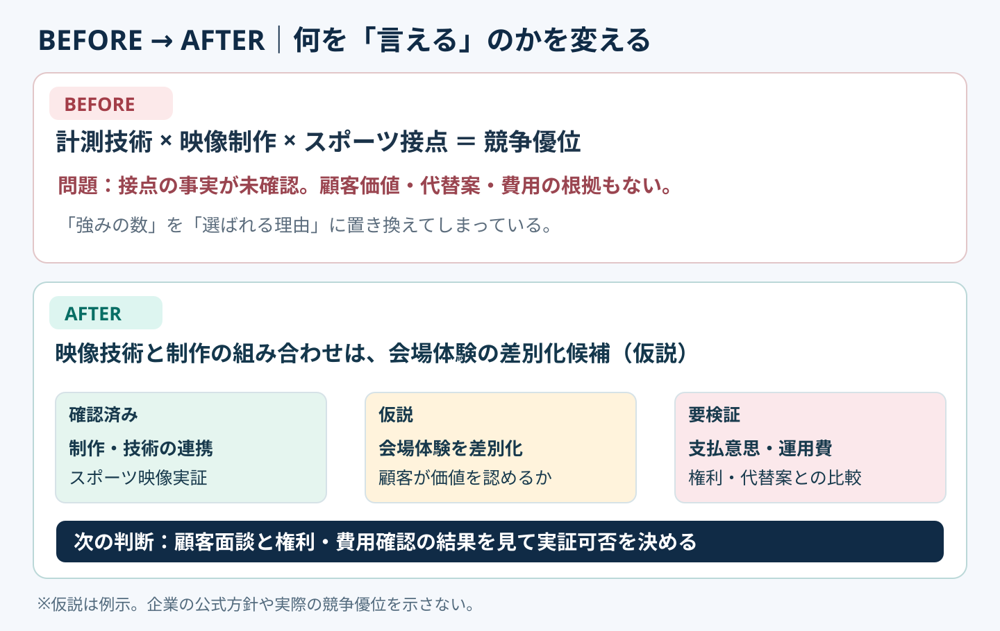

# 強みの羅列を競争優位の検証図に変える｜4段階の論理橋

**2026-11-02 21:00 JST｜学習ID 2026-11-02/2100｜コンサル実務応用｜3〜5分**

## 今日の結論

**今日の技：強みと競争優位の間に「顧客課題・提供価値・検証条件」を挟む。** 企業の技術や接点を並べただけでは、勝てる理由は説明できない。経営層向けの1枚は、何が確認済みで、何を検証すれば投資判断できるかまで示すと、手戻りが減る。

## 守｜強みは出発点であって結論ではない

**競争優位**とは、顧客に選ばれる理由を競合より有利に実現できる状態を指す。例えば、撮影技術を持つことは「資産」だが、顧客の運営費を下げられるか、代替案より優れているか、継続して提供できるかは別の問いになる。

**確認できた事実：**IMAGICA GROUPは公式に「クリエイティブとテクノロジー」「ワンストップサービス」を強みとして紹介し、2024年4月にスポーツのボリュメトリック映像（人物の動きと立体形状を取得する技術）を使った体験型コンテンツの実証を公表している。ただし、これだけでスポーツ市場での優位性やJリーグ・Bリーグとの契約が証明されたわけではない。

**図の読み方：**左端の資産だけは一次資料で確認できる。中央の顧客課題・価値は仮説、右端の成立条件は検証項目。矢印は因果関係の証明ではなく、**説明で埋めるべき論理の橋**を表す。

## 破｜5手順で投資判断用の1枚にする

1. **問いを限定する。**「スポーツ会場での多視点映像体験を、小規模実証する価値はあるか」と置く。製品全般の強み紹介に広げない。
2. **資産を事実で書く。**「映像制作・技術のグループ連携」「スポーツ向け実証の公表」。出典のないJ/Bリーグ接点や受注実績は書かない。
3. **顧客と課題を仮説で置く。**「アリーナ運営者が、観戦体験を差別化したい」。誰が予算を持つかは未確認とする。
4. **代替案と比べる。**「既存の大型ビジョン演出」「外部制作会社への単発発注」などと比較し、何が良いかを仮説として示す。
5. **証拠の取得順を決める。**顧客面談→体験評価→権利・設営・費用→有償実証の意思確認。検証前は『競争優位あり』と書かない。

**PowerPoint配置：**上部25％に結論、中央55％に「資産｜顧客課題｜提供価値｜成立条件」の4列、下部20％に「次の判断・必要な検証」。4列を矢印で結ぶが、矢印の上には「仮説」と明記する。

## Before→After｜IMAGICA GROUPの事業機会

**Before：**「計測技術がある／映像制作ができる／スポーツとの接点がある。だから競争優位がある」。強みの列挙から優位性へ論理が飛んでおり、特にスポーツ接点の実態が不明。**After：**「映像技術と制作の組み合わせは、会場体験を差別化する候補。ただし顧客価値・運用負担・権利・代替優位を検証してから実証判断する（仮説）」。

**図の読み方：**Beforeは資産の一覧で終わる。Afterは「確認済み」「仮説」「要検証」を色とラベルで分ける。タイトルは「強みがある」ではなく、**次にどの判断ができるか**を書く。

## 離｜売り先が変わると、優位性の条件も変わる

同じ映像技術でも、**クラブ**には選手育成・ファン体験、**リーグ**には権利処理・横展開、**施設運営者**には稼働率・運用負荷が重要になる可能性がある。顧客が変われば、比較すべき代替案も、必要な証拠も変わる。これは顧客課題の仮説であり、ヒアリング前の断定ではない。

SlideLandの[横型フロー図解](https://www.slideland.tech/docs/schematic/flow)は、工程や因果の説明に向く作例を探す入口になる。ただし今回のように「事実と仮説の境界」を示す場合は、**4列フロー＋状態ラベル**が有効。単なる強みの数を比較したいなら表、評価軸を横比較したいならマトリクスを選ぶ。

## 失敗例｜「グループシナジー」で説明を終える

**失敗：**「グループ各社の技術を掛け合わせ、唯一無二の価値を提供」と書く。どの顧客が、何に対価を払い、代替案よりなぜ良いかが抜けている。**回避：**「誰の課題→何を改善→何と比べて→どの証拠で確認」の4問を注釈で添え、証拠がない主張は仮説と明示する。

## 60秒課題｜強みを検証可能な仮説へ

**課題：**「当社は高精度な映像技術を持つ」を、経営会議用の1行に書き換える。**解答例：**「高精度映像を活用した会場向け多視点体験は差別化の候補だが、顧客の支払意思・運用費・権利条件は未検証」。**合格基準：**顧客、価値、仮説の境界、次に確かめる項目が読めること。

## 参考資料・Simple English

確認した出典：[IMAGICA GROUP｜3つの強み](https://www.imagicagroup.co.jp/about/)／[IMAGICA GROUP｜スポーツのボリュメトリック映像実証](https://www.imagicagroup.co.jp/volumetric/)／[SlideLand｜フロー（横型）の公開作例](https://www.slideland.tech/docs/schematic/flow)。図は独自作成であり、企業の事業計画・契約・収益性を示すものではない。

**Simple English：A strength is not yet an advantage.** ／ **日本語：強みがあるだけでは、まだ競争優位とはいえない。**
