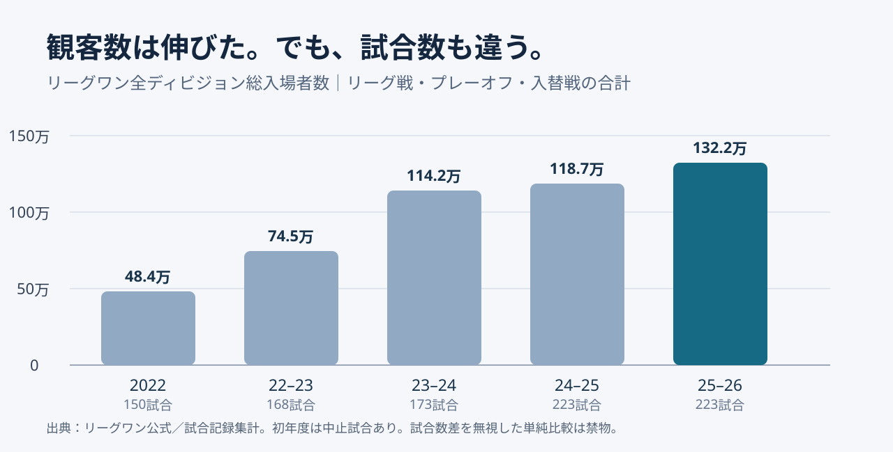
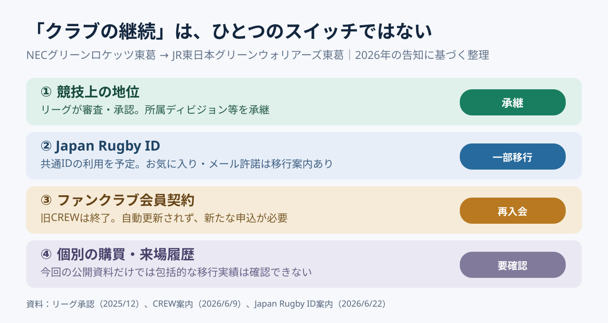

# リーグの理事長が変わると、ファンのログイン画面まで変わるのか

*2026年11月3日時点｜守破離リサーチ。報道・公式決定・解釈・予測・提案を区別する。*

## 理事長が変わるだけなのに、ファンクラブの話をする理由

役員人事のニュースを読んで、最初に気になるのは人物だろう。東海林一氏、玉塚元一氏、清宮克幸氏。誰が改革派で、誰が継続派なのか。しかし、これを調べていくと、不思議なところへたどり着いた。**クラブの持ち主が変わったとき、ファンが使っていたマイページはどうなるのか。**経営の大きな話が、ログイン画面という小さな場所に着地する。

2026年10月30日、共同通信は東海林専務理事の理事長就任が有力だと報じた。現在の理事長は玉塚氏。リーグ側は同日、12月の社員総会と理事会で正式に決定するため、現時点では決定していないと発表している。したがって本稿は、東海林氏の就任を確定事項として扱わない。候補者の演説や選考委員会の評価内容も、確認できない部分を想像で埋めない。記事に必要なのは当て物ではなく、**人が交代しても残る問題**を特定することだ。[共同通信を掲載した神戸新聞](https://www.kobe-np.co.jp/news/zenkoku/compact/202610/0020984529.shtml)／[リーグ公式発表](https://league-one.jp/news/6233)

写真は2025年3月22日の東芝ブレイブルーパス東京対埼玉パナソニックワイルドナイツ戦。人事報道当日の写真ではない。撮影：Bowwow、[ウィキメディア・コモンズ](https://commons.wikimedia.org/wiki/File:%E7%A7%A9%E7%88%B6%E5%AE%AE%E3%83%A9%E3%82%B0%E3%83%93%E3%83%BC%E5%A0%B420250322.jpg)、[CC0 1.0](https://creativecommons.org/publicdomain/zero/1.0/)。撮影者による権利放棄の作品を改変せず引用掲載。

## 守①｜リーグワンは「完全にプロ化した日本ラグビー」ではない

リーグワンは、2022年に開幕した国内最高峰の男子15人制ラグビーリーグである。前身は2003年に始まったトップリーグ。2026-27シーズンは27チームが、ディビジョン1に12、ディビジョン2に8、ディビジョン3に7の構成で参加する。開幕予定は2026年12月12日。なお名称に「リーグ」が入るが、競技は13人制のラグビーリーグではなく15人制のラグビーユニオンである。名称が少しだけ初見に厳しい。[公式大会編成](https://league-one.jp/news/6041)

旧トップリーグを説明するなら、まず企業スポーツの蓄積を理解したい。親会社が選手の雇用、施設、チーム運営を支える強みがある一方、事業の成長と企業の経営方針は一致するとは限らない。リーグワンへの移行は、チームがホストゲームの興行を主体的に担い、チケットやスポンサーなどの成果を自分たちの収益につなげる方向への制度変更だった。つまり「プロかアマか」という二択より、**誰が投資し、誰が売り、誰がリスクを負うか**を問うほうが実態に近い。

企業の支援を減らせば必ずよくなるわけではない。日本のラグビーは企業の設備、雇用、育成投資によって支えられてきた。その資産を残しながら、自主財源と地域との関係を厚くすることが改革の難所なのである。

## 守②｜観客132万人の成功は、全クラブが稼げることを証明しない

2025-26シーズンの総入場者数は132万2,343人。全3ディビジョンのリーグ戦、プレーオフ、入替戦を含む223試合の合計で、過去最多だった。2022年の48万4,047人と比べれば大幅な成長だが、初年度は新型コロナウイルス禍による中止試合があり、試合数も異なる。ここで「2.7倍成長！」とだけ叫ぶと、勢いのよい数字が比較条件をタックルしてしまう。[リーグ公式](https://league-one.jp/news/6008)／[公式試合記録の集計](https://rugby-zukan.com/leagueone/)

上図は各シーズンの全体入場者数を整理した。2025-26のD1リーグ戦の平均は8,900人だが、2023-24には8,929人を記録している。つまり全体の総入場者数が過去最多でも、D1の平均が毎年最高を更新しているわけではない。さらに2025-26の平均はD2が約2,992人、D3が約1,103人。**リーグが大きくなることと、個々のクラブが事業として安定することは別の指標**だ。[ディビジョン別試合記録の集計](https://rugby-zukan.com/articles/leagueone-attendance/)

## 守③｜一般社団法人の理事長は、クラブの集合意思を飛び越えられない

リーグワンの運営主体は一般社団法人である。「社員総会」の社員は会社員ではなく、法人の意思決定に参加する構成員を意味する。公開定款には、社員総会が理事の選任などを担い、理事会が理事長を選定する仕組みが示されている。理事長だけを替えても、社員総会や理事会の権限が自動的に変わるわけではない。言い換えれば、改革案を発表できる人と、それを可決できる機関は同一ではない。[組織概要](https://league-one.jp/content/organization/)／[公開規程](https://league-one.jp/content/regulation/)

仮にトップが「全部のクラブに同じ会場基準を直ちに守ってもらう」と言っても、各クラブの資金力、施設の所有者、地域事情、興行日程は異なる。トップが腕まくりしても、スタジアムの予約表は気合で空かない。経営の要点は威勢のよさより、**合意形成の手順、決定する権限、実行の責任、例外の扱い**を組み合わせることにある。

## 守④｜550億円目標の意味は、売上の大きさより依存の変化にある

リーグワンは2024年11月、2027-28シーズンにリーグと各チームの事業規模を合計550億円程度へ拡大する方針を発表した。同時に、D1平均の母体企業協賛比率を60％以内へ下げる目標を掲げている。前者は規模、後者は収益構造を測る指標である。550億円はリーグ運営法人単体の売上でも、既に達成した金額でもない。[リーグ公式の方向性](https://league-one.jp/news/3590)

この二つを一緒に読むと、目標は「もっとお金を集めよう」だけではないと分かる。親会社からの資金が減っても、外部スポンサー、興行、その他事業から収入が入る構造へ向かうということだ。ただし、協賛比率が下がる理由は分母の事業規模増加でも起きる。比率だけで評価せず、**自主財源の絶対額、収益性、資金の継続性**を確認する必要がある。

## 再リサーチ①｜クラブの持ち主が変わっても、競技上の地位は引き継げた

議論を経営の抽象論から降ろすため、実際に保有者が交代したチームを調べた。NECは2025年8月、グリーンロケッツ東葛を中長期的に維持・発展させることは困難として、第三者への譲渡検討を公表した。2025年12月、リーグワンはJR東日本への正会員の地位の譲渡を承認。2026年7月に新体制へ移行し、2026-27シーズンにはJR東日本グリーンウォリアーズ東葛として参加することになった。[NECの発表](https://jpn.nec.com/press/202508/20250820_02.html)／[リーグの承認](https://league-one.jp/news/4970)／[新チーム名](https://league-one.jp/news/6012)

ここで重要なのは、リーグが新運営主体の適格性、事業継続性、財務健全性などを審査し、所属ディビジョン等の地位の承継を認めた点である。会社が変わるとチームが初年度から作り直しになるわけではない。**競技の歴史を継続させる制度**は用意されていた。ただし、競技上の継続と、すべての契約やデータの自動承継は同じではない。[譲渡承認の公式発表](https://league-one.jp/news/4970)

## 再リサーチ②｜ファンクラブは再入会、しかし「お気に入り」は引き継がれた

ではファンの側はどうなったのか。2026年6月9日の旧クラブの案内によれば、従来の「CREW」マイページは6月30日で終了し、新チームのファンクラブへの会員資格は自動更新されない。継続して特典を受けたい人は新たに申し込む必要がある。厳密には「応援していたのに追い出された」ではない。**旧契約が終わり、新契約への申し込みが必要になった**のである。[旧クラブの案内](https://green.necrockets.net/news/20260610/)

ところが、もう一つの公式告知を読むと話が変わる。Japan Rugby IDにおける旧クラブの「お気に入り登録」とメール受信許諾は、7月1日時点の登録状況に従って新クラブへ移行されると案内されていた。一方でファンクラブの会員資格は自動移行しない。つまり実際には、**ログインの基盤、クラブへの関心、メール許諾、有料会員の契約**が別々に扱われている。これは単なるシステムトラブルではなく、顧客関係の設計を考える格好の材料になる。[お気に入り・許諾の移行案内](https://green.necrockets.net/news/20260623/)

この図は公式発表を整理した概念図であり、個々の会員データの移行実績を監査したものではない。見えてくるのは、**クラブが同じであることと、ファンに同じサービスが継続することを別々に判断する必要**がある、という原則だ。

## 再リサーチ③｜競技を守る制度が、選手の権利とぶつかることもある

もう一つ、組織統治の実力を試した出来事がある。リーグは2026-27シーズンから選手登録区分A-1・A-2を導入する方針を示したが、一部選手が制度の施行差し止めを求めて東京地裁へ仮処分を申し立てた。2026年8月、リーグは要件の一部を追加・修正し、8月27日に和解が成立したと公表した。これは、国内育成選手の出場機会と競技水準、既存選手の取り扱いが同時に関わる難しい制度設計だった。[公式の経緯](https://league-one.jp/news/6084)／[和解・制度変更](https://league-one.jp/news/6124)

この事例から「改革をやめるべきだった」と結論づけるのは早い。逆に「よい目的だから手続きは後でいい」も違う。**政策の目的が正当であることと、影響を受ける人への説明や移行措置が十分であることは独立して検証すべき**だ。理事長の改革力は、発表する力だけでなく、反対が出た際に制度を修正できる力でも測られる。

## 破①｜今回の選考は、改革か保守かより「誰が実装するか」を問うた可能性がある

【解釈・仮説】東海林氏が有力だという報道を、清宮氏の改革案が否定された証拠として扱うことはできない。各候補の演説の詳細や選考基準を十分に確認できていないからだ。東海林氏は立ち上げ期から専務理事として実務に関わってきた。ここから立てられる仮説は、リーグが構想を掲げる段階から、複数のクラブを動かし制度を実施する段階へ移っている、というものだ。**候補者の価値観ではなく、仕事の種類が変わった**と考えるとニュースの読み方が変わる。

ただし、この仮説には裏面もある。既存制度を詳しく知る人は実装に強い一方、自分が関与した制度を根本から見直しにくい場合がある。これを経路依存性という。したがって「継続性」は無条件に長所ではない。**何を継続し、何を修正するかを検証できる統治機関**があって初めて、継続が経営上の強みになる。

## 破②｜最も難しい意思決定は、誰にいくら配るかではなく何を共同で作るか

【予測・論点】今後は放映権、共通スポンサー、デジタル事業などの資源をどう扱うかが重要になるだろう。強いチームに多く配れば努力を促せるが、弱いチームは追いつきにくくなる。均等配分を厚くすれば最低限の基盤は守れるが、収益を伸ばした努力への報酬は薄まる。この二律背反を解く手段は分配金の比率だけではない。リーグ共通で顧客管理、営業ツール、映像制作、スタッフ教育を整える選択肢もある。ただし、それが実際に収益を増やすかは費用対効果の検証が必要だ。

ここにはジャパンラグビーマーケティングという別の主体も存在する。同社は2022年、日本ラグビー協会、リーグワン、ソニーグループによって設立され、2023年にはNTTドコモが出資した。代表戦とリーグ、チームと共通基盤の間で、顧客接点や事業権利をどこまで共有するか。**リーグの成長には、クラブ同士だけでなく組織間の役割分担も必要**になる。[JRM会社概要](https://japan-rugby-mktg.com/company.html)

## 離①｜所有者を替えられる競技と、替えにくいファンの記憶は別のものだ

携帯電話では、通信会社を替えても同じ番号を使い続けられる制度がある。クラブ譲渡にも、これに似た発想を持ち込めないだろうか。ただし似ているのは継続性への期待であって、契約や個人情報を自由に移せるという意味ではない。クラブ名、所属ディビジョン、認証ID、メール許諾、会員契約、来場履歴はそれぞれ異なる対象である。**何を引き継ぐかを一括で決めるのではなく、関係ごとに説明し、同意と移行手順を設計する**必要がある。

ここで「ファンは誰の資産か」と問いがちだが、その言い方も少し危うい。ファンは企業が所有する物ではない。事業者が管理できるのは、契約、権利、データ、サービスの仕組みである。一人のファンがチームを好きでいるという事実自体は、どの会社の貸借対照表にも載らない。**管理できるものと、育てるしかない関係を混同しない**ことが、スポーツの顧客戦略の出発点になる。

## 離②｜実務では、経営変更を四つの引継ぎ案件に分割すると考えやすい

【提案】クラブの譲渡・改称・運営変更を支援するなら、まず四つに分けて管理する。①競技上の継続：リーグ所属、選手契約、競技資格。②営業上の継続：スポンサー、販売権利、会場契約。③顧客サービスの継続：ファンクラブの会期、特典、返金や新規申込。④データと同意の継続：ID、配信許諾、購買・来場履歴の取り扱い。四つを同じ「引継ぎ」でくくると、誰が何を承認したかが見えなくなる。

【提案】評価指標も四つに対応させる。競技資格の承継完了率、重要スポンサーの契約継続率、旧会員への案内到達率・新規入会率、本人同意の取得状況とデータ移行時の苦情件数。加えて、会場と試合日程の確定時期を別の運営指標として追う。指標を混ぜなければ、「チームは残ったから成功」とも「再入会が必要だから失敗」とも短絡せずに済む。

## プロンプト化｜人事ニュースを経営構造へ変換する問い

【再利用用プロンプト】「この役員人事を、人物評ではなく組織設計の問題として調査する。まず①意思決定機関・法的権限、②収益源と依存先、③顧客・従業員・パートナーに生じる契約上の変化、④直近3年の成果指標、⑤当事者間の対立・制度修正事例を一次資料で確認する。報道、公式決定、筆者の解釈、将来の予測を区別する。予測は複数の条件付き仮説と反証指標にする。さらに最も日常的な一つの顧客体験に降り、その体験を生む権利・データ・運用の構造へ再び戻る。出典、調査できなかった事項、実務提案を明示する。」

## 最初のニュースへ戻る｜理事長の顔より、次にログインしたときの体験を見る

結局、東海林氏が理事長になるかどうかは、12月の正式手続きを待たなければならない。だが、このニュースをきっかけに見えるものはもうある。企業から企業へとチームが移るとき、所属ディビジョンは引き継げても、ファンクラブ契約は自動で継続しないことがある。一方で、共通IDの登録情報の一部は移行できる。同じ「継続」という言葉の中には、複数の制度が隠れていた。

だから理事長の改革を評価するとき、壮大な目標に加えて、次のような地味な瞬間を見てみたい。ファンがいつものIDでログインし、自分の好きなチームを確認し、必要な手続きを迷わず終えられるか。これは些細なUIの話に見える。しかし、その裏では一般社団法人の規約、企業間の契約、顧客データの扱い、収益配分が同時に動く。**スポーツリーグが成熟したかどうかは、大きな看板より、その裏の継ぎ目に表れる。**

## 出典・調査メモ｜確認できたことと、まだ分からないこと

**確認した一次資料**：2026年10月30日の[リーグ人事に関する公式声明](https://league-one.jp/news/6233)、[2026-27大会編成](https://league-one.jp/news/6041)、[2025-26入場者数](https://league-one.jp/news/6008)、[2027-28に向けた経営方針](https://league-one.jp/news/3590)、[NECの譲渡検討](https://jpn.nec.com/press/202508/20250820_02.html)、[リーグの譲渡承認](https://league-one.jp/news/4970)、[CREWの会員終了案内](https://green.necrockets.net/news/20260610/)、[Japan Rugby IDの移行案内](https://green.necrockets.net/news/20260623/)、[選手区分見直し](https://league-one.jp/news/6124)、[JRM会社概要](https://japan-rugby-mktg.com/company.html)。

**次の調査計画**：①候補者ごとの公約・選考基準・演説内容、②チーム別自主財源・営業収支、③配分金と権利管理の契約、④譲渡後のファンクラブの実際の再加入率を調べる。今回の再リサーチでは、顧客関係が「全部途切れる」という初期仮説を修正した。移行告知で確認できるのは制度・予定であり、全会員の移行成功を証明するものではない。独自の図解と予測は事実の代わりにはしない。
