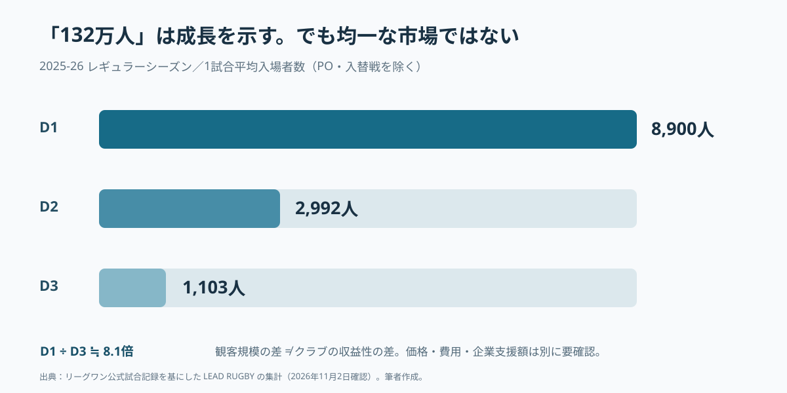
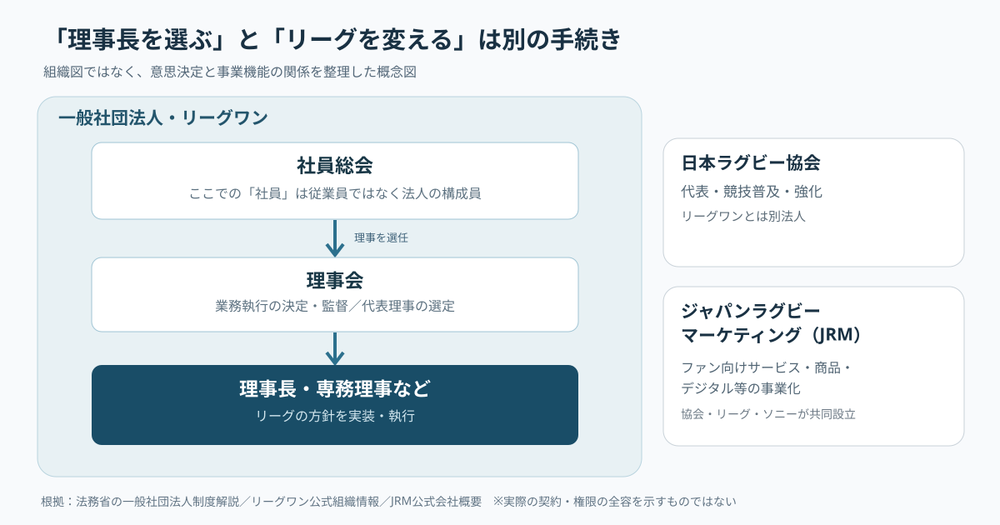
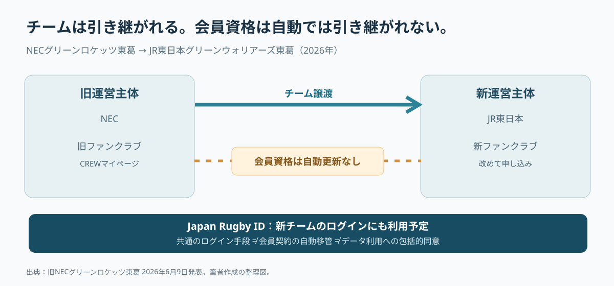

# 理事長を決める「社員」は、会社員ではない――リーグワンの改革を誰が動かすのか

*2026年11月3日現在｜守破離リサーチ。事実・分析・仮説・提案を分けて記す。*

## 「社員総会」で理事長が決まる。その「社員」は誰なのか

「リーグワンの次期理事長は、社員総会と理事会で正式に決まる見通し」。そういう報道を読むと、つい会議室に並ぶ会社員たちを想像してしまう。いや、理事長を選ぶのに従業員総出なのか。相当に気合の入った人事会議である。

ところが、この「社員」は給料をもらう従業員ではない。一般社団法人を構成し、議決権を持つ会員を指す法律用語だ。法務省によれば、一般社団法人では社員総会が理事を選び、理事会が業務執行を決め、代表理事を選定・監督する。リーグワンの公式な組織名も「一般社団法人ジャパンラグビーリーグワン」である。ここで語られているのは単なるトップの交代ではない。**異なる企業やチームが共同で動かすリーグに、誰が改革の権限を与え、誰がその実行を監督するのか**という問題なのだ。[法務省・一般社団法人制度](https://www.moj.go.jp/MINJI/minji153.html)／[リーグワン・組織概要](https://league-one.jp/content/organization/)


*写真：2026年6月7日のリーグワン決勝。撮影：Bowwow／[ウィキメディア・コモンズ原資料](https://commons.wikimedia.org/wiki/File:20260607jrlo.png)／[CC0 1.0](https://creativecommons.org/publicdomain/zero/1.0/)。試合写真は経営改革の成果を示すものではない。*

## 報道で有力とされた東海林氏は、まだ正式に選ばれていない

まず、ニュースの確度を固定しておく。2026年10月30日、共同通信は、2021年から専務理事を務める東海林一氏が新理事長になる方向で調整されていると報じた。現職の玉塚元一氏、日本ラグビー協会副会長の清宮克幸氏も候補として言及されている。一方、リーグワンは同日に「一部報道について」を発表し、12月に予定する手続きを経て正式決定するため、現時点では決定していないと説明した。したがって本稿で「東海林理事長の改革」とは書かない。まだ生まれていない人事の成果を論じるのは、キックオフ前にトライを数えるようなものだからだ。[共同通信配信・神戸新聞](https://www.kobe-np.co.jp/news/zenkoku/compact/202610/0020984529.shtml)／[リーグワン公式・2026年10月30日](https://league-one.jp/news/6233)

当初の報道文には「候補者4人が各チーム代表者に演説した」とある。ただし、今回照合できた共同通信の配信記事と公式発表からは、4人全員の氏名・演説内容・選考基準までは確認できなかった。仮に演説が実施されたとしても、それは候補者を比較する過程であり、法人の正式な選任手続きと同じではない。**人物の勝敗を物語にする前に、誰が何を決める仕組みなのかを見たほうが、ニュースから得られる情報は多い。**

## 守｜リーグワンは「会社のチームが試合をする大会」から変わろうとしている

日本の男子15人制ラグビーの最高峰は、2003年に始まったトップリーグから、2022年1月開幕のリーグワンへ移った。2019年の日本開催ワールドカップで高まった関心を、国内の定期的な試合観戦へつなげることも課題だった。とはいえ、リーグワンを「ラグビーが突然プロ化した大会」と理解するのは正確ではない。企業がチームを保有・支援する基盤は残り、そこに地域との関係や事業収益を強める仕組みを重ねたのが実態に近い。[J SPORTS・リーグワンとは](https://www.jsports.co.jp/rugby/league-one/about/)／[リーグワンの方向性・2024年11月](https://league-one.jp/news/3590)

制度改革の核心は、興行の権利と収入の流れにある。東海林氏は2023年のインタビューで、旧トップリーグからの転換として、リーグとチームが主管権を持ち、チームが主体的に試合を運営するようになったと説明している。通常のホストゲームではチケット、チームスポンサー、グッズの収入をチームが得る。放映権収入はリーグが一括して扱い、運営費などを除いてチームに還元する。チケットを一枚多く売る理由が、従来より直接的にチームの財布へ結びつく。[経済界・東海林一氏インタビュー](https://net.keizaikai.co.jp/archives/2444)

これは経済学でいう**誘因設計（インセンティブ設計）**の変更だ。努力して観客を増やした主体が、その成果を受け取りやすくする。しかし、誘因を設計しただけで、すべてのチームが同じように成長するわけではない。人口、会場、経営体制、母体企業の支援、クラブの知名度が異なるからだ。企業スポーツからプロ興行への移行を、一本の進捗バーで表せない理由がここにある。

## 守｜27チームが参加する一方、観客市場は一つではない

2026-27シーズンの参加は27チーム。ディビジョン1が12、同2が8、同3が7で、2026年12月12日の開幕を予定する。2025-26シーズンの総入場者数は、プレーオフと入替戦を含む223試合で1,322,343人となり、リーグ発足以降の最多を記録した。入場者が増えているのは事実だ。しかしリーグの健康状態を観客の合計だけで診断するのは、体温だけで人間ドックを終えるようなものでもある。[2026-27大会編成](https://league-one.jp/news/6041)／[2025-26総入場者数](https://league-one.jp/news/6008)



*図：2025-26レギュラーシーズンの1試合平均。D1は8,900人、D2は2,992人、D3は1,103人。プレーオフ・入替戦を除外。リーグ公式試合記録に基づく[LEAD RUGBYの集計](https://leadrugby.com/leagueone/attendance)を図示した。*

D1とD3の平均入場者数には約8.1倍の差がある。もっとも、それだけでは利益率や事業の優劣は分からない。チケット価格や興行費用、無料招待の割合、母体企業による支援額を見なければ収益性は測れないからだ。**「リーグは成長した」と「すべてのクラブが自立へ近づいた」は、違う命題**である。これを混同すると、理事長に求める仕事まで変わってしまう。

リーグは2024年11月、2027-28シーズンにリーグとチームの事業規模合計を550億円に拡大し、D1平均の母体企業からの協賛比率を60％以内に抑える目標を公表した。2027-28のサラリーキャップ導入、2028-29のスタジアム固定化も目指している。ここでの550億円は全チームを含む**事業規模の目標**であり、リーグ運営法人だけの売上でも、利益でも、現在の実績でもない。[リーグワン公式・中期方針](https://league-one.jp/news/3590)

## 守｜「社員総会」がある以上、改革は個人の決意だけでは進まない

運営法人の構造も整理しておこう。一般社団法人は、社員総会で理事を選任し、理事会で業務執行を決め、代表理事を選定する。会社員が「社員旅行に行くか」を決める会議ではない。参加する会員は別々の経営目的を持っている。大企業の人材育成を重視する主体も、地域興行の収益を伸ばしたい主体もいる。共通ルールを作るたびに、利害が一致するとは限らない。[法務省](https://www.moj.go.jp/MINJI/minji153.html)／[リーグワン・規程一覧](https://league-one.jp/content/regulation/)



*図：法務省、リーグワン、日本ラグビーマーケティングの公表情報をもとにした筆者作成の概念図。法律上のすべての契約・議決権配分を再現したものではない。*

さらに日本ラグビーには、競技統括・代表強化を担う日本ラグビー協会、リーグを運営するリーグワン、ファン向けサービスや商品・デジタル事業を担う**ジャパンラグビーマーケティング（JRM）**という複数の組織がある。JRMは協会・リーグワン・ソニーが2022年に設立し、2023年にNTTドコモが出資参画した。現在のJRM会社概要では、東海林氏が代表取締役の一人として記載されている。これは業務連携のための強みになりうるが、権利やデータを誰が扱い、利益や費用をどう分けるかを明確にする必要も示している。特定の利益相反が起きたと断定する材料ではない。[JRM会社概要](https://japan-rugby-mktg.com/company.html)

ここで、専任理事長という報道上のキーワードの意味が少し変わる。常勤者を置くこと自体は、会議が速く終わる魔法ではない。**意思決定の責任と執行の責任を、組織間で見失わないための設計**が伴って初めて意味を持つ。

## リサーチ｜成長の裏で生まれた、三つの実務上の摩擦

第一は、**親会社とチームの継続性が同じではない**こと。NECグリーンロケッツ東葛は、2025年12月にNECからJR東日本への正会員地位の譲渡が承認され、2026-27シーズンからJR東日本グリーンウォリアーズ東葛として参加する。リーグは譲渡先の適格性、事業継続性、財務健全性を審査したと説明する。チームの競技上の地位は引き継がれたが、企業側の経営判断がクラブの形を変えたことは動かない。[リーグワン・譲渡承認](https://league-one.jp/news/4970)／[新チーム名発表](https://league-one.jp/news/6012)

第二は、**スタジアムと日程の確定が、集客の前提条件になる**こと。2026年9月に公表されたD1の日程には未定の会場・時間があり、リーグは10月、11月にも追加決定や変更を発表している。2026年11月2日の更新を確認できるため、9月時点の未確定数を現在の数として転載してはいけない。ただ、会場・時刻の公表が遅れると、ファンの予定、遠征、チケット販売、企業の協賛施策の準備期間が短くなりうる。この連鎖は経営上の分析であって、実際の逸失売上を計算できたわけではない。[9月9日の日程発表](https://league-one.jp/news/6140)／[11月2日の追加・変更](https://league-one.jp/news/6226)

第三は、**競技の育成目標と、現役選手の権利が衝突しうる**こと。2026-27からの選手登録区分「A-1／A-2」は、日本で育った選手の出場機会などを念頭に設計されたが、一部の選手が施行差し止めの仮処分を申し立てた。2026年8月、リーグは要件への特別措置の追加と和解成立を公表し、事前説明と意思疎通が十分ではなかった点を認めた。国内育成を重視する政策目的と、移行期に影響を受ける選手への公平な対応は、同時に考えなければならない。[リーグワン・2026年8月28日](https://league-one.jp/news/6124)

これらは種類の異なる問題に見える。しかし共通点がある。**制度を設計した側と、その制度によって日常の行動を変える側が異なる**ことだ。新しいルールは紙の上で整っていても、契約、日程、営業、選手の人生、ファンの習慣に触れた瞬間に摩擦を生む。

## 次の調査計画｜ニュースの裏側を、誰の負担かで分解する

ここまでの調査から、次に必要な検証を四つに絞った。①役員候補者の公約と選考委員会の評価基準、②リーグと各クラブの自主財源・母体企業支援・利益の内訳、③スタジアム日程の初回確定日とその後の変更履歴、④選手・クラブ・ファンが制度変更に意見を伝える手順である。いずれも、理事長の顔写真や事業規模の目標だけからは分からない。

次の調査では、公的制度、リーグ公式発表、試合記録、クラブの移管案内を突き合わせた。結果として、改革の「速さ」だけでなく、**変更を受け取る人が納得・対応できる時間と手続きをどう確保するか**が論点になった。

## 再リサーチ｜リーグは拡大を急ぐだけではない

2026年10月29日、リーグワンは2027-28シーズンの新規参入チームの受け入れと申請受付を実施しないと発表した。2026-27に新規参入するチームの競技力、運営、事業の状況を確認し、2028-29以降の受け入れを検討するという。人数を増やすほど成長という単純な発想なら、少し不思議に見える判断である。[リーグワン公式・2026年10月29日](https://league-one.jp/news/6227)

ただし、受け入れの一時停止を「リーグの拡大が失敗した証拠」とするのも飛躍だ。公式発表から確認できるのは、新規参入組の実績を見たうえで次を考えるという方針まで。**拡大のペースを調整することと、拡大を断念することは違う**。今回の人事を評価するときも、何チーム増えたかだけでなく、新規参入後のクラブが何を維持できているかを見る必要がある。

もう一つ、ファンの目線で調べ直して驚いた。グリーンロケッツ東葛の移行では、旧ファンクラブのマイページが2026年6月30日で終了し、翌シーズンへの会員資格の自動更新は行われないと案内された。一方、新チームのファンクラブでも「Japan Rugby ID」によるログインを予定すると説明された。チームは引き継がれる。しかしファンクラブは、そのまま引き継がれるとは限らない。[旧NECグリーンロケッツ東葛・会員向け案内](https://green.necrockets.net/news/20260610/)



*図：旧クラブの2026年6月9日付案内をもとに作成。共通認証IDがあることは、顧客データの自動移管や包括的な利用同意を意味しない。*

ここで、改革の意味が経営者の選考から少し離れた場所に現れる。クラブを買い手に引き継ぐ制度が整っていても、ずっと応援してきた人は、新しい運営会社に改めて入会手続きをするかもしれない。法人の連続性、競技上の連続性、ファンの体験の連続性は別物なのだ。これは失敗と断定する話ではない。むしろ、本人の同意と情報保護を守りながら「関係が途切れない体験」をどう設計できるかという、新しい経営課題が見えてくる。

## 破｜次の理事長に必要なのは、改革案より実装能力かもしれない

ここからは仮説である。東海林氏が有力視される理由を、改革派対保守派という対立で解釈することはできない。実際の選考理由が公開されていないうえ、東海林氏自身が既存リーグの興行制度設計に関わってきたからだ。考えられる説明の一つは、**新しい制度を掲げる局面から、決めた制度を運用する局面へ移っている**というもの。ただし継続性は長所であると同時に、過去の判断を問い直しにくいという弱点にもなりうる。これは選考委員会の意図を示したものではない。

一つの改革案には、たいてい複数の評価軸がある。放映権収入を均等に配れば小規模クラブの安定には寄与しうるが、人気クラブにとっては成長努力への報酬が小さく感じられるかもしれない。成果に応じた分配を増やせば努力の誘因が働く一方、格差が固定化するおそれもある。別案としてリーグ共通の営業・顧客管理・試合映像基盤へ投資すれば、現金を配る以外の方法で小規模クラブの経営力を補う可能性がある。現行の配分制度を不当と評価するものではなく、**改革案を評価する際の比較軸**である。

専任理事長体制を評価するなら、就任直後の観客数だけで判定すべきではない。2026-27開幕は12月12日予定で、人事改選とほぼ同時期だ。入場者数は長い準備の成果でもある。むしろ次のような実装指標が有用だろう。

| 経営上の問い | 見る指標（提案） | 数字だけで分からない点 |
| --- | --- | --- |
| クラブの自立性は高まったか | 自主財源比率・母体企業への依存度 | 収益の質、繰り返し稼げるか |
| リーグの意思決定は機能するか | 制度公表から実施までの期間・説明実施率 | 誰の負担で速くなったか |
| 興行を計画できるか | 会場・開始時刻の確定時期・変更件数 | スタジアム側の制約 |
| ファンの関係は続いているか | 再来場率・継続会員率・移管後再登録率 | 個人情報の権限と同意 |
| 成長は全チームに届くか | ディビジョン別事業収益・経営継続状況 | チーム間の市場条件の差 |

上のKPIは**筆者提案**であり、リーグの公式な理事長評価基準でも、公開済みの実績値でもない。

## 離｜携帯電話の番号は持ち運べるのに、応援の履歴はどうなるのか

ここで、ラグビーと無関係に見える携帯電話の「番号ポータビリティ」を思い出した。会社を替えても電話番号を使い続けられる仕組みだ。電話番号とスポーツのファン資格は法的にも実務的にも別物だが、**サービス提供者が変わっても、その人の生活の連続性をどう守るか**という設計問題は共通している。

チームの所有者が変わる。チーム名が変わる。ファンクラブの運営システムが変わる。そうしたとき、前年に初めて親子で観戦した記録、会員としての継続年数、イベント応募の履歴などを、ファン本人はどう扱えるのか。仮に情報をつなぐとしても、企業間で無条件に共有してよいわけではない。利用目的、管理主体、同意、セキュリティを丁寧に確かめる必要がある。**「引き継げること」と「引き継いでよいこと」は別**だからだ。

この視点から考えると、リーグ共通IDは単なるログイン画面ではなく、クラブの経営主体が変わる時代における公共的な接点になりうる。ただし、今のJapan Rugby IDにどこまでの機能・データ移管権限があるかは本稿で確認できていない。事業機会としては、移管時の再登録支援、クラブ横断の同意管理、小規模クラブの顧客管理支援などを仮説として挙げられる。いずれも現行制度の欠陥と断定したり、適法性を確認済みとするものではない。

そして最初の「社員総会」に戻る。リーグの正式な構成員としての社員と、スタジアムへ通うファンは違う。社員には議決権がある。ファンには、それとは別の重みがある。どちらが上という話ではない。**意思決定の権利を持つ人と、その決定の影響を長く受ける人が一致しない**。スポーツリーグの統治を考える際、本当に厄介で、本当に面白いのはそこなのだ。

## 実務への落とし込み｜理事長人事を組織診断へ変える

**提案**として、リーグの新経営体制を調べるなら、まず各社・各クラブの代表者に次の5問を聞く。①改革案を誰が最終決定するか、②制度変更の費用を誰が負担するか、③チームの収益が増えたとき誰へ分配されるか、④選手やファンへの説明をいつ行うか、⑤実施した施策の成功・撤回を何で判断するか。これは役員候補者の性格診断ではなく、**意思決定の権利・負担・成果を同じ図に置く**ための質問である。

次に、各改革案について「Input＝誰の資金・権利を使うか」「Process＝誰が決め、どこで合意するか」「Outcome＝誰の行動と数字が変わるか」を記録する。可能なら、リーグの公式目標とクラブ別実績の差、変更告知から施行までの期間、顧客の継続状況を追跡する。説明が上手な理事長と、実装できるリーグは同義ではない。ここまで検証して初めて、今回の人事の意味を後から評価できる。

## 本稿の限界｜まだ分かっていないこと

役員選考委員会の採点内容、候補4人の全氏名・演説の全文、投票経緯、各クラブの詳細な収益構成、会員データの移管契約、今回の人事がJRMの経営に与える影響は確認できていない。これらは未確認のまま残す。2025-26入場者数は公式発表、ディビジョン別平均は公式記録を基にした外部集計であり、両者の集計範囲を区別する。経営の予測は事実ではなく条件付きの分析である。

## 再利用できる調査プロンプト｜別のスポーツリーグでも使う

```text
あるスポーツリーグのトップ人事ニュースを起点に、単なる人物評ではなく組織と事業の構造を調査する。
1. 公表日・正式決定日・報道と公式発表の差を確認する。
2. 前史、運営法人の法形式、意思決定権限、収入・権利の分配を一次資料から図解する。
3. 観客数、収益、親会社依存、会場、選手・ファンの権利を異なる指標として検証する。
4. 追加調査の問いを立て、公表資料を再確認して初期仮説を修正する。
5. 守＝前提、破＝条件付きシナリオ、離＝異分野との接続を展開する。
6. 事実／解釈／予測／提案を明示し、未確認事項は未確認として残す。
7. 冒頭の小さな違和感へ戻り、別の見方が生まれる結末にする。
8. 日本語版と日本語主体のEnglish Mix版を作り、図の出典と写真の権利を明記する。
```

## 主な資料と確認日

- [共同通信配信・神戸新聞（2026年10月30日）](https://www.kobe-np.co.jp/news/zenkoku/compact/202610/0020984529.shtml)／[リーグワン・一部報道について（同日）](https://league-one.jp/news/6233)
- [法務省・一般社団法人制度Q&A](https://www.moj.go.jp/MINJI/minji153.html)／[リーグワン・組織と規程](https://league-one.jp/content/organization/)
- [リーグワン・事業の方向性（2024年11月）](https://league-one.jp/news/3590)／[東海林氏へのインタビュー（2023年）](https://net.keizaikai.co.jp/archives/2444)
- [2026-27ディビジョン編成](https://league-one.jp/news/6041)／[2025-26総入場者数](https://league-one.jp/news/6008)／[LEAD RUGBY観客数集計](https://leadrugby.com/leagueone/attendance)
- [2027-28新規参入の見送り（2026年10月29日）](https://league-one.jp/news/6227)／[選手区分見直し（2026年8月28日）](https://league-one.jp/news/6124)
- [NECからJR東日本へのチーム譲渡](https://league-one.jp/news/4970)／[ファンクラブ移行案内](https://green.necrockets.net/news/20260610/)／[JRM会社概要](https://japan-rugby-mktg.com/company.html)

*調査・執筆基準日：2026年11月3日。写真と図の出典・利用条件を記載し、重要な断定は公表資料で確認した。文章構成は、具体と抽象を往復しながら前進する「Uneven U」の考え方を参考にした。*
