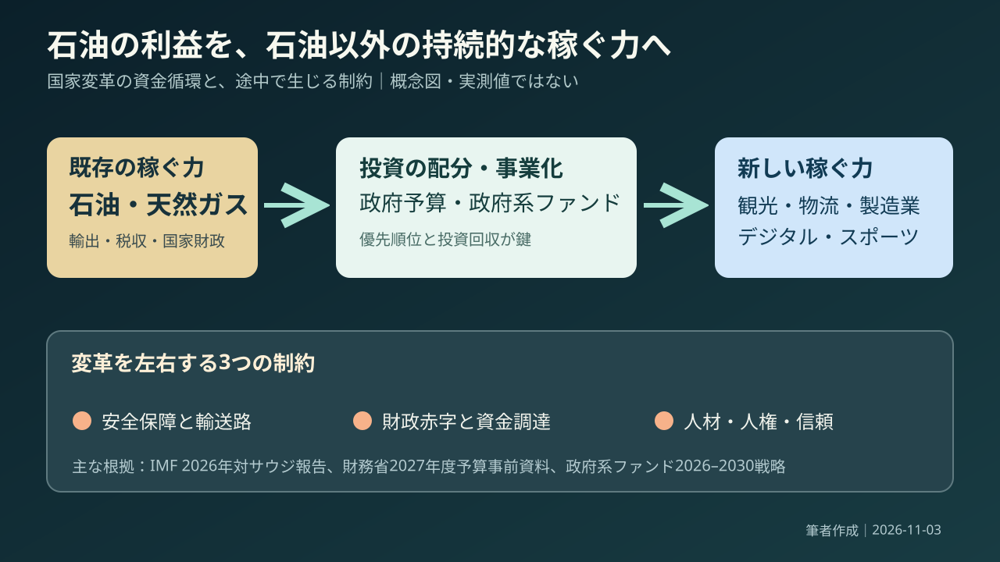
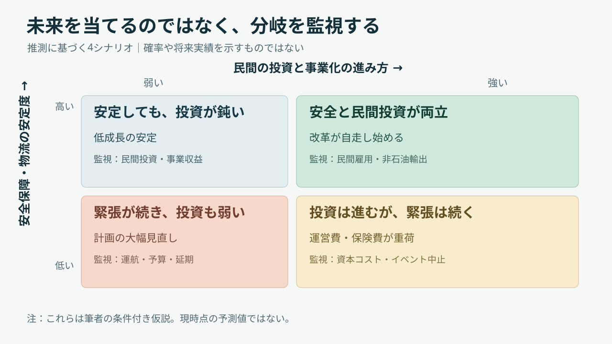

# 石油で稼いだ国は、石油に頼らない未来を買えるのか

*守破離リサーチ｜調査→次の調査計画→再調査→構造化→実務への展開。事実・解釈・仮説を区別する。*

## 30秒で結論：改革の成否は、巨額投資より自走する経済にある

サウジアラビアは何を目指し、なぜ難航しているのか。石油で得た収入を観光、物流、製造業などの新産業へ投じる「国家の事業転換」が進んでいる。しかし2026年は中東の戦闘、輸送路の混乱、財政負担が同時に重なった。問題は資金があるかだけではない。**国が支出を減らしても、民間企業と人々が自ら稼ぎ続ける仕組みを作れるか**である。

数字を一つ見る。サウジ財務省の2026年9月公表資料では、2027年の歳入見込みが1兆2,020億リヤル、歳出見込みが1兆3,920億リヤル。差は約1,900億リヤルの赤字である。もちろん国家の赤字は企業の赤字と同一ではない。だからこそ、予算の穴そのものより、そこから何を守り何を後回しにするかという「資源配分」の判断に目を向けたい。出典：[サウジ財務省・2027年度予算事前資料](https://mof.gov.sa/en/w/saudi-ministry-of-finance-announces-pre-budget-statement-for-fy2027-expenditures-estimated-at-sar-1-392-bn-and-revenues-at-sar-1-202-bn)。

## リサーチ：ニュースだけでは、国の全体像は見えない

情勢を理解するには、軍事ニュースだけを追っても足りない。最初の調査では、①国の統治制度、②石油と財政、③2030年に向けた改革、④地域の安全保障、⑤人々の権利と働き方、という五つの観点を分けた。その結果、サウジは単なる産油国というより、**国が最大級の資金提供者・事業発注者・安全保障の担い手を兼ねる国**だと捉え直せる。だから国家経営の成果も、一つの成長率だけでは測れない。

写真は2022年の首都リヤドであり、2026年の情勢を写したものではない。撮影：Thesadcactus／[ウィキメディア・コモンズの原画像](https://commons.wikimedia.org/wiki/File:Riyadh_skyline.jpg)／[クリエイティブ・コモンズ 表示・継承4.0](https://creativecommons.org/licenses/by-sa/4.0/)。改変なし。高層建築の姿は投資の規模を示すが、そこから生じる利益や人々の生活改善までは映らない。

## 次のリサーチ計画：何を比べれば、改革の実力が分かるか

次に確認すべき問いは「非石油産業が伸びているか」だけではない。第一に、輸出・税収・国内総生産のどれを指して「石油依存」と呼ぶか。第二に、政府資金が呼び水となり民間資金を呼べているか。第三に、計画変更が失敗の隠蔽なのか合理的な優先順位の変更なのか。これを分ければ、巨大建築物の完成率に議論が吸い寄せられず、**事業の自立性**を問える。

再リサーチでは、政府の公表資料を国際通貨基金の分析に突き合わせ、さらに人権団体の指摘と独立報道を重ねることにした。公式資料は計画の内側を、外部資料は計画が見落としやすい負担を映す。二つの見方が食い違うところこそ、経営コンサルタントにとって重要な「論点」である。

## 再リサーチ：2026年の成長予測は、時点によって大きく変わった

2026年7月の国際通貨基金（IMF）は、サウジの2026年実質経済成長率をプラス1.7％と予測していた。一方、9月30日公表のサウジ財務省の事前資料では、2026年の成長率をマイナス3.6％とする暫定的な見通しが示され、石油関連活動の大幅減と、非石油活動のプラス3.2％が並んだ。**同じ2026年でも、7月の予測と9月の暫定見通しは別物**である。数字の食い違いを誤りとして消すより、情勢の変化と前提条件の違いを読むほうが重要だ。出典：[IMF・2026年7月](https://www.imf.org/en/news/articles/2026/07/29/pr26267-saudi-arabia-imf-concludes-2026-aiv)、[サウジ財務省・2026年9月](https://mof.gov.sa/en/w/saudi-ministry-of-finance-announces-pre-budget-statement-for-fy2027-expenditures-estimated-at-sar-1-392-bn-and-revenues-at-sar-1-202-bn)。

もう一つの食い違いは「非石油比率が高まったなら、改革は成功か」という問いにある。財務省は2026年上半期の非石油活動が国内総生産の57.3％を占めたと説明する。ただし、石油部門が縮小して分母の構成が変われば、比率は上がる場合がある。**構成比の改善と、新しい輸出競争力の獲得は区別する必要がある。**ここから先は、民間雇用、輸出、投資回収という質の指標が必要になる。出典：[サウジ財務省](https://mof.gov.sa/en/w/saudi-ministry-of-finance-announces-pre-budget-statement-for-fy2027-expenditures-estimated-at-sar-1-392-bn-and-revenues-at-sar-1-202-bn)。

## 守①：サウジアラビアは、どこにある、誰が治める国か

まず地図の前提を押さえたい。サウジアラビア王国はアラビア半島の大部分を占め、首都はリヤド。西に紅海、東にペルシャ湾を望み、イスラム教の重要な聖地メッカとメディナを擁する。国王はサルマン・ビン・アブドルアジーズ、皇太子兼首相はムハンマド・ビン・サルマンである。王家が統治の中心にいる**君主制**だから、民間企業の投資判断も、国家の長期方針と深く結びつく。出典：[サウジ政府・統治制度](https://my.gov.sa/en/content/govmechanism)、[豪州政府・首脳一覧](https://www.dfat.gov.au/geo/heads-of-government/saudi-arabia)。

この国を単純に「宗教で動く国」と片付けるのも誤解を招く。聖地を預かる立場、王家の政治的な正統性、若者の就労、都市の生活費、国際的な投資判断が一つの政策に重なる。たとえば観光施設の整備は、経済政策であると同時に文化的な変化でもある。つまり、改革が速く見えても、社会全体が同じ速度・同じ方向に動くわけではない。

## 守②：石油で豊かになった国が、なぜ改革を急ぐのか

サウジ王国は1932年に成立し、20世紀に石油開発によって国の財政基盤を大きく変えた。石油は輸出に強いが、その価格は国内だけでは決められない。2016年に打ち出された「サウジ・ビジョン2030」は、資源依存から離れ、民間投資や産業、人材を育てる長期改革計画である。目標は「石油を捨てる」ことではない。石油が高い時期に得た利益を使い、価格が下がっても国が回る仕組みを整えることにある。出典：[IMF・10年間の進展](https://www.elibrary.imf.org/view/journals/002/2026/210/article-A001-en.xml)。

ここで覚える言葉が**経済の多角化**。一つの稼ぎ口への依存を減らし、別の事業を育てることを指す。ただし「石油以外の国内総生産が増えた」と「政府の石油収入への依存がなくなった」は別の命題だ。IMFによれば2025年時点でも石油・石油製品は主な輸出品の約69％を占める。経済改革は進展しているが、財政と輸出の構造転換はまだ途中なのである。出典：[IMF・2026年対サウジ審査](https://www.imf.org/en/news/articles/2026/07/29/pr26267-saudi-arabia-imf-concludes-2026-aiv)。

## 守③：政府系ファンドは、国が持つ巨大な投資会社に近い

サウジの変革で頻出するのが**政府系ファンド（ソブリン・ウェルス・ファンド）**という言葉。国が保有する資金や資産を長期運用する組織で、サウジでは公共投資基金（PIF）が重要な役割を担う。観光、物流、製造業、デジタルなどに投資し、産業の土台を作る。一方で、基金が支出した金額は、そのまま利益や成功を意味しない。新しい産業がどれだけ外部の客を呼び、継続的な収入を得るかが次の審査項目になる。出典：[PIF・2026〜2030年戦略](https://www.pif.gov.sa/en/strategy-and-impact/our-strategy/)。

この図は公開資料を踏まえた筆者作成の概念図であり、資金額や因果関係を実測したものではない。重要なのは、石油→国家資金→新事業という矢印の途中に、財政、安全保障、人材、信頼の制約があること。矢印を一本増やすだけでは経済は多角化しない。投資した先が自立して初めて、国家の収入構造が変わり始める。

## 守④：外交と安全保障は、油田だけでなく運搬の問題でもある

サウジは米国との関係を重視しながら、周辺国や大国との関係も調整する。隣国イエメンではフーシ派との衝突が長く続き、2026年11月2日にはサウジ南部へ向けたミサイルを迎撃したと報じられた。さらに湾岸のホルムズ海峡は原油輸送の要衝で、サウジは紅海側へ送る東西パイプラインを活用する。地図上の細い海峡と一本の輸送路は、遠く離れた企業の仕入れ価格や保険料にも影響する。ここでの安全保障は、軍事だけでなく**供給網を止めない能力**の問題になる。出典：[ロイター・11月2日](https://www.reuters.com/world/middle-east/saudi-civil-defence-sounds-all-clear-after-alerts-southern-cities-2026-11-02/)、[IMF・7月](https://www.imf.org/en/news/articles/2026/07/29/pr26267-saudi-arabia-imf-concludes-2026-aiv)。

2026年の地域紛争について、相手国や複数の武装勢力の利害を一つにまとめるのは危険である。確認できるのは、輸出経路の変更、施設への攻撃、民間の移動への影響が国の経済見通しを変えたという点だ。外交で求められるのは単なる勝敗ではなく、投資家、輸送会社、観光客が「明日も活動を続けられる」と判断できる予見可能性の回復である。

## 守⑤：経済改革の数字と、人々の権利は別々に点検する

国の変化は実際に起きている。IMFは女性の労働参加や民間部門の拡大を評価している。一方、国際人権団体ヒューマン・ライツ・ウォッチは、2025年に多数の死刑執行があり、言論の自由への制約や移民労働者の賃金未払い・危険な労働環境が続くと指摘した。つまり「女性が働く割合が増えた」と「自由や労働者保護が十分に確立された」は同じ意味ではない。ビジネスの成長と人権の検証は、どちらかを選ぶ話ではなく別々に行うべき評価である。出典：[IMF](https://www.elibrary.imf.org/view/journals/002/2026/210/article-A001-en.xml)、[ヒューマン・ライツ・ウォッチ2026年報告](https://www.hrw.org/world-report/2026/country-chapters/saudi-arabia)。

これは企業にも直接関係する。国際大会や高層ビルは、選手や観客が見える表舞台の裏に、建設・警備・清掃・輸送を担う人々がいる。安価な工期だけを見積もれば、賃金支払いや労働安全が見えなくなる。ここで覚える言葉が**デューデリジェンス（事前の調査・確認）**。事業が生む利益だけでなく、誰にどのようなリスクと負担が生じるかを確かめる作業である。

## 破①：政府系ファンドが「造る」から「稼がせる」へ移る

2026〜2030年のPIF戦略で重要なのは、投資額の拡大から、保有する資産が価値を生み出す段階へ重心が移ったことである。公式には投資先を三つの投資区分に整理し、長期収益、資金調達の強さ、民間企業との協業を重視する。経営用語でいう**ポートフォリオ管理**とは、複数の事業を一つの集合として見て、何に投資を続け、何を減らすか決めること。国家の巨大な夢にも、優先順位と撤退判断が必要になった。出典：[PIFの公式戦略](https://www.pif.gov.sa/en/strategy-and-impact/our-strategy/)。

この転換を「金が尽きたから失敗」と即断するのは早い。たとえば2026年10月、ロイターは未来都市構想に含まれていた2034年ワールドカップ関連のスタジアム計画が棚上げされつつあると報じた。ただし報道は事業方針の独立した確定発表ではない。大事なのは一つの建物の存廃でなく、**計画の採算と他の投資を比較して選び直す力があるか**という観察点だ。出典：[ロイター・10月4日](https://www.reuters.com/sports/soccer/saudi-arabia-quietly-shelving-neom-stadium-one-2034-world-cup-venues-2026-10-04/)。

## 破②：アジアカップ延期は、国家戦略を一試合の運営に引き戻す

2026年11月3日、アジアサッカー連盟（AFC）は、サウジで2027年1〜2月に予定されていたアジアカップを、同年12月23日〜2028年1月21日へ延期すると発表したとロイターが報じた。移動の混乱や安全面が理由で、新日程は国際サッカー連盟（FIFA）に承認を求める段階とされた。発表のわずか8日前、10月26日には当初日程での試合会場・時間が公表されていた。**国家規模の投資であっても、試合を予定どおり開催できるとは限らない**。出典：[ロイター・11月3日](https://www.reuters.com/sports/soccer/asian-cup-postponed-until-december-2027-afc-says-2026-11-03/)、[サウジ通信社・10月26日](https://www.spa.gov.sa/en/N2710627)。

大会の延期は、チケット・放映・旅行・スポンサー・警備・宿泊・雇用へ波及する。これらの影響の金額は本稿では確認できないが、因果の経路は描ける。スポーツ投資は国の知名度を買うだけでなく、実際に観客と企業が移動できることを前提にした事業である。したがって2034年のワールドカップを考えるとき、競技場の数だけでなく、非常時の意思決定や代替輸送、費用負担まで見る必要がある。

## 破③：未来を予言せず、四つの条件付きシナリオで備える

今後を一つの結論に決め打ちするより、**シナリオ分析**を使うほうが実務的だ。これは未来の確率を当てる方法ではなく、条件が変わったときの判断を事前に用意する考え方である。横軸に「民間投資と新産業の事業化」、縦軸に「安全保障と物流の安定度」を置くと、回復・低成長の安定・高コストの投資継続・計画の大幅見直しという四つの筋道が現れる。予測より大事なのは、それぞれを見分ける指標を持つことだ。

筆者作成の仮説図。**予測確率や実績ではない。**観察すべき指標は、航路と航空便の復旧、施設への攻撃、非石油輸出、民間雇用、政府の追加支出、事業の延期・縮小である。安全が戻っても民間企業が育たなければ改革は自走しない。反対に投資が進んでも治安が不安定なら、保険・物流・集客のコストが収益を削る。だから外交と産業政策は、別々の部署の問題ではなく同じ成長戦略の条件になる。

## 離①：日本の企業から見れば、遠い戦争ではなく仕入れの問題になる

ここからサウジを離れ、日本へ視点を移そう。日本の2025年原油輸入は数量ベースで中東から約94％を調達していた。日本貿易振興機構（ジェトロ）は、2026年4月に中東からの原油輸入量が前年同月比67.2％減となり、北米などへの代替調達が増えたと報告する。これはサウジの政治を知ることが、物流会社や製造会社の調達戦略を考えることでもあると示す。海外情勢は経営環境の外側ではなく、原価と納期の中に入ってくる。出典：[ジェトロ・2026年10月](https://www.jetro.go.jp/biz/areareports/special/2026/0501/bbdf8eef23bb46ab.html)。

経営の教訓を「調達先を分散しよう」だけで終わらせたくない。仕入れ先を変えると単価や品質、契約期間、設備適合、物流、在庫負担まで変わる。そこで考えるべきは、平時の最安調達と、有事でも止まらない調達をどう組み合わせるかだ。**レジリエンス（回復力）**とは、事故が起きないという願望ではなく、起きた後に機能を維持・回復できる設計を指す。

## 離②：スポーツビジネスでは、スター獲得より仕組みの持続性を測る

スポーツへの巨額投資を、世界的選手の獲得だけで評価するのは不十分である。サウジのプロサッカーリーグは2026年、選手獲得支援の制度を四年間の配分枠へ発展させ、クラブの競争力と財務の持続可能性の両立を目指すと表明した。これはスター選手の存在より、クラブ運営、スポンサー収益、育成、観客、放映の仕組みが続くかを重視する方向と読める。ただし、その成果がすでに出たとまでは言えない。出典：[サウジ・プロリーグ2026年5月](https://www.spl.com.sa/en/news/next-phase-of-pace-to-drive-sustainable-growth-and-global-competitiveness)。

ここから一段抽象化すると、国の知名度を上げるための投資と、観客が毎週お金を払う事業の構築は異なる。前者は予算で始めやすいが、後者には日々の満足とリピートが必要だ。スタジアムの豪華さを示す写真より、来場回数、地元客の比率、スポンサー継続率、運営利益を見れば、「国家の宣伝」が「地域の事業」になったかを問える。

## コンサル実務：依頼を受けたら、まず一枚で何を整理するか

もしクライアントから「サウジに進出すべきか」と聞かれたら、結論を先に出さない。まず**論点分解**を行う。市場の魅力（需要・価格・競争）、参入できる条件（許認可・現地提携・人材）、実行リスク（治安・物流・契約・人権）、収益性（投資回収・撤退条件）を分ける。次に「政府案件を受注できても、補助金が減った後に民間の顧客はいるか」という仮説を置く。この一問が、華やかな市場資料を事業計画に変える。

初期の二週間で調べるのは、①顧客となる現地企業・行政の購買予算、②競合と販売単価、③現地の契約・決済と人材確保、④安全対策と渡航制約、⑤労働者への支払いを含む供給網、の五項目。評価指標は売上見通しだけでなく、民間売上比率、粗利益率、代金回収日数、事業中断日数、重大な労働問題の是正状況とする。数字は現地ヒアリングで検証し、本稿から存在しない市場規模や契約条件を推計しない。

## 対立する見方と限界：成功にも失敗にも、早すぎる判定がある

肯定的な見方には根拠がある。非石油部門の活動、女性の労働参加、民間企業への投資は過去10年で進んだ。一方、批判的な見方にも根拠がある。財政赤字、巨大計画の見直し、地域紛争、言論・労働の権利への問題は残る。この二つは互いを打ち消さない。**経済改革が進んだという事実と、その成果を持続的・公正なものにする課題は同時に存在する**からだ。出典：[IMF・2026年報告](https://www.elibrary.imf.org/view/journals/002/2026/210/article-A001-en.xml)、[ヒューマン・ライツ・ウォッチ](https://www.hrw.org/world-report/2026/country-chapters/saudi-arabia)。

本稿は2026年11月3日時点の公開情報に基づく。軍事状況や大会日程は短期間で変わり、2026年の成長率や2027年予算は確定実績ではない。未来の四シナリオは筆者の条件付き仮説で、確率を付けていない。国の評価では、予測値を実績と混ぜないこと、当局の発表を外部報道と区別すること、人々の権利を経済成長の副次的な話にしないことが最低条件になる。

## 覚えたい専門用語は五つだけ

**①経済の多角化（economic diversification）**＝石油のような一つの収入源だけに頼らず、別の産業を育てること。**②政府系ファンド（sovereign wealth fund）**＝国の資産を長期運用する投資組織。**③ポートフォリオ管理（portfolio management）**＝複数の投資をまとめて評価し、資金配分を決めること。

**④シナリオ分析（scenario planning）**＝条件が変わった場合の複数の未来と対応を考えること。**⑤レジリエンス（resilience）**＝混乱の中でも機能を維持・回復する力。これらを覚えると「巨大投資を進める国」という見方から、「どの条件で投資が成果になるのか」という問いへ進める。

## 結論：サウジを理解するとは、「お金の大きさ」から「条件の組み合わせ」へ視点を変えること

サウジアラビアのニュースには、巨大な都市構想も、軍事衝突も、サッカーの大会延期も並んでいる。別々の話に見えたそれらは、石油収入を将来の競争力へ変える過程でつながっていた。国家が大きな投資をしても、安全が確保されず、民間の顧客が育たず、働く人の権利が守られなければ、その投資の価値は脆い。問うべきは「いくら使ったか」より「国の支出がなくても誰が何にお金を払うか」。その問いは、スポーツクラブの新規事業から企業の海外進出まで使える。

## 出典・確認範囲と、この先の再リサーチ

**公的・国際機関**：[サウジ財務省・2027年度予算事前資料（2026年9月）](https://mof.gov.sa/en/w/saudi-ministry-of-finance-announces-pre-budget-statement-for-fy2027-expenditures-estimated-at-sar-1-392-bn-and-revenues-at-sar-1-202-bn)／[IMF・2026年7月審査](https://www.imf.org/en/news/articles/2026/07/29/pr26267-saudi-arabia-imf-concludes-2026-aiv)／[IMF・詳細報告](https://www.elibrary.imf.org/view/journals/002/2026/210/article-A001-en.xml)／[PIF・2026〜2030年戦略](https://www.pif.gov.sa/en/strategy-and-impact/our-strategy/)／[サウジ政府・統治制度](https://my.gov.sa/en/content/govmechanism)。

**報道・批判的資料**：[ロイター・イエメン情勢（11月2日）](https://www.reuters.com/world/middle-east/saudi-civil-defence-sounds-all-clear-after-alerts-southern-cities-2026-11-02/)／[ロイター・アジアカップ延期（11月3日）](https://www.reuters.com/sports/soccer/asian-cup-postponed-until-december-2027-afc-says-2026-11-03/)／[ロイター・スタジアム計画（10月4日）](https://www.reuters.com/sports/soccer/saudi-arabia-quietly-shelving-neom-stadium-one-2034-world-cup-venues-2026-10-04/)／[ヒューマン・ライツ・ウォッチ2026](https://www.hrw.org/world-report/2026/country-chapters/saudi-arabia)／[ジェトロ・中東のエネルギー調達（2026年10月）](https://www.jetro.go.jp/biz/areareports/special/2026/0501/bbdf8eef23bb46ab.html)／[サウジ・プロリーグ（2026年5月）](https://www.spl.com.sa/en/news/next-phase-of-pace-to-drive-sustainable-growth-and-global-competitiveness)。

**次の更新で検証すること**：2026年の確定経済統計、アジアカップの国際サッカー連盟による日程承認、主要交通路の復旧状況、PIF各事業の営業収入と民間出資比率、労働者への賃金支払いと安全改善。現時点で未確認のものは未確認として残した。文章構成はエリック・ハイヨの「Uneven U」を参考に、問いから具体的事実へ降り、次の問いへ上がる順序で組み立てた。手法の参考：[ウィスコンシン大学ライティングセンター](https://writing.wisc.edu/handbook/processandstructure/revisinglongprojects/)。調査・執筆基準日：2026年11月3日。
