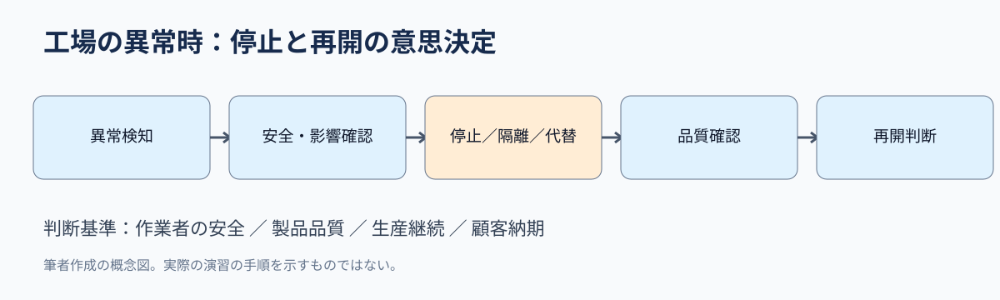
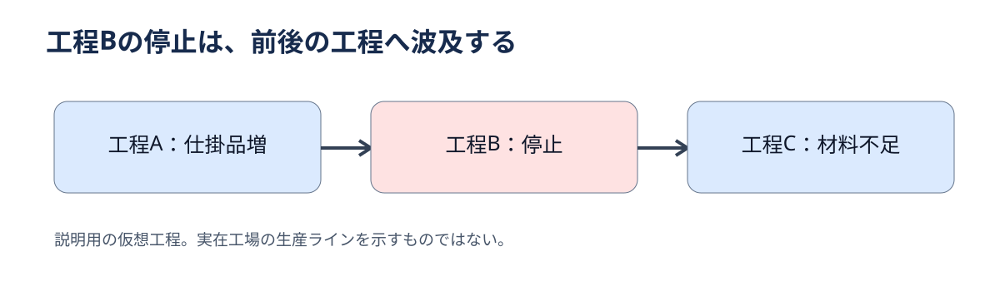

# 工場のサイバー訓練は「止める権限」を問う――運営管理から考える生産継続

2026年10月28日の仙台での机上演習から学ぶ、生産統制・制約工程・事業継続計画

**配信枠：2026年11月3日13:00｜担当科目：運営管理｜ニュース対象日：2026年10月28日**

## 問い

工場でサイバー事故を想定した訓練をする理由は、情報漏えい対策だけでは説明できない。設備を止める判断、代替生産、顧客への連絡が絡むからだ。2026年10月28日、仙台市で工場の制御・運用技術（OT）を対象とする事故対応の机上演習が開催された。今回の問いは「工場の異常時に、誰が何を基準に生産停止を決めるか」。

## 30秒で結論

生産現場の事故対応は、設備の復旧手順だけでは完結しない。人命・安全、品質、納期、情報保護を同時に扱うため、判断権限と代替手順を平時に決めておく必要がある。これは実際の事故発生を報じる記事ではなく、演習の開催事実から運営管理の論点を考える教材である。

## ニュースの事実

情報処理推進機構の公開情報によると、10月28日14時から17時まで、仙台市で「工場におけるOTセキュリティ対策のためのインシデント対応机上演習」が開催された。共催には東北経済産業局、東北IT産業推進機構、情報処理推進機構が名を連ねる。公開案内から確認できるのは開催日時・場所・主題であり、参加企業の成果や訓練で判明した弱点までは確認できない。

## なぜ工場の事故対応は情報システム部門だけに任せられないのか

制御・運用技術（OT）は、生産設備や物理的な工程を監視・制御する仕組みを指す。通常の事務系情報システムと異なり、停止や誤作動が設備・品質・作業者の安全に影響し得る。したがって対策の単位は「パソコン1台」ではなく、「生産工程とその依存関係」になる。

## 守：試験で押さえる3概念

第一は生産統制。生産計画に対して進捗・余力・異常を把握し、工程間の調整を行う。第二はボトルネック。ある工程が全体の生産能力を制約する場合、その停止は後工程にも影響する。第三は事業継続計画（BCP）。事故時に優先業務、代替手段、復旧順序を決める考え方だ。三つは別々の暗記事項ではない。停止判断を「どこが止まるか」「何が遅れるか」「何を残すか」に分解する道具になる。

## 図解：異常検知から再開までの判断は直線ではない

以下は公開された演習の実際の進行内容ではなく、経営診断のために作成した概念図である。異常を検知したら、安全確認と影響範囲の把握を先行し、停止・隔離・代替運転を判断する。その後に品質確認と顧客対応を経て再開する。復旧速度だけを追うと、品質確認や再発防止の判断を飛ばす危険がある。

*筆者作成の概念図。情報処理推進機構の公開情報を踏まえた分析であり、演習の実施記録ではない。*

## 図解：工程の依存関係が損失の大きさを変える

仮に工程A→B→Cの順に生産し、工程Bだけが止まる場合、前工程Aで仕掛品が滞留し、後工程Cは材料不足になる可能性がある。これは説明用の仮定であり、今回の演習参加工場の構成ではない。対策は工程Bの復旧だけでなく、在庫、代替設備、外注先、顧客納期を同時に調べることになる。

*筆者作成の概念図。情報処理推進機構の公開情報を踏まえた分析であり、演習の実施記録ではない。*

## 破：停止を避けるほど安全になるとは限らない

「止めなければ納期を守れる」という判断には隠れた前提がある。設備の状態が安全で、製品の品質も保証できるという前提だ。異常の原因が未確定なら、運転継続が不良品や設備損傷を広げる可能性もある。一方、すべての設備を一律停止すれば不要な損失を招く。判断に必要なのは一律の正解ではなく、影響範囲・停止基準・決裁者の事前合意だ。

## 離：診断士なら最初に何を聞くか

相談時には、①停止すると最も損失が大きい工程はどこか、②設備停止と再開を誰が承認するか、③代替生産・納期連絡・品質検査の手順は文書化されているか、を確認する。提案として、まず工程依存図と意思決定表を作り、半日の机上演習で判断の遅れを測る。必要データは工程別停止時間、仕掛品量、受注納期、代替設備の能力、判断記録。成果指標は異常検知から判断までの時間、代替手段の実行可能率、再開前の品質確認完了率とする。

## 確認問題：生産統制と事業継続を区別できるか

【第1次試験風・4択】工場の制御設備に異常が発生したとき、最も適切な対応はどれか。A.復旧速度を優先して品質確認を省く。B.情報システム担当者だけで生産再開を決定する。C.安全・品質・工程への影響を確認し、事前に定めた権限で停止・再開を判断する。D.すべての工程を必ず同じ時間だけ停止する。正解はC。Aは品質リスクを、Bは現場の安全・生産判断を、Dは影響範囲の違いを無視する。

## 事例問題：50字で助言する

【第2次試験風・仮想事例】部品加工会社では主要工程が停止すると後工程も止まるが、停止・再開の承認者が不明確である。最初に整えるべき管理策を述べよ。【模範解答】工程ごとの影響と代替手段を整理し、安全・品質基準に基づく停止・再開条件と決裁権限を明文化して演習で検証する。【採点観点】工程影響、判断基準、権限、演習による検証。

## 英語で覚える3語

生産統制（production control）：Production control connects the plan with actual progress.／制約工程（bottleneck）：A bottleneck limits the whole line.／事業継続計画（business continuity plan）：A business continuity plan sets recovery priorities. いずれも、設備の問題を経営判断へ接続する言葉である。

## 調査前後で何が変わるか

「工場でサイバー訓練」と聞くと、攻撃を防ぐ技術の話に見える。しかし運営管理の視点から見ると、問われるのは止める判断と、止まった後に残す仕事の設計である。情報処理推進機構の中小企業向け指針も、経営者が実施すべき事項と現場の実践手順を分けている。事故対応力は機器の性能だけでなく、組織が意思決定できるかで左右される。

## 出典と確認範囲

一次資料：情報処理推進機構「中小企業支援セミナー」（2026年10月30日更新、10月28日の机上演習を掲載）https://www.ipa.go.jp/security/seminar/sme/supportseminar.html。補助資料：情報処理推進機構「中小企業の情報セキュリティ対策ガイドライン第4.0版」（2026年9月30日更新）https://www.ipa.go.jp/security/guide/sme/about.html。関連情報：不正アクセス対策特設サイト https://www.ipa.go.jp/security/support/incident-support.html。確認日：2026年11月3日。演習の成果、参加企業の実態、実被害の発生については確認していない。

