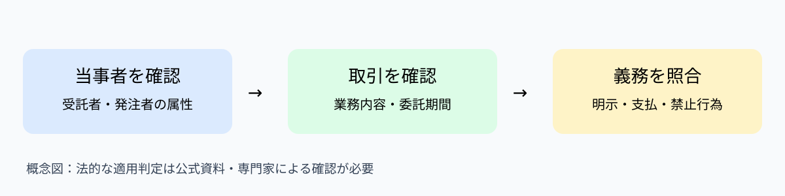

# フリーランス法の広報強化が問うのは、発注の瞬間を誰が管理するか

## 問い

2026年11月3日15:00｜経営法務｜ニュース発表：2026年10月8日。発注者が「仕事は頼んだが条件は後で決める」と言うとき、何が問題なのか。

## 30秒で結論

外注管理は、仕事の品質だけでなく取引条件を発注時に明確にする仕組みが必要である。フリーランス法は対象取引について取引条件の明示などを求める。経営者は契約書の有無だけで安心せず、発注時点で相手に必要事項が伝わったかを点検したい。

## ニュースの事実：広報強化期間は11月30日まで続く

公正取引委員会は2026年10月8日、同日から11月30日までをフリーランス法の広報強化期間とすると発表した。アニメ作品「秘密結社 鷹の爪」と連携した啓発も行う。これは新法の施行発表ではない。法律は2024年11月1日に施行済みである。発表日は10月8日、制度の施行日は2024年11月1日、この記事の確認日は11月3日と区別する。

## 守：取引条件の明示は、口約束を禁止するだけの話ではない

フリーランス法の正式名称は「特定受託事業者に係る取引の適正化等に関する法律」。対象となる発注者・受託者と取引の条件に応じて義務が定まる。第一の概念は**取引条件の明示**。業務内容や報酬額、支払期日などの必要事項を発注時に明らかにする考え方だ。第二は**支払期日の管理**。一定の取引では給付受領日から起算した支払期日の規律がある。第三は**禁止行為と就業環境整備**。発注者の属性や委託期間などによって適用される規律が異なる。試験では「すべての外注に同じ義務」と覚えず、主体・取引・期間を分ける。

## 図解：まず対象取引か、その次に義務を確認する

以下は法令の完全な適用判定ではなく、相談時の確認順序を示す筆者作成の概念図。まず受託者が従業員を使用しない個人等に当たるか、発注者の事業形態と従業員使用の有無、業務委託の内容・期間を確認し、該当する義務を条文・公取委資料で照合する。**読み取り：契約の名称より当事者と取引の実態が先。**

*筆者作成の確認フロー。出典：公正取引委員会の制度解説。法的な適用可否を確定する図ではない。*

## 経営問題：発注の速さと証跡は対立しない

仮説として、制作会社が繁忙期に個人のデザイナーへ口頭で依頼し、後から作業範囲が増える場面を考える。発注時の条件が曖昧なら、双方が異なる完成像を想定し、修正費用や納期をめぐる争いが生じやすい。代替策は①毎回長文契約を作る、②標準発注票に必須項目を埋める、③発注後にまとめて精算する、の三つ。②は迅速さと証跡の両立を狙えるが、法令上必要な明示事項の充足を別途確認する必要がある。

## 図解：発注前の確認項目を一枚にする

次の表は**実在企業の調査結果ではなく、発注管理のための提案**。誰が何をいつ確認するかを整理した。

| 段階 | 主担当（提案） | 確認する証跡 |
| --- | --- | --- |
| 発注前 | 現場担当 | 業務範囲・納期・報酬条件 |
| 発注時 | 発注管理担当 | 必要事項の明示記録 |
| 変更時 | 現場と受託者 | 変更内容・追加報酬の合意記録 |
| 支払時 | 経理担当 | 受領日・支払期日・支払実績 |

**読み取り：契約書を保管するだけでなく、変更と支払まで追跡する。** 出典：公正取引委員会の制度説明を踏まえた筆者提案。

## 破：発注票を作れば法令遵守が完成するわけではない

発注票があっても、記載内容が不十分なら問題は残る。反対に電子メールなど適切な方法で必要事項を明示できる場合、紙の契約書がないことだけで違法とは言えない。さらに発注者が従業員を使用するか、委託期間がどの程度かで適用される義務は異なる。したがって「全外注先に一律の契約書」という運用より、対象判定と記録の質を確認する方が実務的だ。

## 離：診断士なら3つ聞き、最初の2週間で検証する

確認質問は①個人への発注が月何件あり、誰が承認するか、②発注時に報酬・業務範囲・支払条件を何で伝えるか、③変更と支払遅延を誰が検知するか。**提案**として最初の2週間で直近20件を抽出し、適用判定、明示記録、変更履歴、支払記録を点検する。20件は監査の仮置き件数で、法定のサンプル数ではない。必要データは発注台帳、明示文面、検収・受領日、支払実績。成果指標は対象取引の明示事項充足率、変更記録率、期日内支払率とする。法的評価は必要に応じて弁護士等に確認する。

## 試験の確認問題：義務の適用条件を問う

【第1次試験風・4択】フリーランス法の理解として最も適切なのはどれか。A.すべての企業間取引に同じ義務が生じる。B.発注者・受託者の属性や委託期間などで適用される義務が異なる。C.契約書に署名がなければ、すべての発注が直ちに違法となる。D.法律は2026年10月8日に施行された。**正解B**。Aは対象を広げすぎ、Cは明示方法と契約書を混同し、Dは広報発表日と施行日を混同する。

## 第2次試験風：発注管理を助言する

【仮想事例】従業員のいる広告会社が個人クリエイターへ継続的に発注している。発注条件はチャットで断片的に伝え、変更履歴を残していない。初動の改善策を80字以内で述べよ。**模範解答**：対象取引と適用義務を確認し、業務内容・報酬・支払期日等の明示項目を標準化する。変更履歴と支払実績を台帳で管理し、担当者の確認手順を定める。**採点観点**：対象判定、明示事項、変更記録、責任者と運用。

## 英語で覚える3語

取引条件（contract terms）：Clear contract terms reduce disputes.／発注者（client）：The client should clarify the scope.／支払期日（payment due date）：Check the payment due date before work begins. 英文は学習用であり、法律の条文を翻訳したものではない。

## 結論：法務は契約締結の瞬間ではなく発注の流れにある

広報強化のニュースが教えるのは、法律の存在を知ることと、現場で守れることの距離である。現場担当の発注、変更、経理の支払を一本の記録としてつなげれば、遵守状況を確認できる。経営法務は最後に契約書をチェックする仕事だけではなく、日々の業務設計の一部になる。

## 出典と確認範囲

一次資料：公正取引委員会「令和8年度におけるフリーランス法の広報強化期間」（2026年10月8日）https://cms03.jftc.go.jp/houdou/pressrelease/2026/oct/261008_flkouhou.html。補助資料：公正取引委員会「フリーランスの取引適正化に向けた取組」https://www.jftc.go.jp/fllaw_limited.html。確認日：2026年11月3日。具体的な企業の違反件数・効果測定は本稿で主張しない。制度の適用は最新の法令・公式解説を確認する。
