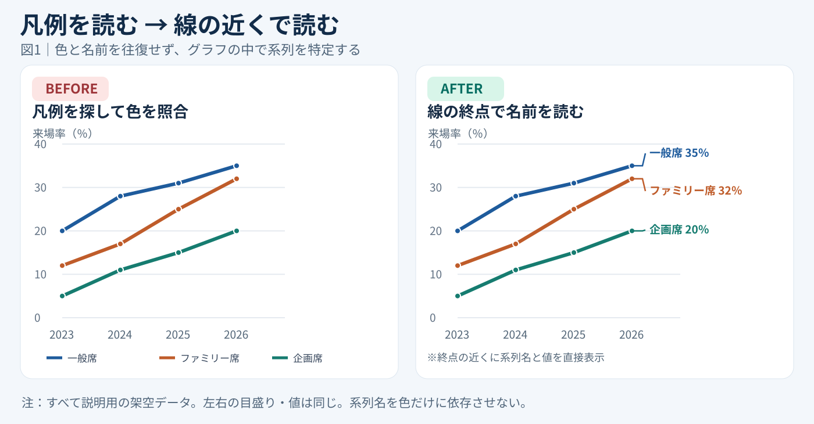
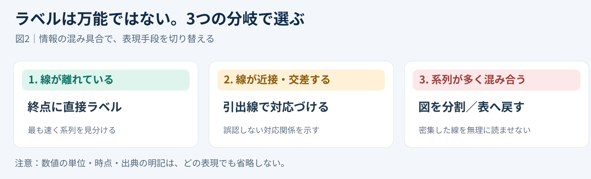

# 凡例を消して線の終点に名前を置く｜直接ラベルの60秒改善

**2026-11-03 06:00 JST｜学習ID 2026-11-03/0600｜基礎技・今日の小さな改善｜3〜5分**

## 今日の結論

**今日の技：凡例を線の終点の近くに移す「直接ラベル」。** 折れ線グラフの色を確認するために視線を往復させず、どの線が何を表すかをその場で読めるようにする。朝の1分で直せる、小さいが再利用しやすい改善だ。

## 守｜凡例は情報だが、視線の移動も生む

**凡例**とは、グラフの色や線と、項目名の対応を示す説明欄のこと。凡例がグラフの下にあると、読み手は「線を見る→下の色を探す→線に戻る」を繰り返す。**直接ラベル**は線の近くに「一般席35％」などと書き、対応づけの作業を減らす手法だ。

米ハーバード大学のアクセシビリティ解説も、可能ならデータの近くに項目名を置く直接ラベルを紹介している。色だけで区別させないため、色の見え方が異なる人にも役立つ。グラフの値や傾向を変える技術ではなく、**読み解く手間を減らす**技術である。

## Before→After｜3本の線を読む

例は「一般席・ファミリー席・企画席の来場率」。2023〜2026年の数値は**すべて説明用の架空データ**で、実際のチケット販売や来場実績を示さない。左右のグラフは同じデータと同じ目盛りを使う。

**Before：**下の凡例で色を覚えてから線を探す。**After：**終点の横に「一般席35％」「ファミリー席32％」「企画席20％」を置く。読者が最後の値と系列名を同時に把握できる。図の目的は「どの系列か」を迷わせないことだ。

## 破｜PowerPointで4手順

1. **対象を選ぶ。**2〜4本程度の折れ線で、右端に文字を置ける余白があるグラフから試す。比較したい時点が終点でない場合は、その時点の点に付ける。
2. **終点にラベルを付ける。**Windows版PowerPointでグラフを選択し、［グラフのデザイン］→［グラフ要素を追加］→［データラベル］を使う。対象の点だけを選んでラベルを付けることもできる。
3. **名前と数値を表示する。**［データラベルの書式設定］で系列名・値などを選び、必要なら位置をドラッグして調整。名前を含むセルをラベルに使う方法もある。
4. **凡例を外して確認する。**対応が一意に分かることを確認してから凡例を削除。スライドを縮小表示し、ラベルが重ならず読めるか確認する。

**例外：**線が近い場合は引出線、系列が多い場合は小さなグラフに分割するか表に戻す。数値が頻繁に変わるなら、手入力のテキストボックスよりデータに連動するラベルを優先する。

## 離｜図を直すとは、読む動作を設計すること

スライド制作の時短は作る人だけの話ではない。読む人が一度に理解できれば、会議中の「青い線は何でしたっけ？」という確認も減らせる。これはスポーツの来場率だけでなく、部門別売上やサービス別契約数にも転用できる。ただし、比較対象が多いときに直接ラベルを増やすほど、かえって読みにくくなる。**目的は凡例を消すことではなく、誤読を減らすこと**だ。

## 失敗例｜ラベルが重なって逆効果

**失敗：**線の終点が近いのに、ラベルを無理に横並びにしてどの線か分からなくなる。**回避：**引出線を付けて対応を示すか、グラフを分ける。線色だけに頼らず、ラベルと単位も残す。

## 60秒課題｜既存の1枚を改善

**課題：**手元の折れ線グラフを1枚選び、凡例を見なくても各線を識別できる位置に系列名を仮置きする。**合格基準：**縮小表示でも、線と名前を1回で対応づけられる。重なるなら「今回は表の方がよい」と判断できても合格だ。

## 参考資料・Simple English

出典：[SlideLand｜折れ線グラフの公開作例](https://www.slideland.tech/en/graph/line-graph/2)／[ハーバード大学｜図表のアクセシビリティ](https://accessibility.huit.harvard.edu/data-viz-charts-graphs)／[Microsoft公式｜グラフのデータラベル](https://support.microsoft.com/en-us/office/add-or-remove-data-labels-in-a-chart)。SlideLandは構成の比較例、ハーバード大学は直接ラベルの原則、MicrosoftはWindows版を含む操作の確認に使用した。

**Simple English：Label the line where people look.** ／ **日本語：線を見る場所に、その線の名前を書こう。**
