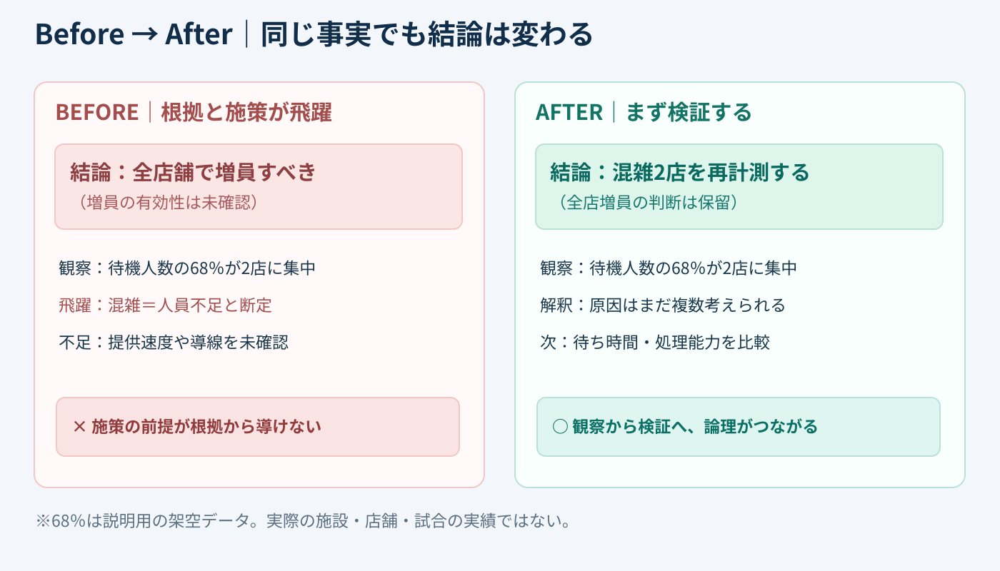
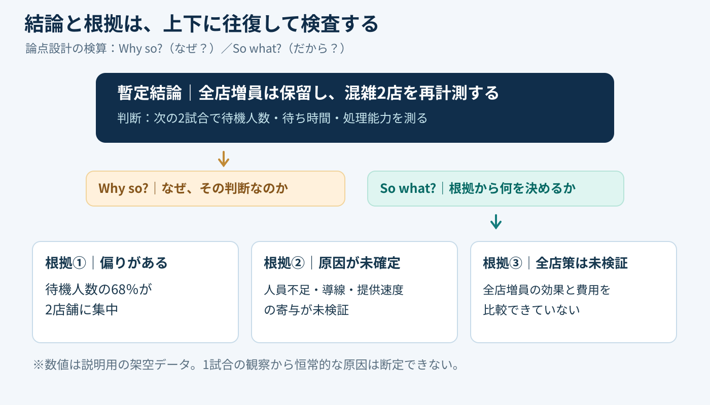

# 結論を「なぜ？」「だから？」で往復検査する｜論理の接続チェック

**2026-11-03 09:00 JST｜学習ID 2026-11-03/0900｜構想・論理｜3〜5分**

## 今日の結論

**今日の技：結論から「なぜそう言える？」、根拠から「だから何を決める？」を往復する。** これを図の制作前に行うと、見た目を整えた後で「そのデータから、その施策は言えない」と作り直す手戻りを減らせる。

## 守｜主張と根拠は、上下に論理でつなぐ

バーバラ・ミントの**ピラミッド原則**は、伝えたい一つの主張を頂点に置き、その下に支える考えを整理する方法。ここでは、その接続を検算するために二つの問いを使う。**Why so?（なぜ？）**は結論から根拠へ下り、**So what?（だから？）**は根拠から判断へ上がる問いだ。

たとえば「売店の行列が長い」という観察だけでは「全店のスタッフを増やす」とは決められない。行列の原因は注文導線、提供速度、時間帯の偏りかもしれない。**観察と対策の間に、説明されていない推論がないか**を見る。

## Before→After｜スタジアム売店の提案を直す

以下は**すべて説明用の架空データ**。ある1試合のピーク時に観察した待機人数の68％が2店舗に集中していた、と仮定する。この観察から「全店増員すべき」と結論づけるのは飛躍だ。

**Before：**「行列が長い→全店で増員」。**After：**「混雑が一部店舗に偏っている→全店増員は保留し、次の2試合で混雑2店の待機人数・待ち時間・処理能力を追加計測する」。同じ観察でも、**判断の強さを根拠の強さに合わせる**と、実行可能な次の一歩が見える。

## 破｜4ステップで論理を検算する

1. **暫定結論を書く。**「全店増員は保留し、混雑2店の追加計測を優先」と、判断が分かる一文にする。
2. **Why so?で下りる。**理由を挙げる。「混雑は2店に集中」「原因は未確定」「全店増員の費用対効果は未検証」。同じ内容の言い換えを根拠として数えない。
3. **So what?で上がる。**各理由から本当に「追加計測を優先」が導けるか確認する。導けない場合は結論を弱めるか、必要なデータを特定する。
4. **見出しだけを通読する。**見出しを上から読んで、問い→暫定結論→根拠→次の判断がつながるか確認する。PowerPointの［表示］→［アウトライン］はタイトルと本文の見直しに使える。

**別解：**判断材料がそろっていないときは、断定型のアクションタイトルにせず「混雑原因の特定が先決（暫定）」と明示する。ピラミッド型の図を描く必要はなく、文章の階層だけでも検算できる。

## 離｜資料の速さは、図を描く前に決まる

この検算は市場規模（TAM）、スポーツ映像サービスの導入判断、スポンサー施策の効果説明にも転用できる。たとえば「市場が大きい」から「自社が勝てる」へ飛ぶなら、顧客獲得・価格・競争・実行能力の論拠が抜けている。**大きな図を作る前に、小さな論理の穴を見つける**ことが時短につながる。

SlideLandのピラミッド図解集は、階層関係の見せ方を探す参考になる。ただし、**図形がピラミッドでも、論理がピラミッドとは限らない**。先に主張と根拠を文章でつなぎ、その後でレイアウトを選ぶ。

## 失敗例｜相関や一度の観察を原因と決めつける

**失敗：**「待機人数の68％が2店に集中→2店のスタッフが不足」と断定する。これは原因の推定を事実にすり替えている。**回避：**「集中」は観察、「人員不足」は仮説と分け、時間帯別の処理能力、注文導線、他試合での再現性を確かめる。

## 60秒課題｜結論の飛躍を1つ見つける

**課題：**「動画の再生数が落ちた。だから投稿本数を増やすべき」を、Why so?とSo what?で検算しよう。**解答例：**「再生数低下の原因が不明なので、投稿本数を増やす前に表示回数・クリック率・視聴維持率を比較する」。**合格基準：**観察、未確認の原因、次の判断を区別できること。

## 参考資料・Simple English

出典：[バーバラ・ミント公式｜ピラミッド原則](https://www.barbaraminto.com/)／[SlideLand｜ピラミッド図解の実在作例](https://www.slideland.tech/docs/schematic/pyramid)／[Microsoft公式｜PowerPointのアウトライン表示](https://support.microsoft.com/ja-jp/powerpoint/create-and-print-a-presentation-in-outline-view)。ミント公式は単一主張と根拠の階層、SlideLandは図解分類、MicrosoftはWindows版を含むアウトライン操作の確認に使用した。

**Simple English：Ask why, then ask what follows.** ／ **日本語：なぜそう言えるかを問い、その根拠から何が言えるかを確かめよう。**
