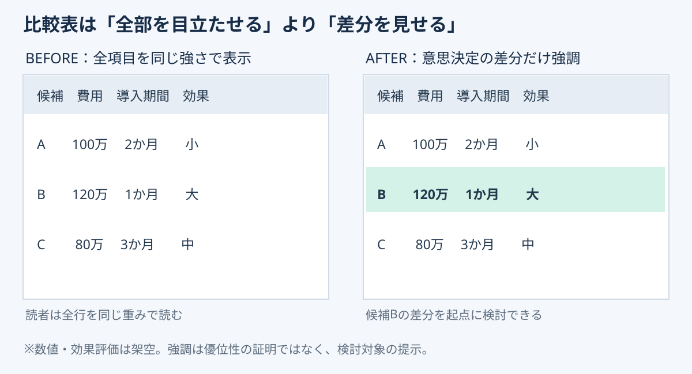

# 比較表は「差分だけ」を強調する｜判断を速くする表の設計

**2026-11-03 12:00 JST｜学習ID 2026-11-03/1200｜レイアウト・図解｜3〜5分**

## 今日の結論

**表はすべての情報を同じ強さで見せる必要はない。** 判断に影響する差分を1か所だけ強調すると、読み手は「どこを比較するか」を探す時間を減らせる。

## 守｜比較表の目的は一覧ではなく差分の発見

3候補の費用・導入期間・期待効果を比較する場合、すべてのセルを濃く塗ると強弱が消える。強調は**見せたい結論の代わり**ではなく、比較の入口を作るために使う。見出しは「候補Bは費用が高いが、短期導入と高い期待効果が特徴（仮説）」のように、比較から分かることを書く。

## Before→After｜強調するのは一つの差分

以下は説明用の架空データ。Aは100万円・2か月・効果小、Bは120万円・1か月・効果大、Cは80万円・3か月・効果中。Bの行だけを淡い色で強調する。**高い費用を隠さず、導入期間と期待効果の違いを同時に見せる**のが重要だ。

*図：全行が同じ重みの表と、検討対象Bだけを淡色で示す表。色は優劣の確定を意味しない。*

## 破｜4ステップで作る

1. **問いを決める。** 「どの候補を実証するか」など、表の利用目的を一文にする。
2. **比較条件をそろえる。** 費用の範囲、期間の起点、効果の評価基準を明記する。
3. **差分を選ぶ。** 結論に関係する1行または1列だけ淡い色で強調する。
4. **PowerPointで実装する。** Windows版では表のセルを選択し、［テーブルデザイン］の［網かけ］で背景色を設定する。最終的にモノクロでも識別できるよう、太字やラベルも併用する。

## 離｜表より適切な図もある

評価基準が多く、数値を正確に見比べたいなら表が向く。費用と効果の関係を俯瞰するなら散布図、時間に沿う変化なら折れ線、導入手順ならフローが向く。**表を作り始める前に、読み手が比較するのは数値・関係・順序のどれか**を決めよう。

## 失敗例と60秒課題

失敗は「推奨候補」を強調してから、都合のよい項目だけを並べること。候補の除外条件や評価基準を先に固定し、未検証の期待効果には「仮説」と書く。

**60秒課題：** 既存の比較表で最も重要な1行を選び、残りの色を薄くする。表題を「比較表」から判断を示す一文に直す。**合格基準：** 強調の理由を一文で説明でき、他候補の不利・有利な情報を隠していないこと。

## 参考資料とSimple English

- [Microsoft公式｜表の外観を変更する](https://support.microsoft.com/ja-jp/powerpoint/change-the-look-of-a-table)
- [Microsoft公式｜表の網かけ](https://support.microsoft.com/en-au/office/add-or-remove-shading-in-a-table)
- [SlideLand｜公開スライドの図解研究](https://www.slideland.tech/)

**Simple English:** Highlight the difference, not everything. **日本語：** 全部ではなく、判断に必要な違いを強調しよう。
